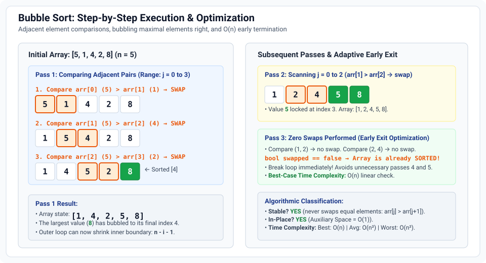
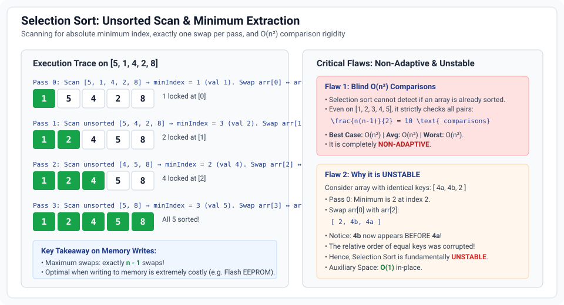
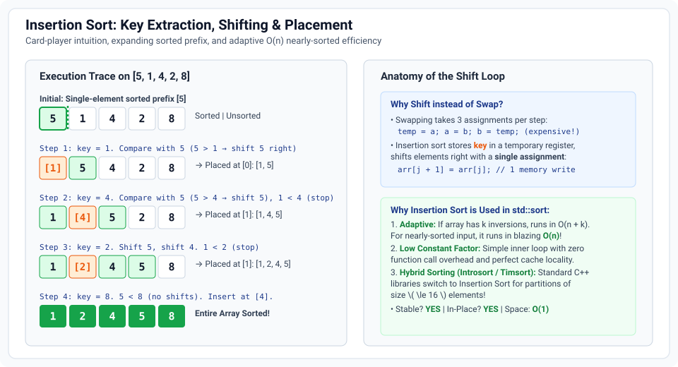

# Elementary Sorting Algorithms: Bubble Sort, Selection Sort & Insertion Sort

## Related Implementation

- `../Elementary_Sorting.cpp` *(Supplementary implementation created for this folder)*

---

## 1. Concept Introduction

### What is the Concept?
**Sorting** is the process of rearranging a sequence of elements into a well-defined order (typically non-decreasing $a_0 \le a_1 \le \dots \le a_{n-1}$).
The three fundamental $O(n^2)$ comparison-based sorting algorithms are:
1. **Bubble Sort**: Repeatedly steps through the list, compares adjacent elements, and swaps them if they are in the wrong order, causing the largest unsorted element to "bubble up" to its final position at the end of each pass.
2. **Selection Sort**: Repeatedly scans the unsorted suffix to find the minimum element and swaps it into the front of the unsorted region.
3. **Insertion Sort**: Builds a sorted prefix one element at a time by taking the next unsorted element (`key`) and shifting larger sorted elements right to insert `key` into its proper place.

### Why is it Required?
Sorted data is a prerequisite for Binary Search ($O(\log n)$), two-pointer algorithms, duplicate removal, and greedy interval scheduling. Furthermore, Insertion Sort is used inside production hybrid sorting algorithms (such as C++ `std::sort`'s IntroSort and TimSort) for small subarrays ($n \le 16$) because of its low constant overhead and adaptive $O(n)$ behavior on nearly sorted data.

---

## 2. Fundamental Theory

### Essential Sorting Terminology
1. **In-Place Sorting**: An algorithm is *in-place* if it uses only $O(1)$ auxiliary memory beyond the input array. Bubble, Selection, and Insertion Sort are all **in-place**.
2. **Stable Sorting**: A sorting algorithm is *stable* if elements with equal keys preserve their original relative order after sorting:
   $$\text{If } A[i] == A[j] \text{ and } i < j \text{ before sorting, then } A[i] \text{ appears before } A[j] \text{ after sorting.}$$
   - **Bubble Sort and Insertion Sort are Stable** (because they only swap/shift when strictly greater: `arr[j] > arr[j + 1]` and `arr[j] > key`).
   - **Selection Sort is Unstable** (because a long-range swap between `arr[i]` and `arr[min_idx]` can jump an equal element over another equal element, e.g., in `[4a, 4b, 2]`, swapping `4a` with `2` yields `[2, 4b, 4a]`).
3. **Adaptive Sorting**: An algorithm is *adaptive* if it runs faster when the input is already sorted or nearly sorted. Optimized Bubble Sort and Insertion Sort run in $O(n)$ time on an already-sorted array, whereas Selection Sort always takes $\Theta(n^2)$ comparisons regardless of input order.

---

## 3. Mathematical Representation

### Loop Invariants and Comparison Counts

#### 1. Bubble Sort
- **Loop Invariant**: After pass $i$ ($0 \le i < n - 1$), the last $i + 1$ elements `arr[n - 1 - i .. n - 1]` contain the $i + 1$ largest elements of the array in sorted order.
- **Worst-Case Comparisons**:
  $$\sum_{i=0}^{n-2} (n - 1 - i) = (n - 1) + (n - 2) + \dots + 1 = \frac{n(n - 1)}{2} = \Theta(n^2)$$

#### 2. Selection Sort
- **Loop Invariant**: At the start of iteration $i$, the prefix `arr[0 .. i - 1]` contains the $i$ smallest elements of the array in sorted order.
- **Exact Comparisons (All Cases)**:
  $$\sum_{i=0}^{n-2} (n - 1 - i) = \frac{n(n - 1)}{2} = \Theta(n^2)$$
- **Maximum Swaps**: At most $n - 1$ swaps ($O(n)$ data writes).

#### 3. Insertion Sort
- **Loop Invariant**: At the start of iteration $i$ ($1 \le i < n$), the subarray `arr[0 .. i - 1]` consists of the original first $i$ elements in sorted order.
- **Relation to Inversions**: An **inversion** is a pair of indices $(p, q)$ such that $p < q$ and $A[p] > A[q]$. Each shift in Insertion Sort removes exactly one inversion, so its running time is:
  $$T(n) = \Theta(n + I)$$
  where $I$ is the number of inversions in the input array ($0 \le I \le \frac{n(n-1)}{2}$).

---

## 4. Working Mechanism

### 1. Bubble Sort (`bubble_sort`)
1. Loop `i` from `0` to `n - 2`:
2. Set `bool swapped = false`.
3. Loop `j` from `0` to `n - i - 2`:
   - If `arr[j] > arr[j + 1]`, swap `arr[j]` and `arr[j + 1]` and set `swapped = true`.
4. If `!swapped`, break early (the array is completely sorted).

### 2. Selection Sort (`selection_sort`)
1. Loop `i` from `0` to `n - 2`:
2. Assume minimum is at `min_idx = i`.
3. Scan unsorted suffix `j` from `i + 1` to `n - 1`:
   - If `arr[j] < arr[min_idx]`, update `min_idx = j`.
4. Swap `arr[i]` with `arr[min_idx]`.

### 3. Insertion Sort (`insertion_sort`)
1. Loop `i` from `1` to `n - 1` (`arr[0]` alone is trivially sorted):
2. Save `int key = arr[i]` and set `j = i - 1`.
3. While `j >= 0 && arr[j] > key`:
   - Shift `arr[j + 1] = arr[j]` and decrement `j--`.
4. Insert `arr[j + 1] = key`.

---

## 5. Visual Representation

The diagrams below show the key operation in each algorithm:







### Partitioning of the Array During Sorting
```
1. Bubble Sort (Sorted Suffix grows from right to left):
+---------------------------------------+-----------------------+
| Unsorted Prefix [0 .. n - i - 1]      | Sorted Largest Suffix |
+---------------------------------------+-----------------------+

2. Selection Sort (Sorted Smallest Prefix grows from left to right):
+-----------------------+---------------------------------------+
| Sorted Smallest [0..i]| Unsorted Suffix (scan for min_idx)    |
+-----------------------+---------------------------------------+

3. Insertion Sort (Sorted Prefix of original elements grows left to right):
+-----------------------+-----+---------------------------------+
| Sorted Prefix [0..i-1]| key | Unseen Elements [i+1 .. n-1]    |
+-----------------------+-----+---------------------------------+
```

---

## 6. C++ Implementation Analysis

### File: `../Elementary_Sorting.cpp`

1. **`bubble_sort(vector<int> &arr)`**:
   - Uses `bool swapped = false;` optimization to achieve $O(n)$ best-case time when the array is already sorted.
   - Inner loop bound `n - i - 1` avoids re-comparing the already-sorted suffix at the end.
2. **`selection_sort(vector<int> &arr)`**:
   - Finds `min_idx` across `[i + 1 .. n - 1]` and performs at most one `swap(arr[i], arr[min_idx])` per pass.
3. **`insertion_sort(vector<int> &arr)`**:
   - Uses right-shifting (`arr[j + 1] = arr[j]`) instead of repeated full swaps, cutting data assignments in half.

---

## 7. Dry Runs

### Dry Run 1: Bubble Sort on `{64, 34, 25, 12}`
| Pass `i` | Inner Comparisons `(j, j+1)` | Swaps Performed | Array After Pass | `swapped` |
| :---: | :--- | :--- | :--- | :---: |
| Initial | — | — | `[64, 34, 25, 12]` | — |
| `i = 0` | `(64,34)->swap`, `(64,25)->swap`, `(64,12)->swap` | 3 swaps | `[34, 25, 12, 64]` | `true` |
| `i = 1` | `(34,25)->swap`, `(34,12)->swap` | 2 swaps | `[25, 12, 34, 64]` | `true` |
| `i = 2` | `(25,12)->swap` | 1 swap | `[12, 25, 34, 64]` | `true` |

### Dry Run 2: Selection Sort on `{64, 25, 12, 22, 11}`
| Pass `i` | Unsorted Range Scanned | `min_idx` Found (`arr[min_idx]`) | Swap `(arr[i], arr[min_idx])` | Array After Pass |
| :---: | :---: | :---: | :---: | :--- |
| `i = 0` | `[0 .. 4]` | `4` (`11`) | `swap(64, 11)` | `[11, 25, 12, 22, 64]` |
| `i = 1` | `[1 .. 4]` | `2` (`12`) | `swap(25, 12)` | `[11, 12, 25, 22, 64]` |
| `i = 2` | `[2 .. 4]` | `3` (`22`) | `swap(25, 22)` | `[11, 12, 22, 25, 64]` |
| `i = 3` | `[3 .. 4]` | `3` (`25`) | No swap (`min_idx == i`) | `[11, 12, 22, 25, 64]` |

### Dry Run 3: Insertion Sort on `{12, 11, 13, 5, 6}`
| Pass `i` | `key = arr[i]` | Elements Shifted Right (`arr[j] > key`) | Inserted Index `j + 1` | Array After Pass |
| :---: | :---: | :--- | :---: | :--- |
| `i = 1` | `11` | `12` shifted to index `1` | `0` | `[11, 12, 13, 5, 6]` |
| `i = 2` | `13` | None (`12 <= 13`) | `2` | `[11, 12, 13, 5, 6]` |
| `i = 3` | `5` | `13, 12, 11` shifted right | `0` | `[5, 11, 12, 13, 6]` |
| `i = 4` | `6` | `13, 12, 11` shifted right (`5 <= 6`) | `1` | `[5, 6, 11, 12, 13]` |

---

## 8. Time Complexity

| Algorithm | Best Case | Average Case | Worst Case | Explanation |
| :--- | :---: | :---: | :---: | :--- |
| **Bubble Sort (with flag)** | $O(n)$ | $O(n^2)$ | $O(n^2)$ | Best: 1 pass with 0 swaps on sorted input; Worst: reversed input ($\frac{n(n-1)}{2}$ swaps) |
| **Selection Sort** | $O(n^2)$ | $O(n^2)$ | $O(n^2)$ | Always scans the remaining $n - 1 - i$ elements to verify the minimum |
| **Insertion Sort** | $O(n)$ | $O(n^2)$ | $O(n^2)$ | Best: `while` condition fails immediately on sorted input; Worst: reversed input |

---

## 9. Space Complexity

- **Auxiliary Space**: $O(1)$ for all three algorithms (`bubble_sort`, `selection_sort`, `insertion_sort`).
- **Input Space**: $O(n)$ for the vector of $n$ elements.

---

## 10. Important Properties and Observations

1. **Minimum Memory Writes**: Selection Sort performs at most $O(n)$ swaps (whereas Bubble and Insertion Sort perform $O(n^2)$ writes in the worst case). When writing to memory is expensive (such as flash/EEPROM memory), Selection Sort minimizes writes among elementary sorts.
2. **Online Sorting Property of Insertion Sort**: Insertion Sort can sort a stream of elements as they arrive one by one because it only needs the current prefix `arr[0 .. i-1]` and does not need to see future elements first (unlike Selection Sort, which must scan the entire array to find the global minimum first).

---

## 11. Advantages and Disadvantages

- **Bubble Sort**: Simple to understand and detects an already-sorted array in $O(n)$, but slowest in practice due to excessive swaps.
- **Selection Sort**: Performs at most $n - 1$ swaps, but is neither stable nor adaptive ($O(n^2)$ even on sorted input).
- **Insertion Sort**: Stable, in-place, online, and adaptive ($O(n + I)$); fastest elementary sort in practice and ideal for small or nearly-sorted arrays, though still $O(n^2)$ on large random/reversed inputs.

---

## 12. Comparison with Related Concepts

| Property | Bubble Sort | Selection Sort | Insertion Sort |
| :--- | :---: | :---: | :---: |
| **Best-Case Time** | $O(n)$ (with `swapped` flag) | $O(n^2)$ | $O(n)$ |
| **Average/Worst Time** | $O(n^2)$ | $O(n^2)$ | $O(n^2)$ |
| **Worst-Case Swaps/Shifts** | $O(n^2)$ | $O(n)$ | $O(n^2)$ |
| **Auxiliary Space** | $O(1)$ | $O(1)$ | $O(1)$ |
| **Stable?** | Yes | **No** | Yes |
| **Adaptive?** | Yes | **No** | Yes |

---

## 13. Common Mistakes

1. **Using `>=` Instead of `>` in Bubble or Insertion Sort**:
   Writing `if (arr[j] >= arr[j + 1])` or `while (j >= 0 && arr[j] >= key)` swaps equal elements unnecessarily and **destroys stability**.
2. **Omitting the `swapped` Flag in Bubble Sort**:
   Without `bool swapped`, Bubble Sort degrades from $O(n)$ to $O(n^2)$ in the best case.

---

## 14. Applications

- **Insertion Sort**: Sorting small subarrays inside hybrid `std::sort` (IntroSort), maintaining a small sorted hand of cards, or sorting nearly-sorted event streams where each element is at most $k$ positions away from its sorted index (runs in $O(n \cdot k)$ time).
- **Selection Sort**: Environments where memory writes are significantly costlier than memory reads.

---

## 15. Practice Questions

1. **Basic Understanding**: Give a concrete 3-element example with duplicate values showing why standard Selection Sort is **not stable**.
2. **Implementation**: How would you sort a Singly Linked List (`04-Linked-Lists/linked_list-01.cpp`) using Insertion Sort without allocating any new nodes?
3. **Dry-Run Problem**: Trace Insertion Sort on `[8, 4, 2, 1]`. Count the exact number of comparisons and element shifts, and verify that the number of shifts equals the number of inversions in `[8, 4, 2, 1]`.
4. **Complexity Analysis**: An array of size $n$ is **$k$-sorted** (every element is at most $k$ positions away from its target sorted position). Prove that Insertion Sort sorts this array in $O(n \cdot k)$ time.
5. **Interview Question**: Can we use Binary Search inside Insertion Sort to find the insertion position of `key` in $O(\log i)$ comparisons? Does this reduce the overall worst-case time complexity of Insertion Sort below $O(n^2)$? Why or why not?

---

## 16. Quick Revision

- **Bubble Sort**: Compares adjacent pairs; largest element bubbles to the end; Stable, In-Place, Adaptive ($O(n)$ best, $O(n^2)$ worst).
- **Selection Sort**: Selects minimum from unsorted suffix and swaps to front; Unstable, In-Place, Not Adaptive ($O(n^2)$ always, max $n-1$ swaps).
- **Insertion Sort**: Shifts larger elements in sorted prefix right to insert `key`; Stable, In-Place, Adaptive ($O(n + I)$ time).
