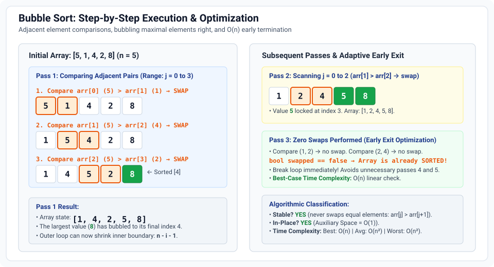
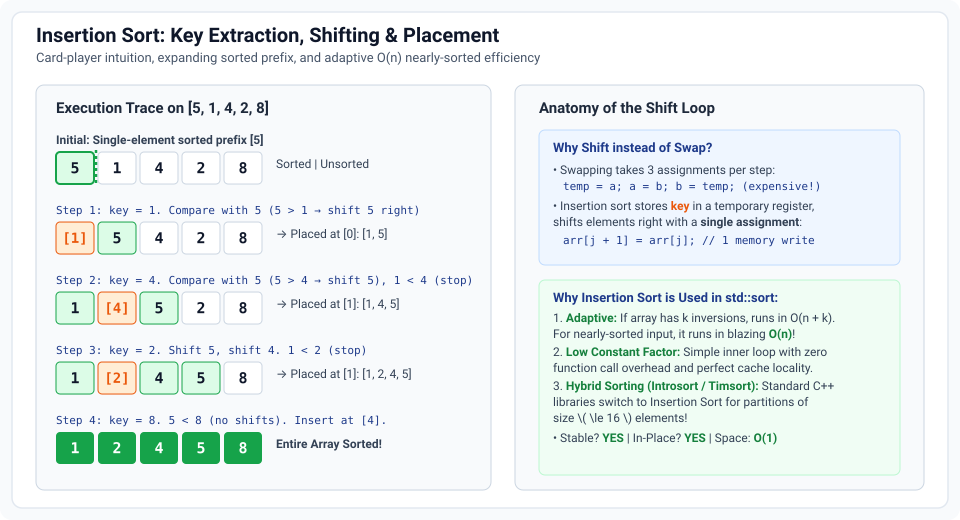
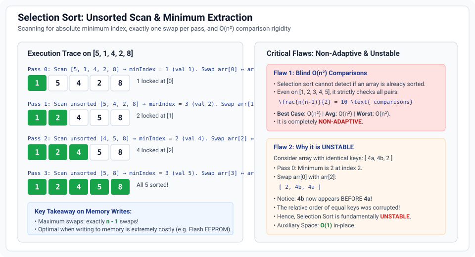
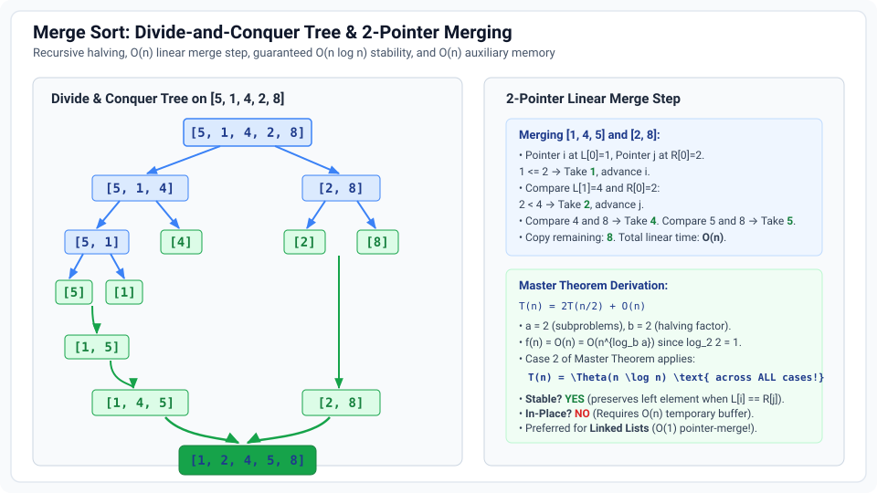
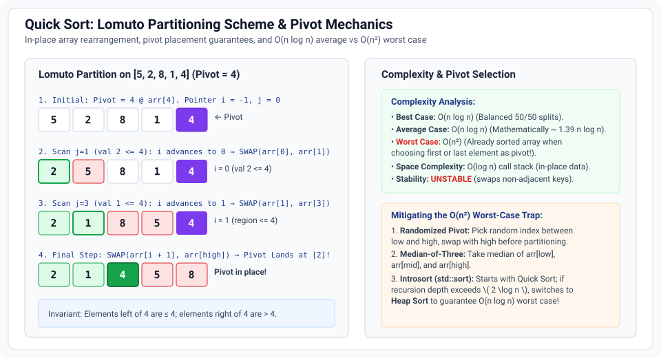
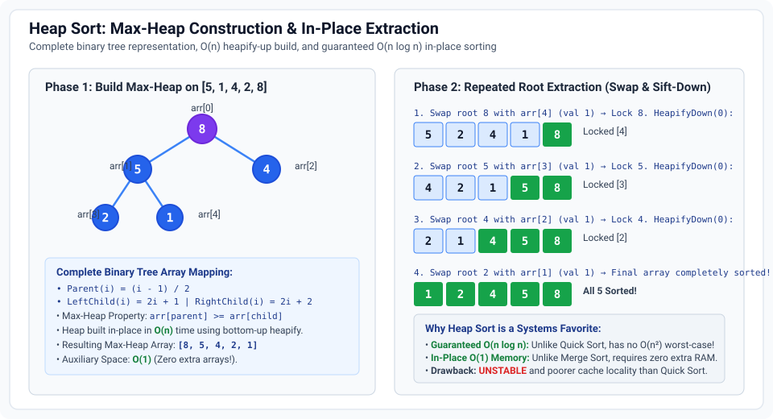

# Sorting Algorithms in Modern C++17

A comprehensive, mathematically rigorous, and visual textbook-style guide to elementary, divide-and-conquer, heap-based, and non-comparison sorting algorithms.

---

## Master Comparison Matrix

| Algorithm | Best Case | Average Case | Worst Case | Auxiliary Space | Stable? | In-Place? | Adaptive? | Primary Advantage |
|---|---|---|---|---|---|---|---|---|
| **Bubble Sort** | \( O(n) \) | \( O(n^2) \) | \( O(n^2) \) | \( O(1) \) | **Yes** | **Yes** | **Yes** (with swap flag) | Conceptually simplest; early exit on sorted data |
| **Insertion Sort** | \( O(n) \) | \( O(n^2) \) | \( O(n^2) \) | \( O(1) \) | **Yes** | **Yes** | **Yes** | Fastest for small or nearly-sorted arrays (\( n \le 16 \)) |
| **Selection Sort** | \( O(n^2) \) | \( O(n^2) \) | \( O(n^2) \) | \( O(1) \) | **No** | **Yes** | **No** | Minimal memory writes (at most \( n - 1 \) swaps) |
| **Merge Sort** | \( O(n \log n) \) | \( O(n \log n) \) | \( O(n \log n) \) | \( O(n) \) | **Yes** | **No** | **No** | Guaranteed \( O(n \log n) \); optimal for Linked Lists |
| **Quick Sort** | \( O(n \log n) \) | \( O(n \log n) \) | \( O(n^2) \) | \( O(\log n) \) | **No** | **Yes** | **No** | Fastest general-purpose cache-friendly in-memory sort |
| **Heap Sort** | \( O(n \log n) \) | \( O(n \log n) \) | \( O(n \log n) \) | \( O(1) \) | **No** | **Yes** | **No** | Guaranteed \( O(n \log n) \) with strictly \( O(1) \) auxiliary RAM |
| **Counting Sort** | \( O(n + k) \) | \( O(n + k) \) | \( O(n + k) \) | \( O(k) \) | **Yes** | **No** | **No** | Linear time for small integer ranges (\( k \le n \)) |
| **Radix Sort** | \( O(d(n + b)) \) | \( O(d(n + b)) \) | \( O(d(n + b)) \) | \( O(n + b) \) | **Yes** | **No** | **No** | Linear time for fixed-digit keys |

---

# 1. Bubble Sort

### 1. Introduction
Bubble Sort is a simple comparison-based sorting algorithm that repeatedly steps through the list, compares adjacent elements, and swaps them if they are in the wrong order.

### 2. Why the Algorithm Exists
Bubble Sort serves as the classical foundational pedagogical model in Computer Science to introduce the concepts of pairwise comparisons, in-place swapping, invariant accumulation, and loop-termination flags.

### 3. Core Intuition
Larger elements "bubble up" to the higher indices of the array like air bubbles rising in water. After pass \( i \), the \( i \)-th largest element is guaranteed to reside in its permanent sorted location at index \( n - i - 1 \).

### 4. Real-Life Analogy
Arranging people in a queue by height by asking pairs of neighbors to swap if the person behind is shorter than the person in front.

### 5. Step-by-Step Example
Given array: `[5, 1, 4, 2, 8]`
- **Pass 1:**
  - Compare (5, 1) → Swap: `[1, 5, 4, 2, 8]`
  - Compare (5, 4) → Swap: `[1, 4, 5, 2, 8]`
  - Compare (5, 2) → Swap: `[1, 4, 2, 5, 8]`
  - Compare (5, 8) → No swap: `[1, 4, 2, 5, 8]`
  - *Result:* 8 is locked at index 4.
- **Pass 2:**
  - Compare (1, 4) → No swap.
  - Compare (4, 2) → Swap: `[1, 2, 4, 5, 8]`
  - Compare (4, 5) → No swap.
  - *Result:* 5 is locked at index 3.
- **Pass 3:**
  - Compare (1, 2) → No swap. Compare (2, 4) → No swap.
  - No swaps occurred! Terminate early!

### 6. Visual Explanation


### 7. Algorithm / Pseudocode
```text
for i = 0 to n - 2:
    swapped = false
    for j = 0 to n - i - 2:
        if arr[j] > arr[j + 1]:
            swap(arr[j], arr[j + 1])
            swapped = true
    if not swapped:
        break
```

### 8. C++17 Implementation
```cpp
void bubbleSort(std::vector<int>& arr) {
    int n = static_cast<int>(arr.size());
    for (int i = 0; i < n - 1; ++i) {
        bool swapped = false;
        for (int j = 0; j < n - i - 1; ++j) {
            if (arr[j] > arr[j + 1]) {
                std::swap(arr[j], arr[j + 1]);
                swapped = true;
            }
        }
        if (!swapped) break;
    }
}
```

### 9. Dry Run
Input: `[5, 1, 4, 2, 8]`  
Outer \( i = 0 \): inner loops 4 times, 3 swaps, array becomes `[1, 4, 2, 5, 8]`.  
Outer \( i = 1 \): inner loops 3 times, 1 swap, array becomes `[1, 2, 4, 5, 8]`.  
Outer \( i = 2 \): inner loops 2 times, 0 swaps. `swapped == false` triggers early break.  
Output: `[1, 2, 4, 5, 8]`.

### 10. Time Complexity Derivation
- Inner loop runs \( (n - 1) + (n - 2) + \dots + 1 = \frac{n(n - 1)}{2} \) times in the unoptimized or worst case.
- Asymptotic time: \( \Theta(n^2) \).

### 11. Space Complexity Derivation
Only requires a single boolean variable `swapped` and an integer counter: \( O(1) \) auxiliary space.

### 12–17. Classification
- **Best Case:** \( O(n) \) (When array is already sorted and swap flag is used).
- **Average Case:** \( O(n^2) \).
- **Worst Case:** \( O(n^2) \) (Reverse sorted array).
- **Stable:** **Yes** (Strict inequality `arr[j] > arr[j+1]` ensures equal elements never swap).
- **In-Place:** **Yes** (\( O(1) \) extra memory).
- **Adaptive:** **Yes** (With early exit flag).

### 18–21. Applications & Pitfalls
- **Advantages:** Simple, detects already-sorted data in \( O(n) \).
- **Disadvantages:** Terribly slow on large inputs; excessive writes.
- **When to Use:** Teaching; checking if an array is sorted.
- **Common Mistake:** Forgetting the `- i` in `j < n - i - 1`, unnecessarily re-checking already sorted elements.

---

# 2. Insertion Sort

### 1. Introduction
Insertion Sort builds the final sorted array one item at a time by repeatedly taking the next unsorted element and inserting it into its correct position within the already sorted prefix.

### 2. Why the Algorithm Exists
It is the most efficient comparison sort for small collections (\( n \le 16 \)) and nearly sorted data due to zero function call overhead and minimal instructions per comparison.

### 3. Core Intuition
Maintain a sorted left partition and an unsorted right partition. Pick the first element of the unsorted partition (`key`), shift all elements in the sorted partition that are greater than `key` one position to the right, and drop `key` into the resulting vacancy.

### 4. Real-Life Analogy
A card player sorting playing cards in hand: holding sorted cards in the left hand, picking a card from the table, shifting larger cards right, and sliding the card into place.

### 5. Step-by-Step Example
Array: `[5, 1, 4, 2, 8]`
- Initial: `[5 | 1, 4, 2, 8]`
- **i = 1 (key = 1):** 5 > 1 → shift 5 right → place 1: `[1, 5 | 4, 2, 8]`
- **i = 2 (key = 4):** 5 > 4 → shift 5 right → 1 < 4 (stop) → place 4: `[1, 4, 5 | 2, 8]`
- **i = 3 (key = 2):** shift 5, shift 4 → 1 < 2 (stop) → place 2: `[1, 2, 4, 5 | 8]`
- **i = 4 (key = 8):** 5 < 8 → no shifts → place 8: `[1, 2, 4, 5, 8]`

### 6. Visual Explanation


### 7. Algorithm / Pseudocode
```text
for i = 1 to n - 1:
    key = arr[i]
    j = i - 1
    while j >= 0 and arr[j] > key:
        arr[j + 1] = arr[j]
        j = j - 1
    arr[j + 1] = key
```

### 8. C++17 Implementation
```cpp
void insertionSort(std::vector<int>& arr) {
    int n = static_cast<int>(arr.size());
    for (int i = 1; i < n; ++i) {
        int key = arr[i];
        int j = i - 1;
        while (j >= 0 && arr[j] > key) {
            arr[j + 1] = arr[j];
            --j;
        }
        arr[j + 1] = key;
    }
}
```

### 9. Dry Run
For `[5, 1, 4, 2, 8]`:  
Key 1 shifts 5 (1 shift) → `[1, 5, 4, 2, 8]`  
Key 4 shifts 5 (1 shift) → `[1, 4, 5, 2, 8]`  
Key 2 shifts 5, 4 (2 shifts) → `[1, 2, 4, 5, 8]`  
Key 8 shifts 0 → `[1, 2, 4, 5, 8]`  
Total memory writes are dramatically fewer than swap-based sorts.

### 10. Time Complexity Derivation
If an array has \( k \) inversions, the inner loop executes exactly \( k \) times. Total time: \( O(n + k) \). In the worst case (reverse sorted), \( k = \frac{n(n-1)}{2} = O(n^2) \).

### 11. Space Complexity Derivation
Auxiliary space is \( O(1) \) since it only stores `key` and loop counters.

### 12–17. Classification
- **Best Case:** \( O(n) \) (Already sorted, while-loop terminates on first comparison).
- **Average Case:** \( O(n^2) \).
- **Worst Case:** \( O(n^2) \).
- **Stable:** **Yes**.
- **In-Place:** **Yes**.
- **Adaptive:** **Yes** (Directly proportional to number of inversions).

### 18–21. Applications & Pitfalls
- **Advantages:** Online (can sort a stream of numbers as they arrive); blazing fast on nearly sorted data; chosen as base-case in `std::sort` (Introsort) and `Timsort`.
- **Common Mistake:** Using multiple swaps inside the inner loop instead of shifting (`arr[j+1] = arr[j]`), which triples the number of memory writes.

---

# 3. Selection Sort

### 1. Introduction
Selection Sort divides the input list into a sorted prefix and an unsorted suffix. In each pass, it finds the smallest element from the unsorted suffix and swaps it with the first unsorted element.

### 2. Why the Algorithm Exists
It minimizes the total number of write operations. While other \( O(n^2) \) algorithms perform \( O(n^2) \) swaps, Selection Sort executes **at most \( n - 1 \) swaps**.

### 3. Core Intuition
Scan the unsorted portion, find the global minimum, and swap it into the boundary. Repeat until sorted.

### 4. Real-Life Analogy
Selecting the shortest person from a crowd to stand first in line, then selecting the next shortest person to stand second, and so on.

### 5. Step-by-Step Example
Array: `[5, 1, 4, 2, 8]`
- **Pass 0:** Min in `[5, 1, 4, 2, 8]` is 1 @ index 1. Swap with arr[0]: `[1 | 5, 4, 2, 8]`
- **Pass 1:** Min in `[5, 4, 2, 8]` is 2 @ index 3. Swap with arr[1]: `[1, 2 | 4, 5, 8]`
- **Pass 2:** Min in `[4, 5, 8]` is 4 @ index 2. Swap with arr[2]: `[1, 2, 4 | 5, 8]`
- **Pass 3:** Min in `[5, 8]` is 5 @ index 3. Swap with arr[3]: `[1, 2, 4, 5 | 8]`

### 6. Visual Explanation


### 7. Algorithm / Pseudocode
```text
for i = 0 to n - 2:
    minIndex = i
    for j = i + 1 to n - 1:
        if arr[j] < arr[minIndex]:
            minIndex = j
    if minIndex != i:
        swap(arr[i], arr[minIndex])
```

### 8. C++17 Implementation
```cpp
void selectionSort(std::vector<int>& arr) {
    int n = static_cast<int>(arr.size());
    for (int i = 0; i < n - 1; ++i) {
        int minIndex = i;
        for (int j = i + 1; j < n; ++j) {
            if (arr[j] < arr[minIndex]) {
                minIndex = j;
            }
        }
        if (minIndex != i) {
            std::swap(arr[i], arr[minIndex]);
        }
    }
}
```

### 9–17. Complexity & Classification
- **Time Complexity:** Strictly \( \Theta(n^2) \) across best, average, and worst cases (\( \frac{n(n-1)}{2} \) comparisons always).
- **Auxiliary Space:** \( O(1) \).
- **Stable:** **No** (Long-distance swaps bypass equal elements, e.g. `[4a, 4b, 2]` becomes `[2, 4b, 4a]`).
- **In-Place:** **Yes**.
- **Adaptive:** **No**.

### 18–21. Applications & Pitfalls
- **Advantages:** Minimizes flash memory / EEPROM wear where writes are orders-of-magnitude more costly than reads.
- **Disadvantages:** Blindly performs quadratic comparisons even on sorted arrays.

---

# 4. Merge Sort

### 1. Introduction
Merge Sort is an efficient, general-purpose, comparison-based, divide-and-conquer sorting algorithm.

### 2. Why the Algorithm Exists
It provides a guaranteed \( O(n \log n) \) time complexity in all cases while maintaining absolute **stability**.

### 3. Core Intuition
Divide the array into two halves, recursively sort both halves, and then combine the two sorted halves using a linear two-pointer merge subroutine.

### 4. Real-Life Analogy
Sorting two separate decks of cards independently, then combining them into one sorted deck by repeatedly comparing the top cards of each deck and taking the smaller one.

### 5. Step-by-Step Example
Array: `[5, 1, 4, 2, 8]`
- Divide: `[5, 1, 4]` and `[2, 8]`
- Left divides to `[5, 1]` and `[4]`; `[5, 1]` divides to `[5]` and `[1]`.
- Merge `[5]` and `[1]` → `[1, 5]`.
- Merge `[1, 5]` and `[4]` → `[1, 4, 5]`.
- Merge `[2]` and `[8]` → `[2, 8]`.
- Final Merge `[1, 4, 5]` and `[2, 8]` → `[1, 2, 4, 5, 8]`.

### 6. Visual Explanation


### 7. Algorithm / Pseudocode
```text
mergeSort(arr, left, right):
    if left < right:
        mid = left + (right - left) / 2
        mergeSort(arr, left, mid)
        mergeSort(arr, mid + 1, right)
        merge(arr, left, mid, right)
```

### 8. C++17 Implementation
```cpp
void merge(std::vector<int>& arr, int left, int mid, int right) {
    int n1 = mid - left + 1;
    int n2 = right - mid;

    std::vector<int> L(n1), R(n2);
    for (int i = 0; i < n1; ++i) L[i] = arr[left + i];
    for (int j = 0; j < n2; ++j) R[j] = arr[mid + 1 + j];

    int i = 0, j = 0, k = left;
    while (i < n1 && j < n2) {
        if (L[i] <= R[j]) { // '<=' ensures STABILITY
            arr[k++] = L[i++];
        } else {
            arr[k++] = R[j++];
        }
    }
    while (i < n1) arr[k++] = L[i++];
    while (j < n2) arr[k++] = R[j++];
}

void mergeSort(std::vector<int>& arr, int left, int right) {
    if (left < right) {
        int mid = left + (right - left) / 2;
        mergeSort(arr, left, mid);
        mergeSort(arr, mid + 1, right);
        merge(arr, left, mid, right);
    }
}
```

### 9–17. Complexity & Classification
- **Recurrence:** \( T(n) = 2T(n/2) + O(n) \).
- **Time Complexity:** \( \Theta(n \log n) \) in Best, Average, and Worst cases (by Master Theorem).
- **Auxiliary Space:** \( O(n) \) for temporary merge arrays + \( O(\log n) \) recursion stack.
- **Stable:** **Yes**.
- **In-Place:** **No** (Standard array implementation).
- **Adaptive:** **No** (Standard implementation).

### 18–21. Applications & Pitfalls
- **Advantages:** Guaranteed \( O(n \log n) \); ideal for **Linked Lists** where merging requires \( O(1) \) pointer re-linking without extra array allocations; external sorting (sorting petabytes on disk).
- **Common Mistake:** Writing `mid = (left + right) / 2`, which can overflow 32-bit signed integers when `left + right > 2^31 - 1`. Always write `left + (right - left) / 2`!

---

# 5. Quick Sort

### 1. Introduction
Quick Sort is a highly efficient, cache-friendly divide-and-conquer algorithm developed by Tony Hoare.

### 2. Why the Algorithm Exists
It is generally the fastest in-memory comparison sort because its inner loop can be heavily optimized on modern processor architectures with cache prefetching.

### 3. Core Intuition
Select a `pivot` element. Rearrange the array in-place such that all elements smaller than the pivot precede it, and all elements larger follow it. Then recursively sort the left and right subarrays.

### 4. Real-Life Analogy
Organizing a library shelf by picking a book starting with letter 'M'. Put all books A–L to the left, and N–Z to the right. Repeat on both sides.

### 5. Step-by-Step Example (Lomuto Scheme)
Array: `[5, 2, 8, 1, 4]`, Pivot = 4 @ arr[4].
- Pointers: \( i = -1 \).
- \( j = 0 \) (5 > 4): do nothing.
- \( j = 1 \) (2 <= 4): \( i = 0 \), swap arr[0], arr[1] → `[2, 5, 8, 1, 4]`
- \( j = 2 \) (8 > 4): do nothing.
- \( j = 3 \) (1 <= 4): \( i = 1 \), swap arr[1], arr[3] → `[2, 1, 8, 5, 4]`
- Final: swap arr[i+1], arr[4] → `[2, 1, 4, 5, 8]`. Pivot 4 is in its exact sorted place!

### 6. Visual Explanation


### 7. Algorithm / Pseudocode
```text
partition(arr, low, high):
    pivot = arr[high]
    i = low - 1
    for j = low to high - 1:
        if arr[j] <= pivot:
            i = i + 1
            swap(arr[i], arr[j])
    swap(arr[i + 1], arr[high])
    return i + 1
```

### 8. C++17 Implementation
(See full verified code in [05_quick_sort.cpp](file:///c:/Users/LENOVO/Documents/Mukunda/DSA_CPP/03-Sorting/05_quick_sort.cpp)).

### 9–17. Complexity & Classification
- **Best Case:** \( O(n \log n) \) (Balanced 50/50 splits).
- **Average Case:** \( O(n \log n) \) (\( \approx 1.39 n \log n \)).
- **Worst Case:** \( O(n^2) \) (When pivot is always minimum or maximum, e.g. already sorted array with last-element pivot).
- **Auxiliary Space:** \( O(\log n) \) call stack (with tail call elimination).
- **Stable:** **No**.
- **In-Place:** **Yes**.
- **Adaptive:** **No**.

### 18–21. Applications & Pitfalls
- **Mitigating Worst-Case:**
  1. **Randomized Quick Sort:** Choose a random pivot index.
  2. **Median-of-Three:** Pick median of `arr[low]`, `arr[mid]`, `arr[high]`.
  3. **Introsort:** Switch to Heap Sort if recursion exceeds \( 2 \log n \) (used in `std::sort`).

---

# 6. Heap Sort

### 1. Introduction
Heap Sort is a comparison-based sorting technique based on a **Binary Heap** data structure.

### 2. Why the Algorithm Exists
It combines the \( O(n \log n) \) worst-case guarantee of Merge Sort with the \( O(1) \) auxiliary in-place memory efficiency of Quick Sort.

### 3. Core Intuition
Convert the array into a Max-Heap. The root `arr[0]` is guaranteed to be the maximum. Repeatedly swap the root with the last element of the heap, shrink the heap size by 1, and heapify the new root down.

### 4. Step-by-Step Example
Array: `[5, 1, 4, 2, 8]`
1. **Build Max-Heap:** `[8, 5, 4, 2, 1]`.
2. Swap root 8 with arr[4] (val 1) → `[1, 5, 4, 2 | 8]`. HeapifyDown(0) → `[5, 2, 4, 1 | 8]`.
3. Swap root 5 with arr[3] (val 1) → `[1, 2, 4 | 5, 8]`. HeapifyDown(0) → `[4, 2, 1 | 5, 8]`.
4. Swap root 4 with arr[2] (val 1) → `[1, 2 | 4, 5, 8]`. HeapifyDown(0) → `[2, 1 | 4, 5, 8]`.
5. Swap root 2 with arr[1] (val 1) → `[1 | 2, 4, 5, 8]`.
6. Sorted: `[1, 2, 4, 5, 8]`.

### 5. Visual Explanation


### 6. C++17 Implementation
(See full verified code in [06_heap_sort.cpp](file:///c:/Users/LENOVO/Documents/Mukunda/DSA_CPP/03-Sorting/06_heap_sort.cpp)).

### 7–12. Complexity & Classification
- **Time Complexity:** Guaranteed \( \Theta(n \log n) \) in all cases (Build Heap = \( O(n) \), \( n \) extractions \( \times O(\log n) \)).
- **Auxiliary Space:** Strictly \( O(1) \).
- **Stable:** **No**.
- **In-Place:** **Yes**.
- **Adaptive:** **No**.

---

# 7. Non-Comparison Sorts (Counting & Radix Sort)

Comparison-based sorting has a proven mathematical lower bound of \( \Omega(n \log n) \) (derived from decision trees of height \( \log_2(n!) \approx n \log n - n \log e \)). Non-comparison algorithms bypass this lower bound by exploiting numerical key representations!

### Counting Sort
- **Intuition:** Tally frequencies of elements in an auxiliary count array, calculate prefix sums to determine exact output positions, and place elements into an output array from right to left (preserving stability).
- **Complexity:** Time: \( O(n + k) \), Space: \( O(n + k) \) where \( k = \text{max} - \text{min} + 1 \).
- **Ideal For:** Small key ranges (\( k = O(n) \)).

### Radix Sort (LSD)
- **Intuition:** Sort numbers digit by digit from least significant to most significant using stable Counting Sort as a subroutine.
- **Complexity:** Time: \( O(d \cdot (n + b)) \), Space: \( O(n + b) \) where \( d \) is the number of digits and \( b \) is the base (e.g. 10).
- **Ideal For:** Fixed-length keys, phone numbers, 32-bit integers, strings.
