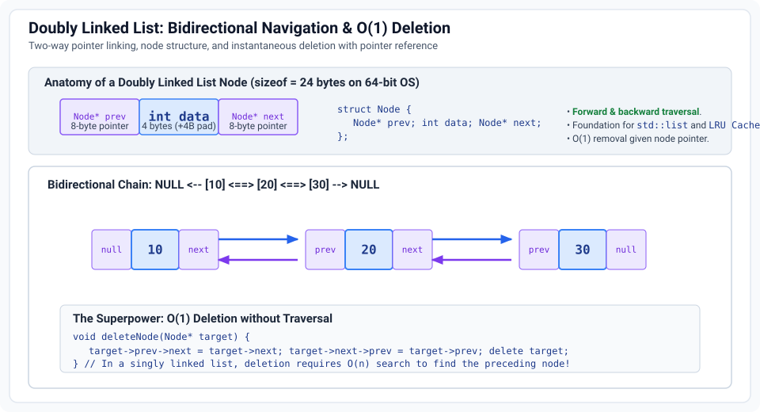
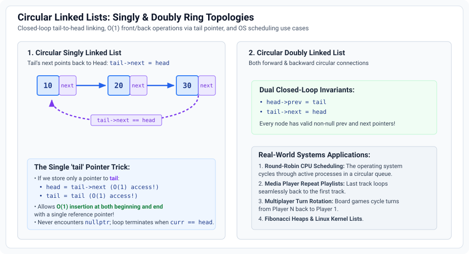

# Doubly Linked Lists and Circular Linked Lists

## Related Implementation

- `../DoubleLinkedList.cpp` *(Original Doubly Linked List implementation)*
- `../clinked.cpp` *(Original Circular Linked List implementation)*
- `../Circular_and_Doubly_Linked_List_Complete.cpp` *(Supplementary complete implementation created for this folder)*

---

## 1. Concept Introduction

### What is the Concept?
1. **Doubly Linked List (`D_List` in `DoubleLinkedList.cpp`)**:
   A linked list in which every `Node` contains **two pointers**:
   - `Node* next` — points to the next node in the sequence.
   - `Node* prev` — points to the previous node in the sequence.
2. **Circular Linked List (`list` in `clinked.cpp`)**:
   A linked list in which the last node (`tail`) does **not** point to `NULL`; instead, `tail->next` points back to `head`, forming a continuous ring.

### Why are They Required?
- In a **Singly Linked List**, you can only traverse forward, and deleting the `tail` node or deleting a node given only its pointer requires an $O(n)$ traversal from `head` to find its predecessor. A **Doubly Linked List** allows bidirectional traversal and **$O(1)$ deletion of the tail (`pop_back`) or any known node** because every node directly knows its predecessor via `node->prev`.
- A **Circular Linked List** allows starting at any node and cycling through the entire list repeatedly without ever hitting `NULL`, which is ideal for round-robin CPU task scheduling and multiplayer turn rotation.

---

## 2. Fundamental Theory

### 1. Doubly Linked List Invariants
For any non-empty Doubly Linked List with `head` and `tail`:
- `head->prev == NULL`
- `tail->next == NULL`
- For every node `x` with `x->next != NULL`:
  $$\text{(x->next)->prev} == \text{x}$$
- For every node `x` with `x->prev != NULL`:
  $$\text{(x->prev)->next} == \text{x}$$

### 2. Circular Linked List Invariants
For any non-empty Circular Singly Linked List (`clinked.cpp`):
- No node has `next == nullptr`.
- The tail node always satisfies:
  $$\text{tail->next} == \text{head}$$
- Traversal cannot use `while (temp != nullptr)` (which would loop infinitely!). Instead, traversal starts at `temp = head` and uses a `do { ... } while (temp != head);` loop so `head` is visited first and the loop stops when `temp` wraps back around to `head`.

---

## 3. Mathematical Representation

### Pointer Updates Required per Operation
Let $U$ be the number of pointer assignments required in the general middle-of-list case:
- **Singly Linked List Insertion**: $U = 2$ (`n1->next = temp->next; temp->next = n1;`).
- **Doubly Linked List Insertion (`DoubleLinkedList.cpp` lines 103–108)**: $U = 4$:
  1. `n1->next = temp->next;`
  2. `n1->prev = temp;`
  3. `(temp->next)->prev = n1;`
  4. `temp->next = n1;`

---

## 4. Working Mechanism

### 1. Doubly Linked List Operations (`DoubleLinkedList.cpp`)
- **`push_front(int val)`**:
  - Creates `Node *n1 = new Node(val)`.
  - If `head == NULL`, sets `head = tail = n1`.
  - Else, links `n1->next = head; head->prev = n1; head = n1;`.
- **`push_back(int val)`**:
  - Creates `Node *n1 = new Node(val)`.
  - If `head == NULL`, sets `head = tail = n1`.
  - Else, links `tail->next = n1; n1->prev = tail; tail = n1;`.
- **`insert(int val, int pos)`**:
  - If `pos == 0`, calls `push_front(val)`.
  - Walks `temp` to index `pos - 1`, then updates the 4 pointers to splice `n1` between `temp` and `temp->next`.

### 2. Circular Linked List Operations (`clinked.cpp`)
- **`push_front(int val)`**:
  - Creates `Node *n1 = new Node(val)`.
  - If `head == nullptr`: sets `head = n1; tail = n1; tail->next = head;`.
  - Else: sets `n1->next = head; head = n1; tail->next = head;` (updating `tail->next` so the circle closes at the new `head`!).
- **`print()`**:
  - Uses `do { cout << temp->data << " --> "; temp = temp->next; } while (temp != head);`.

---

## 5. Visual Representation

### 1. Doubly Linked List Node Structure & 4-Pointer Insertion



```
       head                                              tail
        |                                                 |
        v                                                 v
NULL <--[prev| 10 |next]<===>[prev| 20 |next]<===>[prev| 40 |next]--> NULL
                                ^                 ^
                                |                 |
                            (2) |  [prev|30|next] | (1)
                                +--|---- n1 ----|--+
                                   (4)          (3)
Order of pointer assignments when inserting n1 (30) after temp (20):
  (1) n1->next = temp->next;      // 30->next points to 40
  (2) n1->prev = temp;            // 30->prev points to 20
  (3) (temp->next)->prev = n1;    // 40->prev points to 30
  (4) temp->next = n1;            // 20->next points to 30
```

### 2. Circular Linked List (`clinked.cpp`)



```
        head                                      tail
         |                                         |
         v                                         v
       +-----+     +-----+     +-----+           +-----+
   +-->| 100 |---->|  90 |---->|  80 |--->...--->|  10 |---+
   |   +-----+     +-----+     +-----+           +-----+   |
   |                                                       |
   +-------------------------------------------------------+
                     tail->next == head
```

---

## 6. C++ Implementation & Code Review (`DoubleLinkedList.cpp` & `clinked.cpp`)

### Important Code Review Observations in Original Files
*(Documented here without modifying your original source files; see `../Circular_and_Doubly_Linked_List_Complete.cpp` for the complete supplementary implementations)*

#### A. In `../DoubleLinkedList.cpp`:
1. **Unused Allocation When `pos == 0` in `insert(int val, int pos)` (Lines 89–96)**:
   - Line 89 allocates `Node *n1 = new Node(val);` *before* checking `if (pos == 0) { push_front(val); return; }`. Since `push_front(val)` allocates its own node, `n1` is leaked when `pos == 0`. Moving `if (pos == 0)` above `Node *n1 = new Node(val);` avoids this.
2. **Inserting at the End (`temp->next == NULL`) in `insert` (Line 107)**:
   - Line 107 executes `(temp->next)->prev = n1;`. If `pos` equals the current length of the list (inserting at the end after `tail`), `temp->next` is `NULL`, so `(temp->next)->prev` dereferences `NULL`. Checking `if (temp->next == NULL) { push_back(val); return; }` handles tail insertion safely.
3. **Incomplete Stub `delete_last(int n)` (Lines 111–114) and Pointer Update in `del_last(int pos)` (Lines 116–143)**:
   - `delete_last(int n)` (lines 111–114) is an unfinished stub.
   - `del_last(int pos)` (lines 116–143) updates `prev->next = prev->next->next;` like a singly linked list, without updating the backward `prev` pointer of `curr->next` (`if (curr->next != NULL) curr->next->prev = prev;`).

#### B. In `../clinked.cpp`:
1. **Line 64 in `print()` (`cout << temp->next << " --> " << temp->data << endl;`)**:
   - After the `do-while (temp != head)` loop terminates, `temp` is back at `head`.
   - Line 64 prints `temp->next` (which is a `Node*` pointer, so `cout` prints a hexadecimal memory address like `0x55a8...`) followed by `temp->data` (`100`). To print the wrap-around value instead of the address, use `temp->data` (since `temp == head`).
2. **Empty List Guard in `print()`**:
   - Because `do-while` executes its body before checking the condition, calling `print()` on an empty circular list (`head == nullptr`) dereferences `temp->data` when `temp` is `nullptr`. Adding `if (head == nullptr) return;` at the start of `print()` makes it safe.

---

## 7. Dry Runs

### Dry Run 1: Doubly Linked List `push_front`, `push_back`, and `insert(30, 2)`
| Step | Operation | `head` | `tail` | List State (`<->` means both `next` and `prev` linked) |
| :---: | :--- | :---: | :---: | :--- |
| 1 | `push_back(10)` | `10` | `10` | `NULL <- 10 -> NULL` |
| 2 | `push_back(20)` | `10` | `20` | `NULL <- 10 <-> 20 -> NULL` |
| 3 | `push_back(40)` | `10` | `40` | `NULL <- 10 <-> 20 <-> 40 -> NULL` |
| 4 | `insert(30, 2)` | `10` | `40` | `NULL <- 10 <-> 20 <-> 30 <-> 40 -> NULL` |

### Dry Run 2: Circular Linked List `clinked.cpp` Loop (`i = 1` to `3`, `push_front(i * 10)`)
| Step | Operation | `head` | `tail` | `tail->next` | Circular Chain |
| :---: | :--- | :---: | :---: | :---: | :--- |
| 1 | `push_front(10)` | `10` | `10` | `10` | `10 --> (back to 10)` |
| 2 | `push_front(20)` | `20` | `10` | `20` | `20 --> 10 --> (back to 20)` |
| 3 | `push_front(30)` | `30` | `10` | `30` | `30 --> 20 --> 10 --> (back to 30)` |

---

## 8. Time Complexity

| Operation | Singly Linked List (`list`) | Doubly Linked List (`D_List`) | Circular Linked List (`cll`) |
| :--- | :---: | :---: | :---: |
| **`push_front(val)`** | $O(1)$ | $O(1)$ | $O(1)$ (with `tail` pointer) |
| **`push_back(val)`** | $O(1)$ (with `tail`) | $O(1)$ | $O(1)$ (with `tail` pointer) |
| **`pop_front()`** | $O(1)$ | $O(1)$ | $O(1)$ (with `tail` pointer) |
| **`pop_back()` (Delete Tail)** | $O(n)$ | **$O(1)$** (via `tail->prev`) | $O(n)$ (singly circular) |
| **`insert(val, pos)`** | $O(n)$ | $O(n)$ | $O(n)$ |

---

## 9. Space Complexity

- **Doubly Linked List**: $O(n)$ total space ($2$ pointers per node: `next` and `prev`). All operations use $O(1)$ auxiliary space.
- **Circular Singly Linked List**: $O(n)$ total space ($1$ pointer per node: `next`). All operations use $O(1)$ auxiliary space.

---

## 10. Important Properties and Observations

1. **Order of Pointer Assignment in Doubly Linked List `insert`**:
   In `DoubleLinkedList.cpp` (lines 103–108), notice why you commented out `// temp = temp->next; // temp->prev = n1;` and instead wrote `(temp->next)->prev = n1; temp->next = n1;`. As long as `(temp->next)->prev = n1;` is executed **before** `temp->next = n1;`, `temp->next` still points to the original successor node!
2. **Why `clinked.cpp` Uses a `tail` Pointer in `push_front`**:
   In a Circular Linked List without a `tail` pointer, inserting at `head` requires traversing the entire circle in $O(n)$ time just to find the last node and update its `next` pointer to the new `head`. Because you included `Node *tail` in `clinked.cpp`, updating `tail->next = head;` takes **$O(1)$ time**!

---

## 11. Advantages and Disadvantages

### Doubly Linked List
- **Advantages**: Bidirectional traversal; $O(1)$ `pop_back()` and $O(1)$ deletion when given a `Node*` pointer directly.
- **Disadvantages**: Extra memory for `prev` pointer; 4 pointer updates on middle insertion instead of 2.

### Circular Linked List
- **Advantages**: Can reach all nodes starting from any node; ideal for cyclic buffers and round-robin queues.
- **Disadvantages**: Risk of infinite loops if termination condition `temp != head` is mishandled.

---

## 12. Comparison with Related Concepts

| Feature | Singly Linked List | Doubly Linked List | Circular Singly Linked List |
| :--- | :--- | :--- | :--- |
| **Pointers per Node** | 1 (`next`) | 2 (`next`, `prev`) | 1 (`next`) |
| **Last Node's `next`** | `NULL` | `NULL` | Points to `head` |
| **Backward Traversal?** | No | **Yes** | No (must go full circle) |
| **Delete `tail` in $O(1)$?** | No ($O(n)$) | **Yes** ($O(1)$) | No ($O(n)$) |

---

## 13. Common Mistakes

1. **Overwriting `temp->next` Before Updating `(temp->next)->prev` in Doubly Linked List**:
   Always link the new node `n1` first (`n1->next = temp->next; n1->prev = temp;`), then update `(temp->next)->prev = n1;`, and update `temp->next = n1;` **last**.
2. **Using `while (temp != head)` Instead of `do { ... } while (temp != head)` in Circular List**:
   Since `temp` starts at `head`, `while (temp != head)` is immediately false on the very first check and prints nothing! Using `do-while` (as you did in `clinked.cpp` line 59) is the exact right pattern.

---

## 14. Applications

- **Doubly Linked List**: Browser back/forward history, Undo/Redo stacks in text editors, Music playlist (Next/Previous track), and **LRU Cache** (moving recently accessed nodes to `head` in $O(1)$).
- **Circular Linked List**: Operating system Round-Robin CPU scheduling, multiplayer game turn management, and circular buffers.

---

## 15. Practice Questions

1. **Basic Understanding**: Why does a Circular Singly Linked List (`clinked.cpp`) need `tail->next = head` inside `push_front(int val)` even though `push_front` only inserts at the front?
2. **Implementation**: Write a function `void reverse_dll()` for `D_List` in `DoubleLinkedList.cpp` that reverses a Doubly Linked List in-place in $O(n)$ time and $O(1)$ space by swapping `next` and `prev` pointers for every node.
3. **Dry-Run Problem**: Trace all pointer changes when deleting the middle node `20` from the Doubly Linked List `10 <-> 20 <-> 30`. Which pointers on `10` and `30` change?
4. **Complexity Analysis**: Suppose you only store a single pointer `Node* tail` (and **no** `head` pointer) in a Circular Singly Linked List. Show that you can still access `head`, `push_front`, `push_back`, and `pop_front` all in **$O(1)$ time**!
5. **Interview Question**: Given a Circular Singly Linked List of $n$ nodes, how do you split it into **two equal circular halves** in $O(n)$ time using slow and fast pointers?

---

## 16. Quick Revision

- **Doubly Linked List Insert (`n1` after `temp`)**:
  `n1->next = temp->next; n1->prev = temp; temp->next->prev = n1; temp->next = n1;`
- **Doubly Linked List Delete Node `curr`**:
  `curr->prev->next = curr->next; curr->next->prev = curr->prev; delete curr;`
- **Circular List Invariant**: `tail->next == head`. Traverse using `do { ... } while (temp != head);`.
