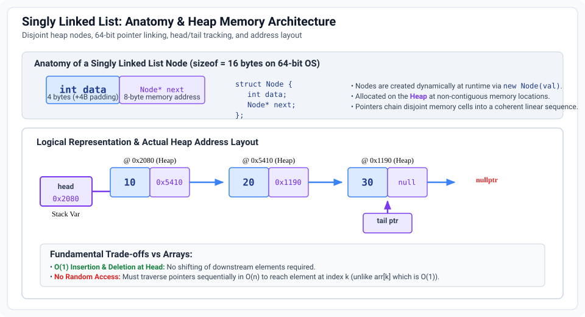
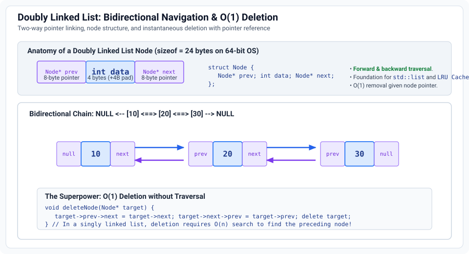
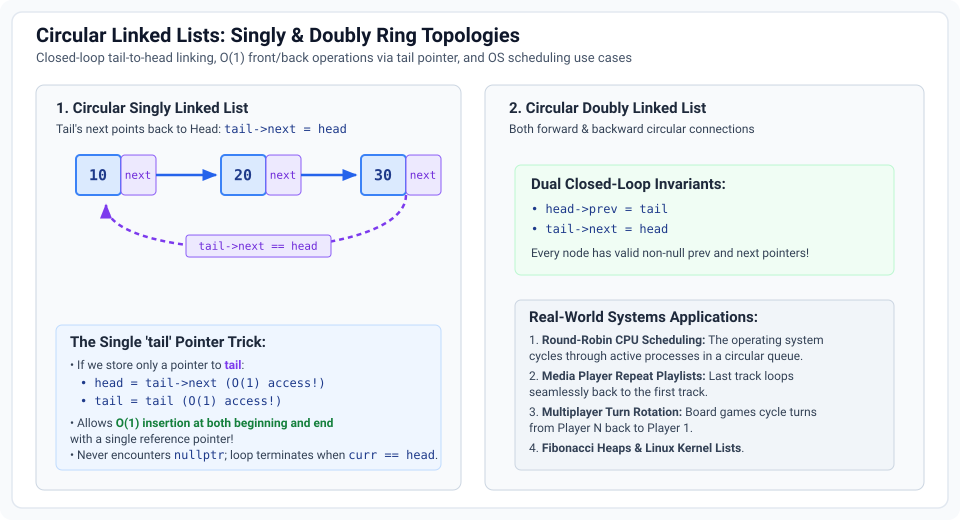
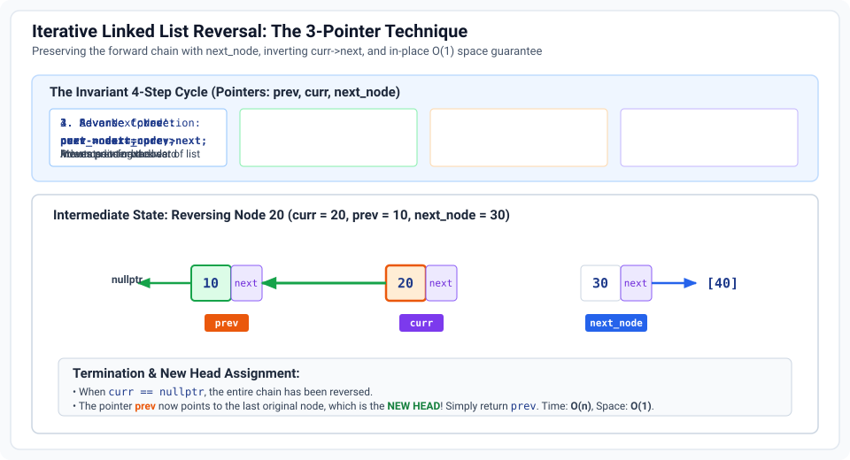
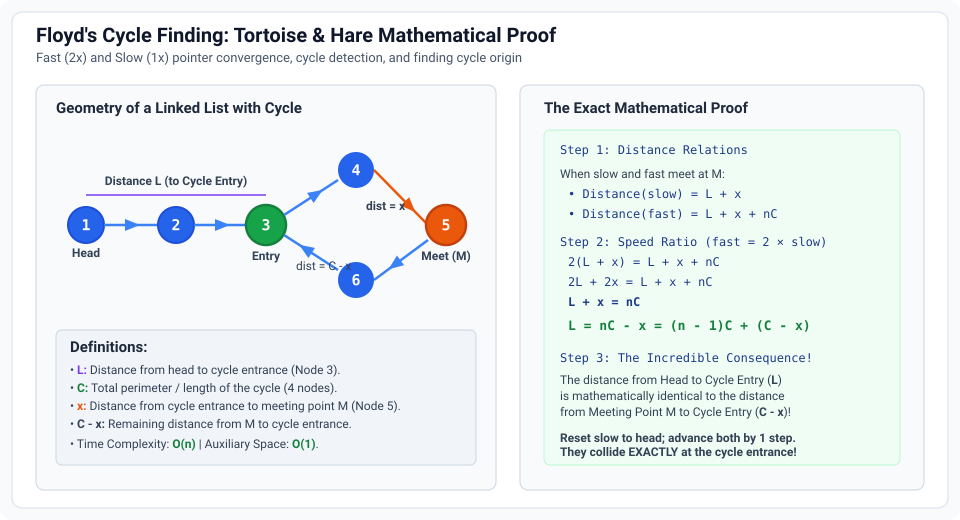

# Linked List Data Structures & Algorithms in Modern C++17

A comprehensive, mathematically rigorous, and visual textbook-style guide to linear linked node structures, dynamic heap memory, pointer mechanics, bidirectional chaining, circular rings, and cycle detection.

---

## Master Comparison Matrix: Arrays vs Linked Lists

| Dimension | Dynamic Array (`std::vector`) | Singly Linked List | Doubly Linked List |
|---|---|---|---|
| **Memory Allocation** | Single contiguous buffer on heap | Disjoint nodes scattered across heap | Disjoint nodes scattered across heap |
| **Access by Index `arr[k]`** | $ O(1) $ direct pointer arithmetic | $ O(k) $ sequential traversal | $ O(\min(k, n-k)) $ sequential traversal |
| **Insert / Delete at Front** | $ O(n) $ (Requires shifting all elements) | $ O(1) $ (Single pointer re-link) | $ O(1) $ (Two pointer re-links) |
| **Insert / Delete at End** | $ O(1) $ amortized | $ O(1) $ (with tail ptr) / $ O(n) $ | $ O(1) $ (with tail ptr) |
| **Insert / Delete at Position $ k $** | $ O(n) $ (Shifting elements) | $ O(k) $ traversal + $ O(1) $ pointer rewire | $ O(k) $ traversal + $ O(1) $ pointer rewire |
| **Delete Node (given pointer to it)** | $ O(n) $ (Must shift elements left) | $ O(n) $ (Must find predecessor) | **$ O(1) $** (Immediate pointer bypass) |
| **Memory Overhead per Element** | 0 bytes extra (pure contiguous data) | 8 bytes per node (`next` pointer) | 16 bytes per node (`prev` + `next` pointers) |
| **CPU Cache Locality** | **Excellent** (Hardware prefetching) | **Poor** (Frequent L1/L2 cache misses) | **Poor** (Frequent L1/L2 cache misses) |

---

# 1. Linked List Fundamentals & Heap Memory

A **Linked List** is a linear data structure in which elements are stored in separate objects called **Nodes**. Unlike arrays, linked list nodes are not stored at contiguous memory locations; each node stores a data payload and a pointer (or reference) to the memory address of the next node.



### Anatomy of a Node
In modern 64-bit C++, a standard node is declared as:
```cpp
struct Node {
    int data;       // 4 bytes payload (+ 4 bytes compiler padding)
    Node* next;     // 8 bytes (stores 64-bit heap address of next node)

    explicit Node(int val) : data(val), next(nullptr) {}
};                  // Total sizeof(Node) = 16 bytes
```

### Stack vs Heap Dynamics
1. The **`head`** pointer is typically a local variable stored in the **Stack Frame** of a function (or member of a class). It contains the raw memory address of the first node (e.g., `0x7ffd_2080`).
2. When a node is created via `new Node(10)`, the memory manager allocates 16 bytes on the **Heap** and executes the constructor.
3. The chain terminates when a node's `next` pointer is set to **`nullptr`** (null address `0x0`).

---

# 2. Singly Linked List Operations

### A. Insertion at Beginning (Push Front)
- **Mechanism:** Create new node `newNode`. Point `newNode->next = head`. Update `head = newNode`.
- **Time Complexity:** Strictly $ O(1) $.
- **Edge Cases:** Empty list (`head == nullptr`) works identically without special branching!

### B. Insertion at End (Push Back)
- **Without Tail Pointer:** Traverse from `head` until `curr->next == nullptr` ($ O(n) $ steps). Set `curr->next = newNode`.
- **With Tail Pointer:** Set `tail->next = newNode; tail = newNode;` ($ O(1) $ steps!).

### C. Insertion at Position $ k $
- **Mechanism:** Traverse to node at position $ k - 1 $. Set `newNode->next = curr->next`. Set `curr->next = newNode`.
- **Order of Operations Trap:** If you execute `curr->next = newNode` before saving `curr->next`, you orphan and permanently lose the rest of the linked list!

### D. Deletion of a Node
Deleting a node requires three strict steps:
1. Locate the predecessor of the target node: `prev`.
2. Re-wire pointer to bypass target: `prev->next = target->next`.
3. **Explicitly Deallocate Memory:** Call `delete target;`. If omitted, the heap memory is permanently leaked!

---

# 3. Doubly Linked Lists



A **Doubly Linked List (DLL)** equips each node with two distinct pointers:
```cpp
struct Node {
    Node* prev; // 8 bytes: Points to predecessor
    int data;   // 4 bytes (+ 4B padding)
    Node* next; // 8 bytes: Points to successor

    explicit Node(int val) : prev(nullptr), data(val), next(nullptr) {}
};              // Total sizeof(Node) = 24 bytes
```

### The DLL Superpower: True $ O(1) $ Deletion
In a singly linked list, even if you are handed a direct pointer to the node you want to delete, you **cannot** delete it in $ O(1) $ because you cannot access its predecessor to update the `next` pointer without traversing from `head`.
In a Doubly Linked List, the predecessor is immediately accessible via `target->prev`:
```cpp
void deleteNode(Node* target) {
    if (!target) return;
    if (target->prev) target->prev->next = target->next;
    if (target->next) target->next->prev = target->prev;
    delete target;
} // Strictly O(1) time!
```
This property makes DLLs the foundational data structure behind **LRU (Least Recently Used) Caches**, **Navigation History (Back / Forward)**, and the C++ STL **`std::list`**.

---

# 4. Circular Linked Lists



In a **Circular Linked List**, the last node (`tail`) does not point to `nullptr`. Instead, its `next` pointer loops directly back to the first node (`head`).

### The Single `tail` Pointer Design
By maintaining a single pointer to `tail`:
- `head = tail->next` is accessible in $ O(1) $.
- `tail` is accessible in $ O(1) $.
- Inserting at the front or back takes strictly $ O(1) $ time with minimal state management!

---

# 5. Reversing a Linked List



### The 3-Pointer Iterative Reversal Algorithm
To invert the direction of every `next` pointer in an $ n $-node singly linked list in-place:
```cpp
Node* reverseList(Node* head) {
    Node* prev = nullptr;
    Node* curr = head;
    Node* next_node = nullptr;

    while (curr != nullptr) {
        next_node = curr->next; // 1. Save successor before severing link
        curr->next = prev;      // 2. Invert link to point backward
        prev = curr;            // 3. Advance prev pointer
        curr = next_node;       // 4. Advance curr pointer
    }
    return prev; // prev now points to the new Head!
}
```
- **Time Complexity:** $ O(n) $ (Visits each node exactly once).
- **Auxiliary Space:** $ O(1) $ (Uses 3 raw pointers; zero heap allocations).

---

# 6. Floyd's Cycle-Finding Algorithm (Tortoise & Hare)



Detects whether a linked list contains a cycle, and if so, locates the exact starting node of the cycle in $ O(n) $ time and $ O(1) $ auxiliary space.

### The Algorithm
1. Initialize two pointers at `head`: `slow` and `fast`.
2. In each iteration:
   - Advance `slow` by 1 step: `slow = slow->next`.
   - Advance `fast` by 2 steps: `fast = fast->next->next`.
3. If `fast` or `fast->next` reaches `nullptr`, the list has **no cycle**.
4. If `slow == fast`, a **cycle is confirmed**!
5. **Locate Cycle Start:** Keep `fast` at the meeting point. Reset `slow = head`. Advance both `slow` and `fast` by **1 step** simultaneously. The node where they collide is the **exact cycle origin**!

### The Exact Mathematical Proof
Let:
- $ L $: Distance from `head` to cycle entrance.
- $ C $: Perimeter / length of the cycle.
- $ x $: Distance from cycle entrance to meeting point $ M $.

When `slow` and `fast` meet:
```math
\text{Distance}(\text{slow}) = L + x
```
```math
\text{Distance}(\text{fast}) = L + x + nC \quad (n \ge 1 \text{ full cycle loops})
```
Because `fast` moves at twice the speed of `slow`:
```math
2 \cdot \text{Distance}(\text{slow}) = \text{Distance}(\text{fast})
```
```math
2(L + x) = L + x + nC
```
```math
2L + 2x = L + x + nC \implies L + x = nC
```
Rearranging for $ L $:
```math
L = nC - x = (n - 1)C + (C - x)
```
**Conclusion:** The distance from `head` to the cycle entrance ($ L $) is mathematically equivalent to the remaining distance from meeting point $ M $ back to the cycle entrance ($ C - x $), modulo cycle length $ C $. Advancing both pointers by 1 step guarantees collision at the cycle entrance!

---

# 7. Common Pitfalls & Interview Traps

1. **Memory Leaks during Deletion:**
   - Overwriting a pointer (`head = head->next;`) without calling `delete oldHead;` permanently strands the node on the heap.
2. **Dangling Pointers:**
   - Using a pointer after calling `delete ptr;`. Always set `ptr = nullptr;` after deallocation!
3. **Null Pointer Dereference on Fast Pointer:**
   - Writing `while (fast->next != nullptr)` without checking `while (fast != nullptr && fast->next != nullptr)`. If the list has odd length or is empty, accessing `fast->next` when `fast == nullptr` triggers a segmentation fault!
