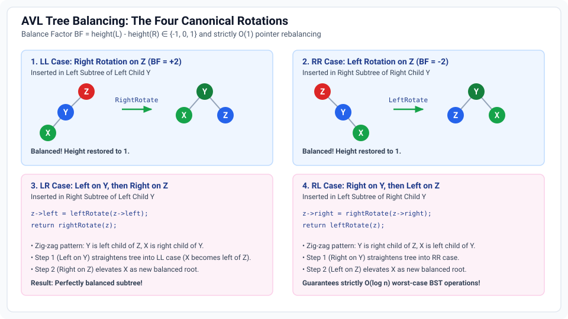
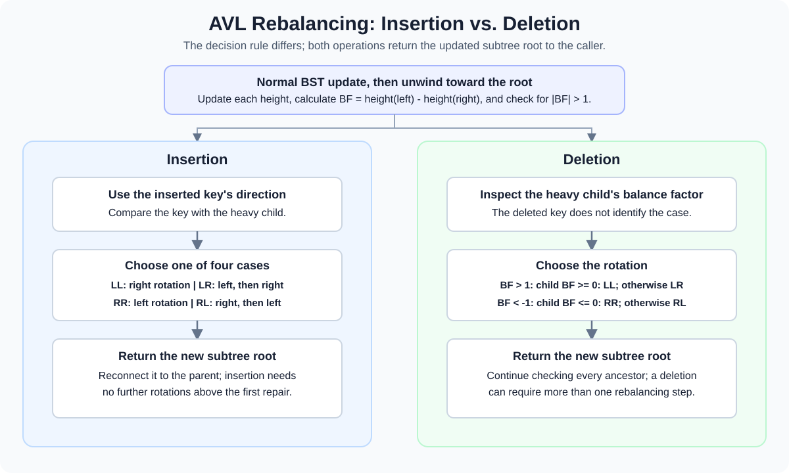

# AVL Tree in C++ — Complete Conceptual and Implementation Guide

> **Learning goal:** Understand an AVL tree from the ground up, implement it using a class and pointers, understand every rotation, and confidently handle insertion and deletion.

---

## 1. What problem does an AVL tree solve?

A Binary Search Tree (BST) keeps values ordered:

- Values smaller than a node go to its left subtree.
- Values greater than a node go to its right subtree.

For example, inserting `10, 20, 30` into an ordinary BST can produce:

```text
10
  \
   20
     \
      30
```

This is still a valid BST, but it has become a chain. Searching for `30` takes three node visits. Searching in a balanced tree with the same number of nodes can take fewer.

A badly skewed BST can have height close to `n`, so search, insertion, and deletion can degrade to **O(n)**.

An **AVL tree** is a self-balancing Binary Search Tree. After insertion or deletion, it checks subtree heights and uses rotations to restore balance.

The AVL tree was introduced by Adelson-Velsky and Landis. Its key guarantee is that the tree height remains **O(log n)**.

Therefore, search, insertion, and deletion take **O(log n)** time in the worst case.

---

## 2. The BST property

For every node `x`:

```text
Every value in x's left subtree  < x->data
Every value in x's right subtree > x->data
```

Example:

```text
             50
           /    \
         30      70
        /  \    /  \
      20   40  60   80
```

- `30 < 50`, so 30 is on the left.
- `70 > 50`, so 70 is on the right.
- 20 and 40 are both in the left subtree of 50, and each respects the ordering around 30.
- 60 and 80 are both in the right subtree of 50, and each respects the ordering around 70.

The BST property must remain true after every AVL rotation.

### How BST insertion works

To insert `35` into the tree:

1. Start at root 50.
2. `35 < 50`, so move left to 30.
3. `35 > 30`, so move right to 40.
4. `35 < 40`, so move left.
5. The left pointer is NULL; create the new node there.

```text
             50
           /    \
         30      70
        /  \    /  \
      20   40  60   80
           /
          35
```

This is exactly the BST insertion logic used inside `insert_node()` before AVL balancing is checked.

---

## 3. Height: the foundation of AVL trees

Height measures the longest downward path from a node to a leaf, counting nodes under the convention used in this implementation.

We use:

| Situation | Height |
|---|---:|
| NULL pointer / empty subtree | 0 |
| Leaf node | 1 |
| Node with children | `1 + max(left height, right height)` |

Example:

```text
             50                 Height(50) = 3
            /  \
          30    70              Height(30) = 2
         /                         Height(70) = 1
        20                        Height(20) = 1
```

For node 30:

```text
height(30) = 1 + max(height(20), height(NULL))
           = 1 + max(1, 0)
           = 2
```

For node 50:

```text
height(50) = 1 + max(height(30), height(70))
           = 1 + max(2, 1)
           = 3
```

### Why store height inside each node?

Our `Node` class contains:

```cpp
int height;
```

We store the height so that `height(node)` can return it in **O(1)** time.

If we recursively traversed the entire subtree every time we needed its height, repeated balance checks could become unnecessarily expensive.

The stored height must be updated whenever a subtree changes.

### Two important functions

```cpp
int height(Node* node) {
    if (node == nullptr) {
        return 0;
    }
    return node->height;
}
```

This reads a stored value. It does not recalculate the height.

```cpp
void update_height(Node* node) {
    if (node == nullptr) {
        return;
    }

    node->height = 1 + max(height(node->left),
                           height(node->right));
}
```

This recalculates and stores the height using the two child heights.

**Remember:** `height()` reads; `update_height()` writes.

---

## 4. Balance Factor (BF)

The balance factor tells us whether a node is left-heavy or right-heavy.

$$
BF(node) = height(node.left) - height(node.right)
$$

Interpretation:

| Balance factor | Meaning |
|---:|---|
| `0` | Left and right subtree heights are equal |
| `+1` | Left subtree is one level taller |
| `-1` | Right subtree is one level taller |
| `+2` or more | Too left-heavy; AVL violation |
| `-2` or less | Too right-heavy; AVL violation |

An AVL node must satisfy:

$$
-1 \le BF(node) \le 1
$$

Example:

```text
             50
            /  \
          30    70
         /
        20
```

At node 50:

- Left height = 2
- Right height = 1
- BF = 2 - 1 = +1

It is balanced.

If another level is added under 20, the left height can become 3 while the right height remains 1. Then BF(50) = +2, and a rotation is required.

### Code

```cpp
int get_balance(Node* node) {
    if (node == nullptr) {
        return 0;
    }

    return height(node->left) - height(node->right);
}
```

---

## 5. Rotations — the central idea

A rotation changes pointer connections locally. It does **not** discard nodes, and it must preserve the BST ordering.



Think of a rotation as a small pulley or lever arrangement:

- One child is moved upward to become the new root of the local subtree.
- The old root moves downward to the opposite side.
- The middle subtree is transferred to the only position where it still satisfies the BST property.

The pulley analogy is about **which node moves up and which moves down**. In the actual program, this movement is performed by changing pointers, not by physically moving objects in memory.

### 5.1 Right rotation (LL imbalance)

Before:

```text
             y
            / \
           x   C
          / \
         A   B
```

After a right rotation at `y`:

```text
             x
            / \
           A   y
              / \
             B   C
```

Movement:

1. `x`, the left child of `y`, moves up.
2. `y` moves down and becomes `x`'s right child.
3. `B`, previously `x`'s right subtree, becomes `y`'s left subtree.
4. `A` stays on the left of `x`.
5. `C` stays on the right of `y`.

Why must `B` move?

BST ordering tells us:

$$
A < x < B < y < C
$$

After the rotation, `B` must be between `x` and `y`. Therefore it becomes the left subtree of `y`.

#### Pointer-by-pointer code

```cpp
Node* right_rotation(Node* node) {
    Node* y = node;
    Node* x = y->left;
    Node* t2 = x->right;

    x->right = y;
    y->left = t2;

    update_height(y);
    update_height(x);

    return x;
}
```

| Statement | Meaning |
|---|---|
| `y = node` | Remember the old subtree root |
| `x = y->left` | The node that will move up |
| `t2 = x->right` | Save the middle subtree before overwriting a pointer |
| `x->right = y` | Move old root below x |
| `y->left = t2` | Attach the middle subtree to old root |
| `update_height(y)` | Update the node that moved down |
| `update_height(x)` | Then update the new subtree root |
| `return x` | Give the caller the new subtree root |

**Why update `y` before `x`?**

The height of `x` depends on the updated height of `y`. So update the lower node first, then the upper node.

### 5.2 Left rotation (RR imbalance)

Before:

```text
          y
         / \
        A   x
           / \
          B   C
```

After:

```text
             x
            / \
           y   C
          / \
         A   B
```

Movement:

1. `x`, the right child of `y`, moves up.
2. `y` moves down and becomes `x`'s left child.
3. `B`, previously `x`'s left subtree, becomes `y`'s right subtree.
4. `A` and `C` remain in their ordered positions.

Ordering:

$$
A < y < B < x < C
$$

Code:

```cpp
Node* left_rotation(Node* node) {
    Node* y = node;
    Node* x = y->right;
    Node* t2 = x->left;

    x->left = y;
    y->right = t2;

    update_height(y);
    update_height(x);

    return x;
}
```

The logic is the mirror image of right rotation.

### 5.3 Left-Right rotation (LR)

This is a two-step rotation.

Before:

```text
          z
         /
        x
         \
          y
```

Step 1: left-rotate at `x`.

```text
          z
         /
        y
       /
      x
```

Step 2: right-rotate at `z`.

```text
          y
         / \
        x   z
```

Code:

```cpp
Node* left_right_rotation(Node* node) {
    if (node == nullptr) {
        return nullptr;
    }

    node->left = left_rotation(node->left);
    return right_rotation(node);
}
```

Important: the first rotation is performed on the left child, not on the unbalanced root.

### 5.4 Right-Left rotation (RL)

This is the mirror image of LR.

Before:

```text
      z
       \
        x
       /
      y
```

Step 1: right-rotate at `x`.

```text
      z
       \
        y
         \
          x
```

Step 2: left-rotate at `z`.

```text
          y
         / \
        z   x
```

Code:

```cpp
Node* right_left_rotation(Node* node) {
    if (node == nullptr) {
        return nullptr;
    }

    node->right = right_rotation(node->right);
    return left_rotation(node);
}
```

---

## 6. The four AVL cases — quick recognition

For insertion, identify the direction from the newly inserted key:

| Case | Condition | Fix |
|---|---|---|
| LL | `bf > 1` and key `< node->left->data` | Right rotation |
| LR | `bf > 1` and key `> node->left->data` | Left-Right rotation |
| RR | `bf < -1` and key `> node->right->data` | Left rotation |
| RL | `bf < -1` and key `< node->right->data` | Right-Left rotation |

Mnemonic:

- LL → right rotation
- RR → left rotation
- LR → left then right
- RL → right then left

The case name describes the direction of the heavy path, not the name of the rotation.



---

## 7. AVL insertion — full story

Insertion has two phases:

1. Insert the key exactly as in a normal BST.
2. While recursive calls return, update heights and repair any imbalance.

### Why recursion is useful

The recursive call travels down to the insertion position. When it returns, execution resumes at the parent, then the grandparent, and so on.

That gives us a natural bottom-up path to update heights and check balance factors.

### Insertion code

```cpp
Node* insert_node(Node* node, int key) {
    if (node == nullptr) {
        return new Node(key);
    }

    if (key > node->data) {
        node->right = insert_node(node->right, key);
    }
    else if (key < node->data) {
        node->left = insert_node(node->left, key);
    }
    else {
        return node;
    }

    update_height(node);
    int bf = get_balance(node);

    if (bf > 1 && key < node->left->data) {
        return right_rotation(node);
    }

    if (bf > 1 && key > node->left->data) {
        return left_right_rotation(node);
    }

    if (bf < -1 && key > node->right->data) {
        return left_rotation(node);
    }

    if (bf < -1 && key < node->right->data) {
        return right_left_rotation(node);
    }

    return node;
}
```

### Why assign recursive returns?

This line is essential:

```cpp
node->left = insert_node(node->left, key);
```

A rotation can change the root of the left subtree. Assigning the returned pointer reconnects the parent to the new subtree root.

Likewise:

```cpp
root = tree.insert_node(root, val);
```

The overall tree root itself can change after a rotation.

### Example: insert 30, 20, 10

Before balancing:

```text
       30
      /
     20
    /
   10
```

At 30:

- Left height = 2
- Right height = 0
- BF = +2
- Inserted key 10 is less than 20.

This is LL. Right-rotate at 30:

```text
       20
      /  \
     10   30
```

---

## 8. AVL deletion — first perform BST deletion

Deletion also has two phases:

1. Perform ordinary BST deletion.
2. Update heights and rebalance while recursion returns.

There are three BST deletion cases.

### Case 1: Leaf node (zero children)

Simply delete it.

Before:

```text
       30
      /  \
     20   40
```

Delete 20:

```text
       30
         \
          40
```

Code:

```cpp
if (root->left == nullptr && root->right == nullptr) {
    delete root;
    return nullptr;
}
```

Returning `nullptr` tells the parent that this child link is now empty.

### Case 2: Exactly one child

Replace the node with its only child.

Before:

```text
       30
      /
     20
    /
   10
```

Delete 20:

```text
       30
      /
     10
```

Code for only right child:

```cpp
Node* temp = root->right;
delete root;
return temp;
```

Code for only left child:

```cpp
Node* temp = root->left;
delete root;
return temp;
```

Save the child pointer before deleting the old node. Then return the saved pointer so the parent can reconnect to it.

### Case 3: Two children

Use the inorder successor (or predecessor).

The **inorder successor** is the smallest value in the node's right subtree. To find it, start at the right child and keep moving left.

Example:

```text
          50
         /  \
       30    70
            /  \
           60   80
          /
         55
```

The inorder successor of 50 is 55.

Steps:

1. Find 55.
2. Copy 55 into the node that currently contains 50.
3. Delete the original 55 from the right subtree.

Result:

```text
          55
         /  \
       30    70
               \
                80
```

The BST ordering remains correct.

### Inorder successor code

```cpp
Node* Inorder_Successor(Node* root) {
    while (root != nullptr && root->left != nullptr) {
        root = root->left;
    }
    return root;
}
```

The function returns the leftmost node in the supplied subtree.

---

## 9. Why deletion rebalancing differs from insertion

This is one of the most important distinctions in AVL trees.

### Insertion

For insertion, the newly inserted key tells us which direction the height grew.

So we can use comparisons such as:

```cpp
key < node->left->data
```

### Deletion

For deletion, the deleted key does not tell us which side of an ancestor is now heavy. A subtree became shorter, and the resulting shape matters.

Therefore, inspect the **balance factor of the heavy child**.

| Current node | Heavy child BF | Case | Rotation |
|---|---:|---|---|
| `bf > 1` | `>= 0` | LL | Right |
| `bf > 1` | `< 0` | LR | Left-Right |
| `bf < -1` | `<= 0` | RR | Left |
| `bf < -1` | `> 0` | RL | Right-Left |

### Why do we use `>= 0` and `<= 0`?

Deletion can make the heavy child have balance factor exactly zero.

For example, if the current node has BF +2 and its left child has BF 0, a single right rotation is the correct repair.

This zero-child-BF situation is an important difference from the simple insertion decision rules.

### Deletion rebalancing code

```cpp
update_height(root);
int bf = get_balance(root);

if (bf > 1 && get_balance(root->left) >= 0) {
    return right_rotation(root);
}

if (bf > 1 && get_balance(root->left) < 0) {
    return left_right_rotation(root);
}

if (bf < -1 && get_balance(root->right) <= 0) {
    return left_rotation(root);
}

if (bf < -1 && get_balance(root->right) > 0) {
    return right_left_rotation(root);
}

return root;
```

### Why can deletion require rotations at multiple ancestors?

After a deletion, a subtree can become shorter. Rebalancing one ancestor can change the height of the repaired subtree. Its parent may then also become unbalanced.

So deletion must continue checking ancestors all the way toward the root.

Do not stop after the first rotation.

---

## 10. The complete deletion function — line-by-line flow

```cpp
Node* delete_node(Node* root, int key) {
    if (root == nullptr) {
        return nullptr;
    }

    if (key < root->data) {
        root->left = delete_node(root->left, key);
    }
    else if (key > root->data) {
        root->right = delete_node(root->right, key);
    }
    else {
        // Handle zero, one, or two children.
    }

    update_height(root);
    int bf = get_balance(root);

    // Check LL, LR, RR, RL using the heavy child's BF.

    return root;
}
```

The full implementation is in the companion file [Detailed_AVL_Tree.cpp](../Detailed_AVL_Tree.cpp).

Important flow:

1. Search down the BST using comparisons.
2. Find the target.
3. Delete or replace it according to the number of children.
4. Return from the recursive call.
5. Update the current node's height.
6. Calculate its BF.
7. Rotate if needed.
8. Return the possibly changed subtree root to the parent.
9. Continue until the overall root is returned.

**Always write:**

```cpp
root = tree.delete_node(root, key);
```

The root pointer may change after a rotation.

---

## 11. Reading traversals and checking the tree

### Inorder traversal

```cpp
inorder(node->left);
cout << node->data;
inorder(node->right);
```

For a valid BST, inorder traversal must produce sorted values.

Example:

```text
10 20 25 30 35 40 45 50 70
```

This is a useful check of the BST ordering.

### Preorder traversal

```cpp
cout << node->data;
preorder(node->left);
preorder(node->right);
```

Preorder is useful for seeing the root first and understanding the overall shape.

Example:

```text
30 20 10 25 50 40 35 45 70
```

Preorder alone does not prove that a tree is a valid AVL tree. Also check inorder ordering and every node's height and BF.

### Displaying node details

The program prints:

```text
Node: 30 | Height: 4 | BF: -1
```

- `Node` is the key stored in the node.
- `Height` is the stored height.
- `BF` is the calculated balance factor.

Every node must have BF in `[-1, +1]` after a completed insertion or deletion.

---

## 12. Common mistakes and how to avoid them

| Mistake | Why it is wrong | Correct approach |
|---|---|---|
| Initializing leaf height to 0 | Conflicts with the chosen height convention | Leaf = 1, NULL = 0 |
| Recalculating height recursively in `height()` | Can repeatedly traverse subtrees | Return stored `node->height` |
| Forgetting `update_height()` | BF calculations use stale heights | Update after child links change |
| Updating the new root before the old root in a rotation | New root may read stale child height | Update the node moved down first |
| Forgetting to save `T2` | Rewiring can lose the middle subtree | Save it before changing pointers |
| Using the wrong child in left rotation | Reverses the intended structure | Left rotation promotes the right child |
| Forgetting to assign recursive return | Parent may retain an outdated subtree root | `node->left = ...`, `node->right = ...` |
| Forgetting to assign returned root in `main` | Whole tree root can change | `root = tree.insert_node(...)` and `root = tree.delete_node(...)` |
| Using insertion's key-based tests for deletion | Deleted key does not identify the heavy-child shape | Inspect child BF |
| Using only `> 0` / `< 0` in deletion | Misses the child-BF-zero cases | Use `>= 0` and `<= 0` |
| Returning without a pointer from a `Node*` function | Return type mismatch | Return `nullptr` or a valid node pointer |
| Forgetting the final `return root` | Caller does not receive the subtree root | Return after rebalancing |
| Rebalancing only once after deletion | Higher ancestors may also become unbalanced | Continue while recursion returns |
| Forgetting to delete a removed node | Memory leak | Use `delete` after saving the replacement pointer |

### A subtle `else` mistake

Avoid this:

```cpp
if (key > node->data) {
    node->right = insert_node(node->right, key);
}

if (key < node->data) {
    node->left = insert_node(node->left, key);
}
else {
    return node;
}
```

The `else` belongs to the second `if`, not the first. Use an `if / else if / else` chain.

---

## 13. Complexity analysis

Let `n` be the number of nodes and `h` be the height.

An AVL tree maintains `h = O(log n)`.

| Operation | Time | Reason |
|---|---:|---|
| Read stored height | O(1) | One field access |
| Update one node's height | O(1) | Reads two stored heights |
| Calculate BF | O(1) | Two height reads and subtraction |
| Single rotation | O(1) | Constant number of pointer changes |
| Double rotation | O(1) | Two single rotations |
| Search | O(log n) | Follow one root-to-leaf path |
| Insertion | O(log n) | Search path plus constant work per ancestor |
| Deletion | O(log n) | Search path, successor path, and rebalancing |
| Preorder / inorder | O(n) | Visit every node |
| Destroy tree | O(n) | Delete every node |

### Space complexity

- Tree storage: **O(n)** nodes.
- Recursive insertion/deletion stack: **O(log n)** for an AVL tree.
- Traversal recursion stack: **O(log n)** for an AVL tree.
- A rotation itself uses **O(1)** extra space.

The code uses raw pointers and explicitly deletes nodes. The `destroy_tree()` helper releases the remaining nodes at the end of `main()`.

---

## 14. Suggested test plan

Run each test with a fresh tree. Do not reuse a tree after a previous test unless you intentionally want to test a sequence of operations.

### Insertion rotation tests

| Test | Insert sequence | Expected final preorder |
|---|---|---|
| LL | `30, 20, 10` | `20 10 30` |
| RR | `10, 20, 30` | `20 10 30` |
| LR | `30, 10, 20` | `20 10 30` |
| RL | `10, 30, 20` | `20 10 30` |

### Deletion tests

Test:
- Deleting a leaf.
- Deleting a node with only a left child.
- Deleting a node with only a right child.
- Deleting a node with two children.
- Deleting the root.
- Deleting a value that does not exist.
- Deletions that cause each of LL, LR, RR, and RL rebalancing.
- Deletions that cause the heavy child to have BF zero.
- Multiple sequential deletions, checking every node's BF after each operation.

For each test, verify:
1. Inorder traversal is sorted.
2. Every stored height is correct.
3. Every BF is -1, 0, or +1.
4. The preorder reflects the expected tree structure.

---

## 15. Final mental model

Think of AVL operations as this sequence:

```text
                 INSERT / DELETE
                        |
                        v
                  Normal BST work
                        |
                        v
             Recursive calls return upward
                        |
                        v
                  Update height
                        |
                        v
                 Calculate BF
                        |
               +--------+--------+
               |                 |
          BF is valid        BF is invalid
               |                 |
               v                 v
          Return node       Identify LL/LR/RR/RL
                                  |
                                  v
                              Rotate
                                  |
                                  v
                       Return new subtree root
```

The most important ideas to remember:

1. AVL is a BST with a height-balance condition.
2. Rotations preserve BST ordering while changing the shape.
3. Save the middle subtree (`T2`) before rewiring pointers.
4. Update the node that moved down before the node that moved up.
5. Return the new subtree root after every rotation.
6. Insertion identifies the case using the inserted key.
7. Deletion identifies the case using the heavy child's balance factor.
8. Deletion may require rebalancing multiple ancestors.
9. Always reconnect returned subtree roots to their parents.
10. Validate using inorder traversal, stored heights, and balance factors.

**Companion source:** [Detailed_AVL_Tree.cpp](../Detailed_AVL_Tree.cpp) contains the complete class-based implementation with insertion, deletion, rotations, traversals, and memory cleanup.
