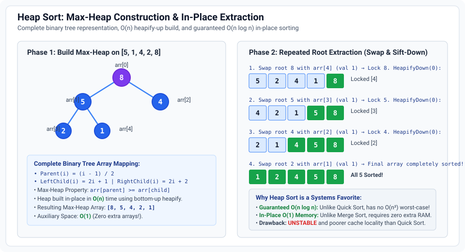

# Binary Heaps (Max Heap & Min Heap) and Heap Sort

## Related Implementation

- `../Binary_Heap.cpp` *(Original Max Heap and Heap Sort implementation)*
- `../Binary_Heap_Detailed_Explanation.cpp` *(Original detailed Max Heap implementation with `build_heap`, `extract_max`, `peek`, `delete_node`, and `heap_sort`)*
- `../Binary_Tree_Array.cpp` *(Underlying 0-based array representation of a Complete Binary Tree)*

---

## 1. Concept Introduction

### What is the Concept?
A **Binary Heap** is a **Complete Binary Tree** stored compactly in an **array** (`int arr[100]`) that satisfies the **Heap Ordering Property**:
1. **Max Heap** *(implemented in `Binary_Heap.cpp` and `Binary_Heap_Detailed_Explanation.cpp`)*:
   Every parent node's value is **greater than or equal to** its children's values ($\text{arr}[\text{parent}] \ge \text{arr}[\text{child}]$). Consequently, the **maximum element is always at the root (`arr[0]`)**.
2. **Min Heap**:
   Every parent node's value is **less than or equal to** its children's values ($\text{arr}[\text{parent}] \le \text{arr}[\text{child}]$). Consequently, the **minimum element is always at the root (`arr[0]`)**.

### Why is it Required?
- In an unsorted array, inserting takes $O(1)$ but finding/removing the maximum takes $O(n)$.
- In a sorted array, finding the maximum takes $O(1)$ but inserting takes $O(n)$.
- A **Binary Heap** gives the best of both worlds: **$O(1)$ access to the maximum/minimum (`peek`)** and **$O(\log n)$ insertion and extraction**, all inside a flat array with **zero pointers**! Furthermore, it enables **Heap Sort**, an in-place $O(n \log n)$ worst-case sorting algorithm.

---

## 2. Fundamental Theory

### The Two Defining Invariants of a Binary Heap
Every Binary Heap operation (`insert`, `extract_max`, `delete_node`, `build_heap`, `heap_sort`) must maintain two invariants:
1. **Shape Property (Complete Binary Tree)**:
   All levels of the tree are completely full except possibly the bottom level, which is filled strictly from **left to right**. This guarantees that:
   - There are **zero gaps** in the array `arr[0 .. size - 1]`.
   - The height of a heap of $n$ elements is strictly $\lfloor \log_2 n \rfloor$.
2. **Heap Property (Parent-Child Dominance)**:
   - Max Heap: `arr[(i - 1) / 2] >= arr[i]` for all $1 \le i < \text{size}$.
   - Note: Unlike a BST, a Binary Heap imposes **no ordering between left and right siblings**! Left child can be greater than or smaller than right child as long as both are $\le$ their parent.

---

## 3. Mathematical Representation

### 1. Array Index Formulas (Zero-Based Indexing)
For a heap of `size` $n$ stored in `arr[0 .. n - 1]`:
- **Root Index**: $0$
- **Parent of Index $i$** ($i > 0$):
  $$\text{parent}(i) = \left\lfloor \frac{i - 1}{2} \right\rfloor$$
- **Left Child of Index $i$**:
  $$\text{left}(i) = 2i + 1$$
- **Right Child of Index $i$**:
  $$\text{right}(i) = 2i + 2$$
- **Last Non-Leaf (Internal) Node Index**:
  $$\text{last\_internal} = \left\lfloor \frac{n}{2} \right\rfloor - 1$$
- **Leaf Node Index Range**:
  $$\text{Leaves occupy indices } \left\lfloor \frac{n}{2} \right\rfloor \text{ through } n - 1$$

### 2. Why Bottom-Up `build_heap()` Runs in $O(n)$ Time (Mathematical Proof)
In a heap of $n$ elements, there are at most $\left\lceil \frac{n}{2^{h+1}} \right\rceil$ nodes at height $h$, and `heapify_down` on a node at height $h$ takes $O(h)$ swaps:

$$T(n) = \sum_{h=0}^{\lfloor \log_2 n \rfloor} \left\lceil \frac{n}{2^{h+1}} \right\rceil c \cdot h \le \frac{c \cdot n}{2} \sum_{h=0}^{\infty} \frac{h}{2^h}$$

Since the infinite series $\sum_{h=0}^{\infty} \frac{h}{2^h} = 2$:
$$T(n) \le \frac{c \cdot n}{2} \times 2 = c \cdot n = O(n)$$

---

## 4. Working Mechanism

### 1. `heapify_up(int index)` (Percolate Up / Sift Up)
Used when a new or increased value at `index` might be **larger than its parent**:
1. While `index > 0`:
   - Compute `parent = (index - 1) / 2`.
   - If `arr[index] > arr[parent]`, swap `arr[index]` and `arr[parent]`, and move `index = parent`.
   - Otherwise, `break` (Max Heap property is satisfied).

### 2. `heapify_down(int index)` (Percolate Down / Sift Down)
Used when a value at `index` might be **smaller than one or both of its children**:
1. Loop `while (true)`:
   - Set `largest = index`, `left = 2 * index + 1`, `right = 2 * index + 2`.
   - If `left < size && arr[left] > arr[largest]`, set `largest = left`.
   - If `right < size && arr[right] > arr[largest]`, set `largest = right`. *(Compares against `arr[largest]`, so we always swap with the **larger** of the two children!)*
   - If `largest == index`, `break`.
   - Swap `arr[index]` and `arr[largest]`, and set `index = largest`.

### 3. `insert(int value)` (`Insert_Binary_heapfyUP` in `Binary_Heap.cpp`)
1. Place `value` at the next available leaf slot `arr[size]` and increment `size++` (preserving the Complete Binary Tree shape).
2. Call `heapify_up(size - 1)` to bubble the element up until the Max Heap property is restored.

### 4. `extract_max()` (in `Binary_Heap_Detailed_Explanation.cpp`)
1. Save `int maximum = arr[0];`.
2. Move the last element into the root (`arr[0] = arr[size - 1];`) and decrement `size--`.
3. Call `heapify_down(0)` to sink the replacement root down to its proper level.
4. Return `maximum`.

### 5. `heap_sort()` (`Binary_Heap.cpp` & `Binary_Heap_Detailed_Explanation.cpp`)
Given a valid Max Heap in `arr[0 .. size - 1]`:
1. Save `int originalSize = size;`.
2. While `size > 1`:
   - The maximum element of the active heap is at `arr[0]`. Swap `arr[0]` with the last active element `arr[size - 1]`.
   - Decrement `size--` (locking that maximum element into its final sorted position at the end of the array).
   - Call `heapify_down(0)` on the reduced active heap `[0 .. size - 1]` to bring the next largest element to `arr[0]`.
3. Restore `size = originalSize;`. The array is now sorted in **ascending order**!

---

## 5. Visual Representation

### 1. Max Heap Array & Tree View (`{100, 50, 70, 20, 40, 60}`)



```
                 100 (idx 0)
               /             \
         50 (idx 1)        70 (idx 2)
         /       \         /
    20(idx 3) 40(idx 4) 60(idx 5)

Array: [ 100 | 50 | 70 | 20 | 40 | 60 ]
Index:    0     1    2    3    4    5
```

### 2. Step-by-Step Execution of `heap_sort()` on `[100, 60, 70, 20, 40, 50]`
```
Initial Max Heap:  [ 100,  60,  70,  20,  40,  50 ]   (size = 6)
Swap(0, 5), size=5:[  50,  60,  70 | 20,  40 | 100] -> heapify_down(0) -> [70, 60, 50, 20, 40 | 100]
Swap(0, 4), size=4:[  40,  60,  50,  20 | 70, 100] -> heapify_down(0) -> [60, 40, 50, 20 | 70, 100]
Swap(0, 3), size=3:[  20,  40,  50 | 60,  70, 100] -> heapify_down(0) -> [50, 40, 20 | 60, 70, 100]
Swap(0, 2), size=2:[  20,  40 | 50,  60,  70, 100] -> heapify_down(0) -> [40, 20 | 50, 60, 70, 100]
Swap(0, 1), size=1:[  20 | 40,  50,  60,  70, 100] -> Done!
Final Sorted Array:[  20,  40,  50,  60,  70, 100 ]
```

---

## 6. C++ Implementation & Code Review (`Binary_Heap.cpp` vs. `Binary_Heap_Detailed_Explanation.cpp`)

### Comparison & Code Review of Original Files
*(Documented here without modifying your original files)*

1. **`delete_node(int index)` When Deleting the Last Element (`index == size - 1`) in `../Binary_Heap.cpp` (Lines 88–90)**:
   - In `Binary_Heap.cpp`:
     ```cpp
     if(index == size-1){
         return;
     }
     ```
   - **Issue**: When `index == size - 1`, it returns immediately **without decrementing `size--`**, so the last element is not actually removed!
   - **How `../Binary_Heap_Detailed_Explanation.cpp` (Lines 371–379) Fixed This**:
     In `Binary_Heap_Detailed_Explanation.cpp`, `size--` is executed *before* checking `if (index >= size) return;`, so deleting the last element properly reduces `size` by 1.
2. **Upward vs. Downward Repair in `delete_node(int index)`**:
   - In `Binary_Heap.cpp` (lines 95–114), after replacing `arr[index]` with `arr[size - 1]`, it only runs a `heapify_down` loop.
   - In `Binary_Heap_Detailed_Explanation.cpp` (lines 382–389), you added the exact right check:
     ```cpp
     if (index > 0 && arr[index] > arr[(index - 1) / 2]) {
         heapify_up(index);
     } else {
         heapify_down(index);
     }
     ```
     Why? Because in a heap, the last element `arr[size - 1]` could belong to the right subtree and actually be **larger** than the parent of a node deleted from a deep left subtree!
3. **Unused Variable in `heapify_down` of `Binary_Heap.cpp` (Line 21)**:
   - Line 21 declares `int parent = largest/ 2 - 1;` which is not used inside `heapify_down` (and was cleanly removed in `Binary_Heap_Detailed_Explanation.cpp`).

---

## 7. Dry Runs

### Dry Run: Inserting `{100, 50, 70, 20, 40, 60}` and Running `heap_sort()` in `../Binary_Heap.cpp`
1. **Insertions (`Insert_Binary_heapfyUP`)**:
   - Since `100 >= 50`, `100 >= 70`, `50 >= 20`, `50 >= 40`, and `70 >= 60`, every inserted value is already $\le$ its parent!
   - Resulting Max Heap array (`unsorted array:`): `100 50 70 20 40 60`
2. **Heap Sort (`b1.heap_sort()`)**:
   | Iteration | Active `size` | Swap `arr[0] <-> arr[size-1]` | Active Heap After `heapify_down(0)` | Sorted Suffix |
   | :---: | :---: | :--- | :--- | :--- |
   | 1 | `6 -> 5` | `swap(100, 60)` | `[70, 50, 60, 20, 40]` | `[100]` |
   | 2 | `5 -> 4` | `swap(70, 40)` | `[60, 50, 40, 20]` | `[70, 100]` |
   | 3 | `4 -> 3` | `swap(60, 20)` | `[50, 20, 40]` | `[60, 70, 100]` |
   | 4 | `3 -> 2` | `swap(50, 40)` | `[40, 20]` | `[50, 60, 70, 100]` |
   | 5 | `2 -> 1` | `swap(40, 20)` | `[20]` | `[40, 50, 60, 70, 100]` |
   - Final Output (`sorted array:`): `20 40 50 60 70 100`

---

## 8. Time Complexity

| Operation | Best Case | Average Case | Worst Case | Explanation |
| :--- | :---: | :---: | :---: | :--- |
| **`peek()` (Get Max)** | $O(1)$ | $O(1)$ | $O(1)$ | Returns `arr[0]` directly |
| **`insert(val)` / `heapify_up`** | $O(1)$ | $O(1)$ | $O(\log n)$ | Bubbles up at most height $\lfloor \log_2 n \rfloor$ levels |
| **`extract_max()` / `heapify_down`** | $O(1)$ | $O(\log n)$ | $O(\log n)$ | Sinks down at most height $\lfloor \log_2 n \rfloor$ levels |
| **`delete_node(index)`** | $O(1)$ | $O(\log n)$ | $O(\log n)$ | Swaps with `arr[size-1]` + at most 1 `heapify_up` or `heapify_down` |
| **`build_heap()` (Bottom-Up)** | $O(n)$ | $O(n)$ | **$O(n)$** | Calls `heapify_down` from `size/2 - 1` down to `0` |
| **Inserting $n$ Elements One-by-One** | $O(n)$ | $O(n)$ | $O(n \log n)$ | $\sum_{i=1}^{n} O(\log i) = O(n \log n)$ |
| **`heap_sort()`** | $O(n \log n)$ | $O(n \log n)$ | **$O(n \log n)$** | $n - 1$ extractions, each taking $O(\log n)$ |

---

## 9. Space Complexity

- **Auxiliary Space**: **$O(1)$** for all operations (`heapify_up`, `heapify_down`, `insert`, `extract_max`, `delete_node`, `build_heap`, `heap_sort`), because your implementations use iterative `while` loops and in-place swaps!

---

## 10. Important Properties and Observations

1. **Max Heap vs. Min Heap for Heap Sort**:
   - **Max Heap** sorts an array in **Ascending Order** (because each maximum element is swapped to the back of the active array).
   - **Min Heap** sorts an array in **Descending Order** (because each minimum element is swapped to the back of the active array).
2. **How to Convert Your Max Heap into a Min Heap**:
   Simply flip the comparison operators (`>` to `<`, and `largest` to `smallest`) in `heapify_up` and `heapify_down`!
3. **Where Can the Minimum Element Reside in a Max Heap?**
   In a Max Heap of $n$ elements, the **minimum** element is guaranteed to be one of the **leaf nodes** (indices $\lfloor n/2 \rfloor$ to $n - 1$), because any internal node is $\ge$ its children. Thus finding the minimum in a Max Heap takes $O(n)$ time (checking the $\lceil n/2 \rceil$ leaves).

---

## 11. Advantages and Disadvantages

### Advantages
- $O(1)$ access to the highest-priority element and $O(\log n)$ insertion/deletion with zero pointer overhead.
- `build_heap()` converts an unsorted array into a heap in $O(n)$ time and $O(1)$ space.
- `heap_sort()` guarantees $O(n \log n)$ worst-case time AND $O(1)$ auxiliary space (unlike Merge Sort which needs $O(n)$ space, and Quick Sort which has $O(n^2)$ worst-case time).

### Disadvantages
- Searching for an arbitrary element by value takes $O(n)$ time (unlike a BST which takes $O(\log n)$).
- Heap Sort is **not stable** and has poorer cache locality than Quick Sort because `heapify_down` jumps from index $i$ to $2i + 1$.

---

## 12. Comparison with Related Concepts

### Binary Search Tree (BST) vs. Binary Heap

| Feature | Binary Search Tree (`BST_01.cpp`) | Binary Heap (`Binary_Heap_Detailed_Explanation.cpp`) |
| :--- | :--- | :--- |
| **Structural Shape** | Any binary tree (can become skewed) | Strictly a **Complete Binary Tree** (height is always $\lfloor \log_2 n \rfloor$) |
| **Memory Representation** | Heap-allocated `Node` pointers | Contiguous array `int arr[100]` |
| **Ordering Property** | $\text{Left} < \text{Parent} \le \text{Right}$ | $\text{Parent} \ge \text{Both Children}$ (Max Heap) |
| **Find Max Element** | $O(h)$ (walk rightmost path) | **$O(1)$** (`arr[0]`) |
| **Search Arbitrary Key** | **$O(\log n)$** (when balanced) | $O(n)$ (must scan array) |
| **Build from $n$ Elements** | $O(n \log n)$ average ($O(n^2)$ worst) | **$O(n)$** worst-case (`build_heap`) |

---

## 13. Common Mistakes

1. **Comparing the Right Child with `arr[index]` Instead of `arr[largest]` in `heapify_down`**:
   As you highlighted in `Binary_Heap_Detailed_Explanation.cpp` (lines 220–223), if both children are larger than the parent, you **must** swap the parent with the **larger** of the two children so the new parent is $\ge$ the other child! Comparing `arr[right] > arr[largest]` ensures this.
2. **Assuming Printing a Heap Array (`print_BH()`) Prints Sorted Order**:
   `print_BH()` prints the level-order array representation of the heap. To get sorted order, you must run `heap_sort()`.

---

## 14. Applications

1. **Priority Queues** (`std::priority_queue<int>` in C++ STL is a Max Heap by default).
2. **Dijkstra's Shortest Path Algorithm** and **Prim's Minimum Spanning Tree Algorithm**.
3. **Top-$K$ Largest / Smallest Elements** in a stream of size $n$ in $O(n \log k)$ time.
4. **Operating System Process Scheduling** and **Median of a Data Stream** (using one Max Heap + one Min Heap).

---

## 15. Practice Questions

1. **Basic Understanding**: Why do we start the loop in `build_heap()` at `i = size / 2 - 1` and move **backward** down to `0`, instead of starting at `0` and moving forward to `size / 2 - 1`?
2. **Implementation**: Write a `Min_Heap` class by adapting `heapify_up` and `heapify_down` from `Binary_Heap_Detailed_Explanation.cpp`.
3. **Dry-Run Problem**: Given the unsorted array `arr = {15, 10, 30, 50, 40, 20, 60}`, trace `build_heap()` bottom-up from index `size / 2 - 1 = 2` down to `0`. Show the array after each `heapify_down(i)` call.
4. **Complexity Analysis**: Suppose you want to find the **$k$ largest elements** in an unsorted array of $n$ elements ($k \ll n$). Compare the time complexity of:
   - Method A: Sorting the array ($O(n \log n)$).
   - Method B: Running bottom-up `build_heap()` ($O(n)$) followed by $k$ calls to `extract_max()` ($O(k \log n)$).
5. **Interview Question**: How can you maintain the **Running Median** of a continuous stream of integers in $O(\log n)$ time per insertion and $O(1)$ time per median query using one Max Heap and one Min Heap?

---

## 16. Quick Revision

- **0-Based Heap Indices**: $\text{Parent} = (i-1)/2$, $\text{Left} = 2i+1$, $\text{Right} = 2i+2$, $\text{Last Internal} = n/2 - 1$.
- **Insert**: Place at `arr[size++]`, then `heapify_up(size - 1)` $\implies O(\log n)$.
- **Extract Max**: Save `arr[0]`, move `arr[--size]` to `arr[0]`, then `heapify_down(0)` $\implies O(\log n)$.
- **Build Heap**: Loop `i` from `size / 2 - 1` down to `0` calling `heapify_down(i)` $\implies O(n)$ time!
- **Heap Sort**: Repeatedly `swap(arr[0], arr[--size])` and `heapify_down(0)` $\implies O(n \log n)$ time, $O(1)$ space.
