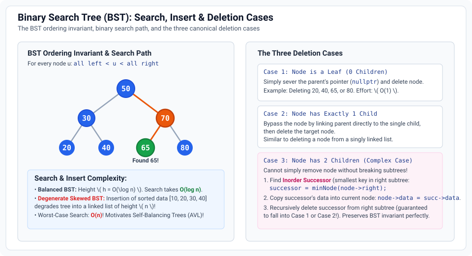
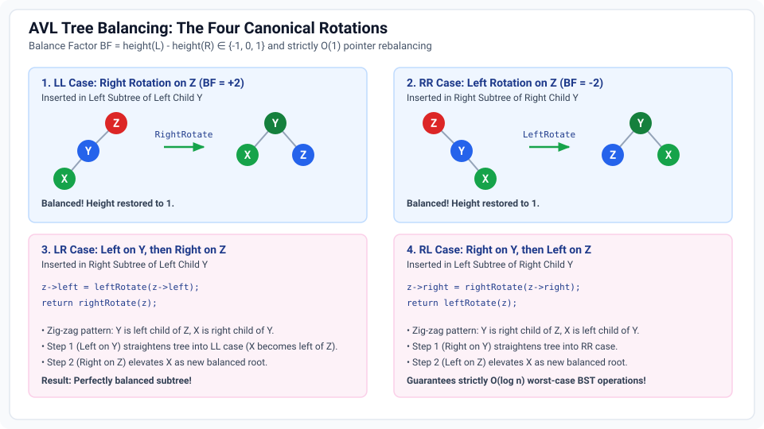

# Binary Search Trees (BST): Insertion, Search, Deletion, Node Counting & Validation

## Related Implementation

- `../BST_01.cpp` *(Original BST implementation with node/leaf/internal counting, height, and strict BT check)*
- `../BST_01_Detailed.cpp` *(Original detailed commented BST implementation)*
- `../Binary_Tree_01_Detailed.cpp` *(Lines 514–544: `check_BST` range validation)*
- `../Binary_Tree_Diameter_and_LCA.cpp` *(Supplementary implementation with `LCA_BST` and complete `IS_STRICT_BST`)*

---

## 1. Concept Introduction

### What is the Concept?
A **Binary Search Tree (BST)** is a binary tree that satisfies the **BST Ordering Property** at every node:
- For every node $u$, **all** keys in the **left subtree** of $u$ are smaller than $u\text{'s}$ key.
- For every node $u$, **all** keys in the **right subtree** of $u$ are greater than (or equal to, in `Build_BST`) $u\text{'s}$ key.

### Why is it Required?
In a general Binary Tree (`Binary_Tree_01.cpp`), searching for a target value (`search`) requires inspecting both subtrees in $O(n)$ time, and inserting or deleting in sorted order is not supported. A balanced BST combines the **$O(\log n)$ search speed of Binary Search on a sorted array** with the **dynamic insertion and deletion flexibility of a linked structure**!

---

## 2. Fundamental Theory

### The Two Most Important Properties of a BST
1. **Subtree Elimination Property**:
   At any node `root`, comparing `key` with `root->data` eliminates an entire subtree immediately:
   - If `key < root->data`, `key` **cannot** exist anywhere in `root->right`; search only `root->left`.
   - If `key > root->data`, `key` **cannot** exist anywhere in `root->left`; search only `root->right`.
2. **Sorted Inorder Property**:
   An **Inorder Traversal** (`Print_Binaray_Tree(root)` in `BST_01.cpp`: Left $\to$ Root $\to$ Right) of any valid BST visits all keys in **non-decreasing sorted order**!

### Inorder Successor (`Inorder_Sucessor(Node* root)`)
The **Inorder Successor** of a node $u$ is the node with the **smallest key strictly greater than $u\text{'s}$ key**.
When node $u$ has a non-empty right subtree (`u->right != NULL`), its Inorder Successor is the **leftmost (minimum) node in `u->right`**, found by starting at `u->right` and repeatedly following `root = root->left` until `root->left == NULL`.

---

## 3. Mathematical Representation

### 1. Formal BST Invariant
For every node $x$ in the tree:
$$\forall y \in \text{LeftSubtree}(x), \quad \text{data}(y) < \text{data}(x)$$
$$\forall z \in \text{RightSubtree}(x), \quad \text{data}(z) > \text{data}(x) \quad (\text{or } \ge \text{data}(x))$$

### 2. Node Relationship Equation in Any Binary Tree / BST
Let:
- $N$ = Total nodes (`count_Nodes(root)`)
- $L$ = Number of Leaf Nodes (`Count_leaf_Nodes_02(root)`)
- $I$ = Number of Internal Nodes (`count_internal_Nodes(root)`)

Every node in the tree is either a Leaf Node ($0$ children) or an Internal Node ($\ge 1$ child):
$$N = L + I \iff I = N - L$$

---

## 4. Working Mechanism

### 1. Insertion (`Build_BST(Node* root, int data)`)
1. **Base Case**: If `root == NULL`, allocate and return `new Node(data)`.
2. **Recursive Step**:
   - If `data < root->data`, set `root->left = Build_BST(root->left, data);`.
   - Else (`data >= root->data`), set `root->right = Build_BST(root->right, data);`.
3. Return `root` so the parent reconnects its child pointer. *(Note: A newly inserted node in a standard BST is always inserted as a new **leaf node**!)*

### 2. Search (`search(Node* root, int key)`)
1. If `root == NULL`, return `false`.
2. If `root->data == key`, return `true`.
3. If `root->data < key`, return `search(root->right, key);`.
4. Else, return `search(root->left, key);`.

### 3. Deletion (`Delete_Node(Node* root, int node)`) — The 3 Classic Cases
First, recursively locate the target node (`if (root->data < node)` go right; `else if (root->data > node)` go left).
Once `root->data == node` is found:
- **Case 1: Leaf Node (`root->left == NULL && root->right == NULL`)**:
  Handled cleanly by the `if (root->left == NULL)` branch: `temp = root->right` (which is `NULL`), `delete root;`, and `return NULL;` to disconnect it from its parent.
- **Case 2: Node with One Child (`root->left == NULL` OR `root->right == NULL`)**:
  Save the single non-NULL child pointer in `temp`, `delete root;`, and `return temp;` so the parent links directly around the deleted node to its child.
- **Case 3: Node with Two Children (`root->left != NULL && root->right != NULL`)**:
  1. Find the Inorder Successor in the right subtree: `Node *temp = Inorder_Sucessor(root->right);`.
  2. Copy the successor's value into the current node: `root->data = temp->data;`.
  3. Recursively delete the successor from the right subtree: `root->right = Delete_Node(root->right, temp->data);`. *(Since the Inorder Successor has no left child, its deletion is guaranteed to fall into Case 1 or Case 2!)*

---

## 5. Visual Representation

### 1. Building the BST in `BST_01.cpp` (`values = {50, 30, 70, 20, 40, 60, 80}`)



```
                    50
                  /    \
                30      70
               /  \    /  \
             20   40  60   80

- Total Nodes (count_Nodes):            7
- Leaf Nodes (Count_leaf_Nodes_02):     4  (Nodes: 20, 40, 60, 80)
- Internal Nodes (count_internal_Nodes):3  (Nodes: 50, 30, 70)
- Height (Height_BST):                  3  (Longest path has 3 nodes)
- Strict BT (is_Strict_BT):             1  (Every node has 0 or 2 children)
```

### 2. Deleting Root `50` (Case 3: Two Children) in `BST_01.cpp`
```
Before Delete_Node(root, 50):          Step 1: Find Inorder Successor in right subtree (70):
            50  <-- Delete                     Leftmost node of 70's subtree is 60.
          /    \                       Step 2: Copy 60 into root (root->data = 60).
        30      70                     Step 3: Delete 60 from right subtree (Case 1 leaf).
       /  \    /  \
     20   40  60   80                  After Delete_Node(root, 50):
              ^                                    60
        Inorder Successor                        /    \
                                               30      70
                                              /  \       \
                                            20   40       80
```

---

## 6. C++ Implementation & Code Review (`BST_01.cpp` & `BST_01_Detailed.cpp`)

### Functions Implemented in `../BST_01.cpp`
1. **`Build_BST(Node* root, int data)`** (lines 21–36): Recursive BST insertion ($O(h)$).
2. **`Print_Binaray_Tree(Node* root)`** (lines 38–47): Inorder traversal printing sorted keys ($O(n)$).
3. **`search(Node* root, int key)`** (lines 49–71): Recursive BST search ($O(h)$).
4. **`Inorder_Sucessor(Node* root)`** (lines 73–81): Finds minimum node by walking `root = root->left` ($O(h)$).
5. **`Delete_Node(Node* root, int node)`** (lines 83–119): Full 3-case BST deletion ($O(h)$).
6. **`Count_leaf_Nodes_01(Node* root)` & `Count_leaf_Nodes_02(Node* root)`** (lines 121–151):
   - Method 1 uses a file-scope `static int count = 0;` incremented at each leaf.
   - Method 2 is a pure recursive function returning `left_subtree + right_subtree` without global state.
7. **`count_Nodes(Node* root)`** (lines 153–164): Returns `1 + left_subtree + right_subtree` ($O(n)$).
8. **`count_internal_Nodes(Node* root)` & `count_internal_Nodes_02(Node* root)`** (lines 166–210):
   - Both return `0` for `NULL` and `0` for leaf nodes, and count `1` for any node that has at least one child.
9. **`Height_BST(Node* root)`** (lines 212–221): Returns `1 + max(left_subtree, right_subtree)` ($O(n)$).
10. **`is_Strict_BT(Node* root)`** (lines 223–241): Checks whether every node has `0` or `2` children ($O(n)$).

### Code Review Observations on `../BST_01.cpp`
*(Documented here without modifying `BST_01.cpp`)*

1. **Behavior of `Count_leaf_Nodes_01` When an Internal Node Has Only 1 Child (Lines 122–137)**:
   - If a tree has an internal node with only 1 child (e.g., node `70` after deleting `60` has `left == NULL` and `right == 80`), `Count_leaf_Nodes_01` recurses on both `root->left` and `root->right`. When it visits the missing `NULL` child, `if (root == NULL)` prints `"BST is Empty"` even though the tree is not empty!
   - By contrast, **`Count_leaf_Nodes_02`** (lines 139–151) simply returns `0` on `root == NULL` without printing `"BST is Empty"` and does not rely on a global `::count` variable, making `Count_leaf_Nodes_02` the cleaner, re-entrant method.
2. **Strict Binary Tree After Deleting `50` in `main()` (Lines 291–298)**:
   - Initially, `{50, 30, 70, 20, 40, 60, 80}` is a Perfect/Strict Binary Tree.
   - On line 291, `root = Delete_Node(root, 50);` replaces `50` with its inorder successor `60` and deletes the leaf `60` from node `70`'s left child. Now node `70` has only **one** child (`80`), so when `is_Strict_BT(root)` is called on line 298, `is_Strict_BT` visits `70->left` (which is `NULL`, printing `"No TREE"`) and returns `0` (`false`)!
3. **Unfinished Stub `IS_STRICT_BST(Node* root)` (Lines 244–250)**:
   - In `BST_01.cpp`, `IS_STRICT_BST` only has `if (root == NULL) return false;` and no return statement for non-NULL trees.
   - A complete implementation of `IS_STRICT_BST` (verifying both the **Strict Binary Tree** property and the **BST Ordering** property simultaneously in $O(n)$ time) is provided in `../Binary_Tree_Diameter_and_LCA.cpp` (lines 114–148).

---

## 7. Dry Runs

### Dry Run of `main()` in `../BST_01.cpp`
| Step | Function Call | Return / Result | Explanation |
| :---: | :--- | :--- | :--- |
| 1 | `Build_BST` on `{50, 30, 70, 20, 40, 60, 80}` | `root` (`50`) | Perfect 3-level BST constructed |
| 2 | `Print_Binaray_Tree(root)` | `20 30 40 50 60 70 80` | Inorder traversal prints sorted values |
| 3 | `search(root, 0)` | `0` (`false`) | Checks `50 -> 30 -> 20 -> NULL` (3 steps) |
| 4 | `Count_leaf_Nodes_01` & `02` | `4` | Leaves are `20, 40, 60, 80` |
| 5 | `count_Nodes(root)` | `7` | Total nodes = $4 + 3 = 7$ |
| 6 | `count_internal_Nodes` (`01` & `02`) | `3` | Internal nodes are `50, 30, 70` |
| 7 | `Delete_Node(root, 50)` | New `root` (`60`) | Inorder successor `60` replaces `50` |
| 8 | `Print_Binaray_Tree(root)` | `20 30 40 60 70 80` | Sorted order preserved after deletion! |
| 9 | `Height_BST(root)` | `3` | Path `60 -> 30 -> 20` (or `60 -> 70 -> 80`) has 3 nodes |
| 10 | `is_Strict_BT(root)` | `0` (`false`) | Node `70` now has only 1 child (`80`) |

---

## 8. Time Complexity

| Operation | Best / Average (Balanced BST, $h = \log_2 n$) | Worst Case (Skewed BST, $h = n$) | Why? |
| :--- | :---: | :---: | :--- |
| **`Build_BST` (Single Insert)** | $O(\log n)$ | $O(n)$ | Follows a single root-to-leaf path of length $\le h$ |
| **`search(root, key)`** | $O(\log n)$ | $O(n)$ | Eliminates one subtree at each level ($T(h) = T(h-1) + c$) |
| **`Delete_Node(root, node)`** | $O(\log n)$ | $O(n)$ | Search takes $O(h)$ + `Inorder_Sucessor` takes $O(h)$ |
| **`Inorder_Sucessor`** | $O(\log n)$ | $O(n)$ | Walks left pointers down at most $h$ levels |
| **`Print_Binaray_Tree` (Inorder)** | $O(n)$ | $O(n)$ | Visits every node once regardless of tree shape |
| **`count_Nodes` / `Count_leaf_Nodes` / `Height_BST`** | $O(n)$ | $O(n)$ | Must visit every node in both subtrees |

---

## 9. Space Complexity

- **`Build_BST`, `search`, `Delete_Node`**: $O(h)$ recursive call stack space ($O(\log n)$ for balanced BST, $O(n)$ for skewed BST).
- **`Inorder_Sucessor`**: $O(1)$ auxiliary space (implemented with a `while` loop!).
- **Tree Counting & Height Functions**: $O(h)$ recursive call stack space.

---

## 10. Important Properties and Observations

1. **When Does a BST Degrade to $O(n)$?**
   If elements are inserted into `Build_BST` in **already sorted** order (e.g., `{10, 20, 30, 40, 50}`) or **reverse sorted** order, the BST degenerates into a **skewed linked list** of height $h = n$:
   ```
   10
     \
      20
        \
         30
           \
            40
   ```
   As you emphasized in `Recursive_Time_Complexity_Binary_Trees.cpp` (line 147): *"Do not say $O(\log n)$ for every BST; it must be balanced."*
2. **Why `check_BST` Requires a Range `(minVal, maxVal)` (`Binary_Tree_01_Detailed.cpp` lines 514–544)**:
   Only checking `root->left->data < root->data && root->right->data > root->data` is **wrong**! For example:
   ```
         50
        /  \
      30    70
       \
        60   <-- INVALID! 60 > 30 (valid locally), but 60 > 50 while in 50's LEFT subtree!
   ```
   Passing `(minVal, maxVal)` down the recursion ensures node `60` is checked against the range `(30, 50)`, immediately catching that `60 >= 50`!

---

## 11. Advantages and Disadvantages

### Advantages
- Supports dynamic $O(\log n)$ search, insertion, deletion, floor/ceiling queries, and sorted range traversal when balanced.
- No element shifting required (unlike sorted arrays).

### Disadvantages
- Without self-balancing rotations (AVL Tree or Red-Black Tree), sorted insertions cause $O(n)$ worst-case degradation.

AVL trees use rotations to restore balance after updates:



---

## 12. Comparison with Related Concepts

### General Binary Tree (`Binary_Tree_01.cpp`) vs. Binary Search Tree (`BST_01.cpp`)

| Feature | General Binary Tree | Binary Search Tree (BST) |
| :--- | :--- | :--- |
| **Ordering Rule** | None | $\text{Left} < \text{Root} \le \text{Right}$ for all subtrees |
| **Inorder Traversal Output** | Arbitrary order | **Sorted order** |
| **Search Complexity (`search`)** | Always $O(n)$ worst-case | $O(h)$ ($O(\log n)$ average, $O(n)$ skewed) |
| **Finding Minimum Element** | $O(n)$ (must check all nodes) | $O(h)$ (walk `root = root->left` until `NULL`) |

---

## 13. Common Mistakes

1. **Forgetting to Assign the Return Value of `Build_BST` or `Delete_Node`**:
   As you noted in `BST_01_Detailed.cpp` (line 331: `// Always assign the returned pointer to root`), if the root node itself is inserted into an empty tree or deleted, `root` changes. Writing `Delete_Node(root, 50);` without `root = ...` leaves a dangling pointer when the root has 0 or 1 child!
2. **Checking Only Immediate Children in `check_BST`**:
   Always pass `(minVal, maxVal)` bounds (or verify that Inorder traversal is strictly increasing).

---

## 14. Applications

1. **Ordered Symbol Tables & Dictionaries** (`std::set` and `std::map` in C++ STL use Red-Black balanced BSTs).
2. **Database Indexing & Range Queries** (finding all records with keys in $[L, R]$ in $O(\log n + k)$ time).
3. **Order Statistics** ($k$-th smallest/largest element using Inorder traversal or subtree sizes).

---

## 15. Practice Questions

1. **Basic Understanding**: In `Delete_Node`, Instead of replacing a two-child node with its **Inorder Successor** (smallest node in the right subtree), how would you replace it with its **Inorder Predecessor**? Which node in which subtree is the Inorder Predecessor?
2. **Implementation**: Write a function `int kth_smallest(Node* root, int &k)` that finds the $k$-th smallest element in a BST in $O(h + k)$ time using Inorder traversal.
3. **Dry-Run Problem**: Insert the sequence `{45, 25, 65, 15, 35, 55, 75, 30, 40}` into an initially empty BST. Then trace `Delete_Node(root, 25)` step-by-step and draw the resulting tree.
4. **Complexity Analysis**: What is the worst-case time complexity of inserting $n$ elements one by one into an initially empty BST using `Build_BST`? Give an input sequence of $n$ numbers that triggers this worst case.
5. **Interview Question**: Given a sorted array `vector<int> arr = {10, 20, 30, 40, 50, 60, 70}`, how do you construct a **Height-Balanced BST** of minimum possible height in $O(n)$ time?

---

## 16. Quick Revision

- **BST Invariant**: Left subtree keys $<$ Root key $<$ Right subtree keys.
- **Inorder of BST**: Always sorted in ascending order.
- **Inorder Successor of 2-child node**: Leftmost node in `root->right` (`while (curr->left != NULL) curr = curr->left`).
- **3 Deletion Cases**:
  1. Leaf ($0$ children) $\to$ `delete root; return NULL;`
  2. $1$ Child $\to$ bypass `root` and return the non-NULL child pointer.
  3. $2$ Children $\to$ copy `Inorder_Sucessor(root->right)->data` into `root->data`, then recursively delete successor from `root->right`.
