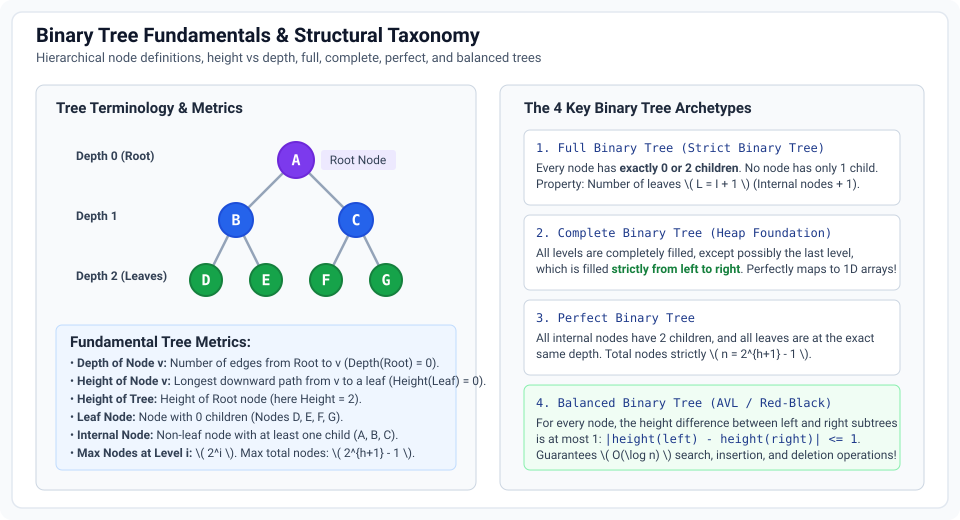
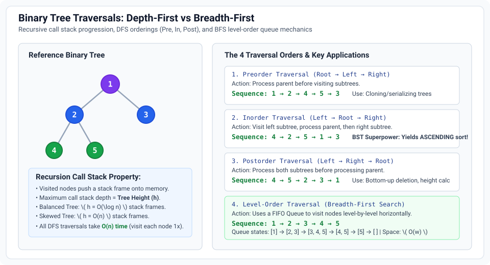
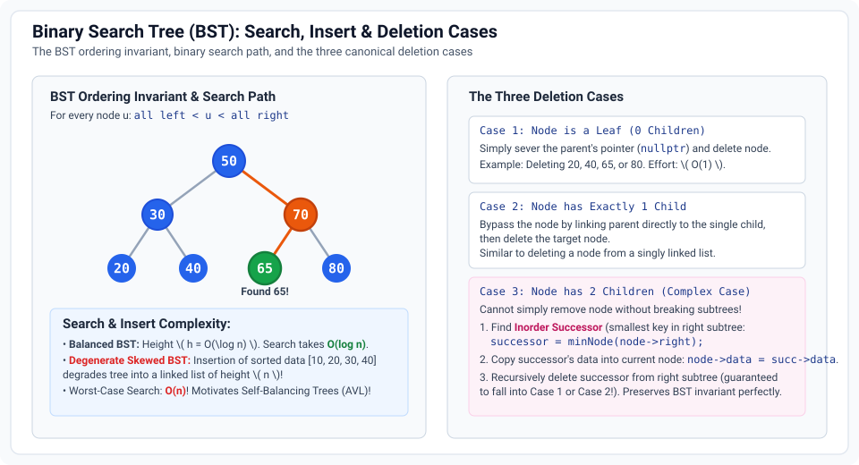
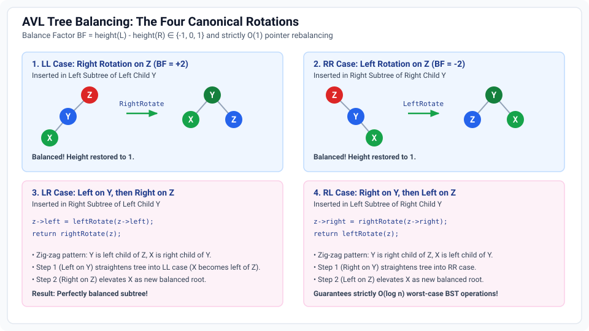

# Tree Data Structures & Algorithms in Modern C++17

A comprehensive, mathematically rigorous, and visual textbook-style guide to binary trees, binary search trees (BST), self-balancing AVL trees, binary heaps, and hierarchical traversals.

---

## Master Comparison Matrix: Tree Data Structures

| Data Structure | Search Time | Insert Time | Delete Time | Space Complexity | Balance Guarantee | Primary Use Case |
|---|---|---|---|---|---|---|
| **Binary Tree (General)** | $ O(n) $ | $ O(1) $ (given pointer) | $ O(n) $ | $ O(n) $ | None | Hierarchical representation, parse trees |
| **Binary Search Tree (BST)** | Avg: $ O(\log n) $, Worst: $ O(n) $ | Avg: $ O(\log n) $, Worst: $ O(n) $ | Avg: $ O(\log n) $, Worst: $ O(n) $ | $ O(n) $ | None (Can degenerate to linked list) | Dynamic set operations with ordered traversal |
| **AVL Tree** | Guaranteed $ \Theta(\log n) $ | Guaranteed $ \Theta(\log n) $ | Guaranteed $ \Theta(\log n) $ | $ O(n) $ | Strict: $ \|h_L - h_R\| \le 1 $ | Lookup-intensive databases and symbol tables |
| **Red-Black Tree** | Guaranteed $ \Theta(\log n) $ | Guaranteed $ \Theta(\log n) $ | Guaranteed $ \Theta(\log n) $ | $ O(n) $ | Relaxed balance | `std::map`, `std::set`, Linux kernel CFS |
| **Binary Heap (Max/Min)** | Find Min/Max: $ O(1) $, General: $ O(n) $ | $ O(\log n) $ | Extract: $ O(\log n) $ | $ O(n) $ | Complete binary tree shape | `std::priority_queue`, Dijkstra, Heap Sort |

---

# 1. Tree Fundamentals & Structural Taxonomy

A **Tree** is a non-linear, hierarchical data structure consisting of a collection of nodes connected by directed or undirected edges, with strictly **no cycles**.



### Definitions & Metrics
- **Root:** The topmost node with in-degree 0 (no parent).
- **Parent & Child:** If edge $ (u, v) $ exists directed from $ u $ to $ v $, $ u $ is the parent of $ v $, and $ v $ is a child of $ u $.
- **Leaf (External Node):** A node with 0 children.
- **Internal Node:** A node with at least one child.
- **Depth of Node $ v $:** The number of edges from the Root to $ v $. $ \text{Depth}(\text{Root}) = 0 $.
- **Height of Node $ v $:** The length of the longest downward path from $ v $ to any leaf. $ \text{Height}(\text{Leaf}) = 0 $.
- **Height of Tree:** The height of the Root node.
- **Maximum Nodes at Level $ i $:** $ 2^i $.
- **Maximum Total Nodes for Height $ h $:** $ \sum_{i=0}^h 2^i = 2^{h+1} - 1 $.

### The Four Binary Tree Archetypes
1. **Full Binary Tree:** Every node has either 0 or 2 children.
2. **Complete Binary Tree:** All levels are completely filled, except possibly the last level which is populated strictly from left to right. This structure maps directly to 1D arrays without pointer overhead.
3. **Perfect Binary Tree:** All internal nodes have 2 children, and all leaves are at the exact same depth. Total nodes $ n = 2^{h+1} - 1 $.
4. **Balanced Binary Tree:** For every node in the tree, $ |\text{height}(\text{left}) - \text{height}(\text{right})| \le 1 $. Guarantees $ O(\log n) $ tree height!

---

# 2. Tree Traversals



Tree traversal is the process of visiting each node in the tree exactly once.

### A. Preorder Traversal (Root → Left → Right)
- **Algorithm:** Visit Root, recursively traverse Left subtree, recursively traverse Right subtree.
- **Applications:** Creating a copy/clone of a tree; prefix expression evaluation.

### B. Inorder Traversal (Left → Root → Right)
- **Algorithm:** Recursively traverse Left subtree, visit Root, recursively traverse Right subtree.
- **The BST Superpower:** In a Binary Search Tree (BST), Inorder traversal visits keys in **strictly ascending sorted order**!

### C. Postorder Traversal (Left → Right → Root)
- **Algorithm:** Recursively traverse Left subtree, recursively traverse Right subtree, visit Root.
- **Applications:** Deleting a tree bottom-up (children must be freed before parent); computing tree size or directory disk usage; postfix expression evaluation.

### D. Level-Order Traversal (Breadth-First Search)
- **Algorithm:** Uses an auxiliary FIFO queue (`std::queue<Node*>`). Pushes root, then repeatedly pops a node, visits it, and pushes its left and right children into the queue.
- **Applications:** Level-by-level serialization; finding the shortest path or minimum depth.

### Recursion Call Stack Memory Derivation
Every recursive DFS traversal executes $ n $ function calls.
- **Balanced Tree:** Tree height $ h = \Theta(\log n) $. Maximum recursion stack frames held in RAM simultaneously: $ O(\log n) $.
- **Skewed Tree (Worst Case):** Tree height $ h = n $. Call stack depth is $ O(n) $, which can cause **Stack Overflow** on large degenerate inputs!

---

# 3. Binary Search Tree (BST)



A **Binary Search Tree** is a binary tree with the strict ordering property:
```math
\forall v \in \text{LeftSubtree}(u), \quad \text{key}(v) < \text{key}(u)
```
```math
\forall w \in \text{RightSubtree}(u), \quad \text{key}(w) > \text{key}(u)
```

### Search & Insertion: $ O(h) $
At each node, compare target key $ x $ with `curr->key`:
- If $ x == \text{curr->key} $, target found!
- If $ x < \text{curr->key} $, search Left subtree.
- If $ x > \text{curr->key} $, search Right subtree.

### Deletion in BST: The Three Cases
1. **Case 1: Node is a Leaf (0 Children):** Sever the parent's pointer to `nullptr` and call `delete node;`.
2. **Case 2: Node has 1 Child:** Bypass the node by pointing the parent directly to the single child, then deallocate the target node.
3. **Case 3: Node has 2 Children:**
   - Locate the **Inorder Successor** (the smallest key in the right subtree: `minNode(node->right)`).
   - Overwrite `node->data = successor->data`.
   - Recursively delete the successor from the right subtree (the successor is guaranteed to fall into Case 1 or Case 2!).

---

# 4. Self-Balancing Trees: AVL Rotations



An **AVL Tree** (Adelson-Velsky and Landis) is a self-balancing Binary Search Tree where the **Balance Factor (BF)** of every node is strictly maintained in the range $ \{-1, 0, 1\} $:
```math
\text{BF}(u) = \text{Height}(\text{LeftSubtree}(u)) - \text{Height}(\text{RightSubtree}(u))
```

If an insertion or deletion causes $ |\text{BF}(u)| > 1 $, balance is restored in strictly $ O(1) $ time using one of four rotations:

### 1. Left-Left (LL) Case: Single Right Rotation
- **Condition:** Node $ z $ has $ \text{BF} = +2 $, and left child $ y $ has $ \text{BF} \ge 0 $.
- **Fix:** `rightRotate(z)` elevates $ y $ to root, moving $ z $ to the right child of $ y $.

### 2. Right-Right (RR) Case: Single Left Rotation
- **Condition:** Node $ z $ has $ \text{BF} = -2 $, and right child $ y $ has $ \text{BF} \le 0 $.
- **Fix:** `leftRotate(z)` elevates $ y $ to root, moving $ z $ to the left child of $ y $.

### 3. Left-Right (LR) Case: Double Rotation
- **Condition:** Node $ z $ has $ \text{BF} = +2 $, but left child $ y $ has $ \text{BF} = -1 $.
- **Fix:** First `leftRotate(y)` on child to convert to LL case, then `rightRotate(z)`.

### 4. Right-Left (RL) Case: Double Rotation
- **Condition:** Node $ z $ has $ \text{BF} = -2 $, but right child $ y $ has $ \text{BF} = +1 $.
- **Fix:** First `rightRotate(y)` on child to convert to RR case, then `leftRotate(z)`.

---

# 5. Binary Heaps & Priority Queues

A **Binary Heap** is a complete binary tree stored inside a contiguous 1D array (`std::vector<int>`).

### Array Mapping Formulas
For a zero-indexed array:
```math
\text{Parent}(i) = \left\lfloor \frac{i - 1}{2} \right\rfloor, \quad \text{LeftChild}(i) = 2i + 1, \quad \text{RightChild}(i) = 2i + 2
```

### Bottom-Up Build Heap: Why $ O(n) $ and not $ O(n \log n) $?
Building a heap by inserting $ n $ elements one-by-one takes $ \sum_{i=1}^n \log i = O(n \log n) $.
However, **bottom-up heap construction** starts at the lowest non-leaf node ($ i = n/2 - 1 $) down to index 0:
```math
\text{Total Work} = \sum_{h=0}^{\lfloor \log n \rfloor} \frac{n}{2^{h+1}} \cdot O(h) = O\left( n \sum_{h=0}^{\infty} \frac{h}{2^h} \right)
```
Because the infinite series $ \sum_{h=0}^\infty \frac{h}{2^h} = 2 $, total work is bounded by:
```math
\text{Total Operations} \le 2n = O(n)
```
This is why building a heap takes **linear time**!
