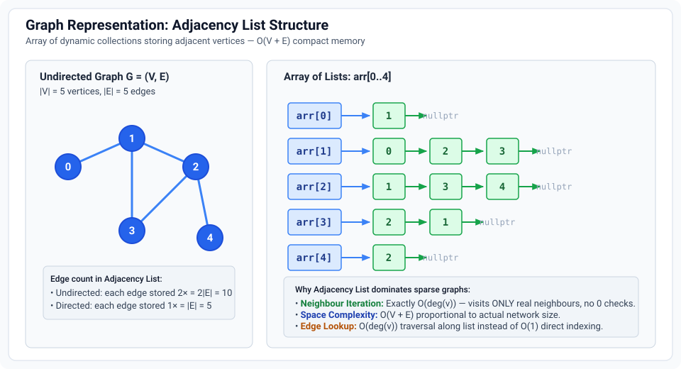
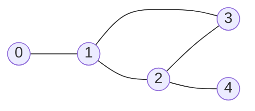
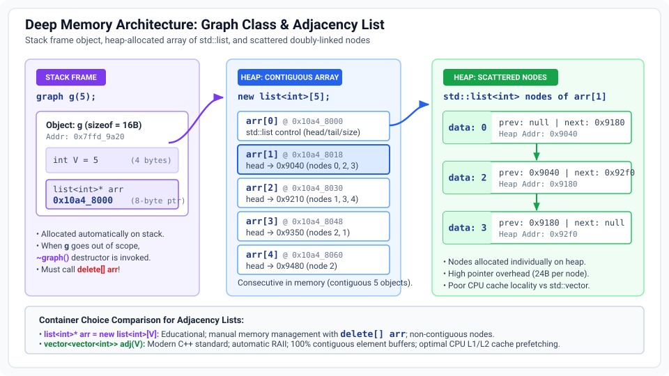
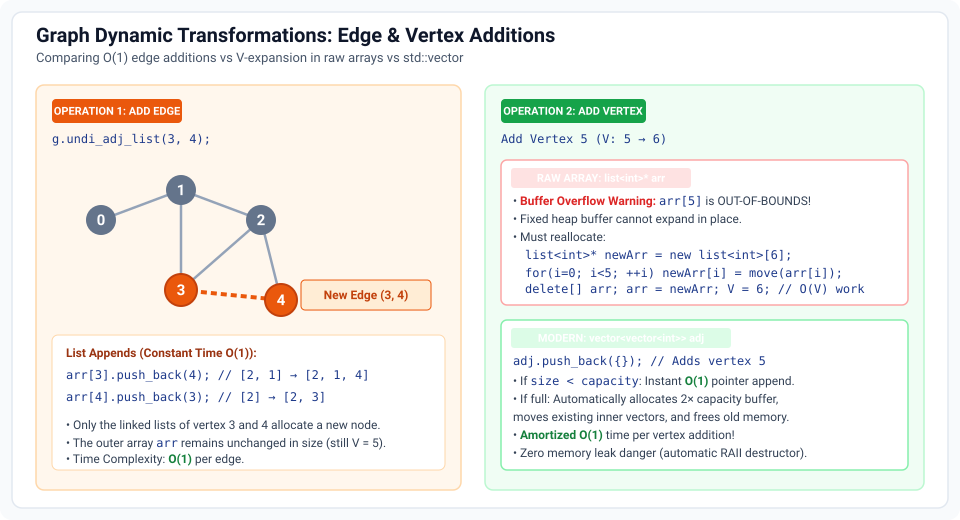

# Graph Representation Using an Adjacency List in C++

## Dynamic Memory, Pointers, `std::list`, Memory Layout, Insertion, Destruction, and Complexity

> A detailed learning note based on the graph class implementation using an array of `std::list<int>` objects.

---

## Table of Contents

1. [What are we trying to represent?](#1-what-are-we-trying-to-represent)
2. [Example graph](#2-example-graph)
3. [What is an adjacency list?](#3-what-is-an-adjacency-list)
4. [Understanding `std::list<int>`](#4-understanding-stdlistint)
5. [Understanding `list<int>* arr`](#5-understanding-listint-arr)
6. [Why do we use dynamic memory allocation?](#6-why-do-we-use-dynamic-memory-allocation)
7. [What happens in memory?](#7-what-happens-in-memory)
8. [How graph edges are inserted](#8-how-graph-edges-are-inserted)
9. [Printing the adjacency list](#9-printing-the-adjacency-list)
10. [Destructor and `delete[]`](#10-destructor-and-delete)
11. [Complete C++ implementation](#11-complete-c-implementation)
12. [Complexity analysis](#12-complexity-analysis)
13. [Important distinctions and common mistakes](#13-important-distinctions-and-common-mistakes)
14. [What if the graph size needs to increase?](#14-what-if-the-graph-size-needs-to-increase)
15. [Quick revision](#15-quick-revision)

---

# 1. What are we trying to represent?

A **graph** is a non-linear data structure made up of:

- **Vertices (V):** the nodes of the graph.
- **Edges (E):** the connections between vertices.

For example, a road network can be represented as a graph:

- Cities are vertices.
- Roads are edges.

In this note, we will represent a graph using an **adjacency list** in C++.

Our design is:

```cpp
list<int>* arr;
```

The idea is to create an array in which every position contains a linked list. Each linked list stores the neighbours of one vertex.

In other words:

```text
Array index  = Vertex
Linked list  = Neighbours of that vertex
```

---

# 2. Example graph

Consider this undirected graph with five vertices:

- Vertices: `0, 1, 2, 3, 4`
- Edges: `(0,1), (1,2), (2,3), (1,3), (2,4)`

## 2.1 Graph figure

The following diagram illustrates the 5-vertex undirected graph:





The connections are:

```text
0 -- 1
1 -- 2
2 -- 3
1 -- 3
2 -- 4
```

## 2.2 Adjacency list for this graph

Because the graph is **undirected**, every edge is stored in both endpoint lists.

| Vertex | Neighbours |
|---|---|
| 0 | 1 |
| 1 | 0, 2, 3 |
| 2 | 1, 3, 4 |
| 3 | 2, 1 |
| 4 | 2 |

The order of neighbours depends on the order in which edges are inserted. For example, vertex `3` has neighbours `2` and `1` because those edges were inserted in that order.

---

# 3. What is an adjacency list?

An adjacency list stores, for every vertex, the vertices directly connected to it.

For the example:

```text
arr[0] --> 1

arr[1] --> 0 --> 2 --> 3

arr[2] --> 1 --> 3 --> 4

arr[3] --> 2 --> 1

arr[4] --> 2
```

Think of it as an array of separate neighbour lists:

- `arr[0]` stores the neighbours of vertex 0.
- `arr[1]` stores the neighbours of vertex 1.
- `arr[2]` stores the neighbours of vertex 2.
- And so on.

The adjacency list is not one single linked list for the entire graph. It is a collection of lists, one for each vertex.

---

# 4. Understanding `std::list<int>`

Before understanding the pointer and dynamic allocation, understand the container itself.

## 4.1 What is `std::list`?

C++ provides a Standard Template Library (STL) container named `std::list`.

It is a sequence container generally implemented as a **doubly linked list**.

To use it:

```cpp
#include <list>
using namespace std;

list<int> numbers;
```

The `int` specifies the type of element stored in the list.

Examples:

```cpp
list<int> a;       // Stores integers
list<double> b;    // Stores double values
list<char> c;      // Stores characters
list<string> d;    // Stores strings
```

## 4.2 Why is it called a template?

`std::list` is a class template. A template allows a class to work with different data types.

Conceptually:

```cpp
list<int>       // A list whose elements are int
list<double>    // A list whose elements are double
```

The compiler creates the appropriate typed container when the template is instantiated.

For our graph, vertex identifiers are integers, so we use:

```cpp
list<int>
```

## 4.3 How is a doubly linked list node organised?

Conceptually, a node in a doubly linked list contains:

```text
+----------+--------+----------+
| Previous |  Data  |   Next   |
+----------+--------+----------+
```

For example, a list containing `10, 20, 30` can be visualised as:

```text
NULL <- [10] <-> [20] <-> [30] -> NULL
```

This is a conceptual explanation of the structure. The exact internal representation of `std::list` is an implementation detail of the C++ standard library.

## 4.4 Why use `std::list` for adjacency lists?

We frequently add neighbours to a vertex's list.

For example:

```cpp
arr[1].push_back(0);
arr[1].push_back(2);
arr[1].push_back(3);
```

`push_back()` appends an element to the end of the list.

For `std::list`, insertion at the end is constant time, \(O(1)\), assuming the usual container operation and excluding allocator overhead.

A list also grows as elements are inserted. We do not need to specify the maximum number of neighbours in advance.

**Important:** `std::list` is not the only possible adjacency-list container. `vector<int>` is also widely used. The choice depends on the operations and performance requirements.

---

# 5. Understanding `list<int>* arr`

This declaration is central to our implementation:

```cpp
list<int>* arr;
```

Break it into parts:

| Part | Meaning |
|---|---|
| `list<int>` | A list whose elements are integers |
| `*` | Declares a pointer |
| `arr` | Name of the pointer variable |

So:

```cpp
list<int>* arr;
```

means:

**`arr` is a pointer to a `list<int>` object.**

A pointer stores an address. It does not, by this declaration alone, allocate an array of lists.

At this point, `arr` is only a pointer variable. It must be made to point to valid list object(s) before we use it.

## 5.1 Why does this pointer suit our graph?

We want an array of lists, not just one list.

We can allocate that array dynamically:

```cpp
arr = new list<int>[V];
```

If `V = 5`, this creates an array of five `list<int>` objects.

Conceptually:

```text
                 arr
                  |
                  v
       +--------+--------+--------+--------+--------+
       | arr[0] | arr[1] | arr[2] | arr[3] | arr[4] |
       +--------+--------+--------+--------+--------+
          list     list     list     list     list
```

Every array element is a complete `list<int>` object.

Each list object can independently store zero, one, or many neighbours.

## 5.2 Compare the three declarations

### A. One list object

```cpp
list<int> arr;
```

Creates one list object. It is not an array of per-vertex lists.

### B. Fixed-size array of lists

```cpp
list<int> arr[5];
```

Creates five list objects with automatic storage duration if declared as a local variable (or static storage duration if declared at namespace scope or `static`).

The size is fixed in the declaration.

### C. Pointer to a dynamically allocated array of lists

```cpp
list<int>* arr;
arr = new list<int>[5];
```

Creates five list objects dynamically. The number of list objects can be chosen at runtime.

This is the approach used in our class.

---

# 6. Why do we use dynamic memory allocation?

This is the main reason for using `new` in our graph class.

## 6.1 The number of vertices may be known only at runtime

Suppose the user enters the number of vertices:

```cpp
int vertices;
cin >> vertices;
```

The number might be:

- 5 in one execution.
- 20 in another execution.
- 1,000 in another execution.

We want to create exactly that many adjacency lists.

Dynamic allocation allows us to use a runtime value:

```cpp
arr = new list<int>[vertices];
```

The array size does not have to be written as a fixed compile-time constant in the source code.

## 6.2 Fixed-size array versus dynamic array

| Fixed-size array | Dynamic array |
|---|---|
| Size specified in the declaration | Size can be supplied at runtime |
| Example: `list<int> arr[5]` | Example: `new list<int>[V]` |
| Number of elements cannot be changed after creation | Number of elements also cannot be changed in place after creation |
| Automatic storage duration for a local non-static array | Dynamic storage duration |
| Automatically destroyed when its scope ends | Must be released with `delete[]` when using raw `new[]` |

**Important clarification:** Dynamic allocation does not mean that the array automatically grows whenever more vertices are added.

For example, if you allocate:

```cpp
arr = new list<int>[5];
```

you have space for exactly five list objects. You cannot safely access `arr[5]`.

To increase the number of vertices, you need to allocate a larger array and transfer the existing adjacency lists, or use a resizable container such as `vector`.

## 6.3 Why not use a fixed array?

This is valid:

```cpp
list<int> arr[5];
```

But it fixes the number of vertices at five in the declaration.

In a reusable graph class, we generally want the caller to decide the number of vertices when creating the graph:

```cpp
graph g(5);
graph anotherGraph(100);
```

That is why runtime-sized dynamic allocation is useful.

---

# 7. What happens in memory?

Let's understand the memory model conceptually.

Consider:

```cpp
graph g(5);
```

The graph object contains:

```cpp
int V;
list<int>* arr;
```

The object stores the vertex count and a pointer. The dynamically allocated array of list objects is separate from the graph object.

## 7.1 Before dynamic allocation

When the pointer is declared:

```cpp
list<int>* arr;
```

it is just a pointer variable. It does not automatically create the five list objects.

## 7.2 After dynamic allocation

When this executes:

```cpp
arr = new list<int>[5];
```

C++:

1. Requests storage sufficient for five `list<int>` objects.
2. Constructs five list objects in that storage.
3. Returns a pointer to the first object.
4. Stores that pointer in `arr`.

Conceptual picture:

```text
Graph object
+-----------------------+
| V   = 5               |
| arr = address --------|-------------------+
+-----------------------+                   |
                                            v
                              Dynamically allocated array
                         +---------+---------+---------+---------+---------+
                         | list[0] | list[1] | list[2] | list[3] | list[4] |
                         +---------+---------+---------+---------+---------+
```



The array's storage is contiguous: its five `list<int>` objects are arranged consecutively in memory.

However, the linked-list nodes managed by those list objects are separately allocated as needed. They are not necessarily adjacent to each other or to the array.

## 7.3 After inserting edges

Suppose we insert:

```cpp
arr[0].push_back(1);
arr[1].push_back(0);
arr[1].push_back(2);
```

Conceptually:

```text
Array of list objects
+---------+---------+---------+---------+---------+
| list[0] | list[1] | list[2] | list[3] | list[4] |
+---------+---------+---------+---------+---------+
     |         |
     v         v
   [1]       [0] <-> [2]
```

The actual nodes are managed internally by the corresponding `std::list` objects.

The array stores the list objects; the list objects manage their own elements.

---

# 8. How graph edges are inserted

We need to distinguish undirected and directed graphs.

## 8.1 Undirected graph

For an undirected edge between `x` and `y`, both vertices are neighbours of each other.

```cpp
void undi_adj_list(int x, int y)
{
    arr[x].push_back(y);
    arr[y].push_back(x);
}
```

For example:

```cpp
undi_adj_list(0, 1);
```

Performs:

```cpp
arr[0].push_back(1);
arr[1].push_back(0);
```

The resulting entries are:

```text
arr[0] --> 1
arr[1] --> 0
```

Each undirected edge contributes two adjacency entries, except that a self-loop may be represented differently depending on the graph convention.

## 8.2 Directed graph

For a directed edge from `x` to `y`, we add only the outgoing neighbour to the source vertex.

```cpp
void Di_adj_list(int x, int y)
{
    arr[x].push_back(y);
}
```

For example:

```cpp
Di_adj_list(0, 1);
```

Produces:

```text
arr[0] --> 1
arr[1] --> empty
```

We do not automatically insert the reverse entry.

## 8.3 One graph class, two insertion methods

The class can provide both methods, but use one consistent graph interpretation for a particular graph. Do not accidentally mix directed and undirected edge insertion unless that is explicitly intended.

---

# 9. Printing the adjacency list

Our function:

```cpp
void print_adjlist()
{
    for (int i = 0; i < V; i++)
    {
        cout << i << " --> ";

        for (int j : arr[i])
        {
            cout << j << " ";
        }

        cout << endl;
    }
}
```

The outer loop:

```cpp
for (int i = 0; i < V; i++)
```

visits each vertex.

The inner range-based loop:

```cpp
for (int j : arr[i])
```

visits every neighbour stored in that vertex's list.

For example, if:

```text
arr[1] contains 0, 2, 3
```

the inner loop prints:

```text
1 --> 0 2 3
```

---

# 10. Destructor and `delete[]`

This section connects dynamic allocation with memory cleanup.

We allocated the array using:

```cpp
arr = new list<int>[V];
```

Therefore, we must release it using:

```cpp
delete[] arr;
```

## 10.1 Why do we need a destructor?

A destructor is a special member function that is automatically called when an object is destroyed.

For our graph class:

```cpp
~graph()
{
    delete[] arr;
}
```

When the graph object goes out of scope, its destructor releases the dynamically allocated array.

## 10.2 What exactly does `delete[] arr` do?

Remember that `arr` points to an array of `V` list objects.

When `delete[] arr` is executed, C++:

1. Calls the destructor of each list object in the array.
2. The list destructors release the nodes managed by their respective lists.
3. Releases the storage occupied by the array of list objects.

Conceptually, if `V = 5`:

```text
delete[] arr
     |
     +--> Destroy arr[4] and its list nodes
     +--> Destroy arr[3] and its list nodes
     +--> Destroy arr[2] and its list nodes
     +--> Destroy arr[1] and its list nodes
     +--> Destroy arr[0] and its list nodes
     |
     +--> Release the array storage
```

Array elements are destroyed in reverse order.

**You do not manually delete the internal nodes of `std::list`.** The container manages its own resources.

## 10.3 Why not simply write `delete arr`?

Because the allocation used `new[]`, not `new`.

Correct pairing:

| Allocation | Correct release |
|---|---|
| `new int` | `delete ptr` |
| `new int[5]` | `delete[] ptr` |
| `new list<int>` | `delete ptr` |
| `new list<int>[5]` | `delete[] ptr` |

Using the wrong form results in undefined behaviour.

## 10.4 What if we do not release the array?

If the graph object is destroyed but its dynamically allocated array is not released, the pointer member disappears while the allocated memory remains unreleased.

This causes a memory leak.

---

# 11. Complete C++ implementation

This implementation follows the original class design and adds a destructor.

```cpp
#include <iostream>
#include <list>
using namespace std;

class graph
{
    int V;
    list<int>* arr;

public:

    // Constructor
    graph(int V)
    {
        this->V = V;
        arr = new list<int>[V];
    }

    // Undirected graph
    void undi_adj_list(int x, int y)
    {
        arr[x].push_back(y);
        arr[y].push_back(x);
    }

    // Directed graph
    void Di_adj_list(int x, int y)
    {
        arr[x].push_back(y);
    }

    // Print adjacency list
    void print_adjlist()
    {
        for (int i = 0; i < V; i++)
        {
            cout << i << " --> ";

            for (int j : arr[i])
            {
                cout << j << " ";
            }

            cout << endl;
        }
    }

    // Destructor
    ~graph()
    {
        delete[] arr;
    }
};

int main()
{
    graph g(5);

    g.undi_adj_list(0, 1);
    g.undi_adj_list(1, 2);
    g.undi_adj_list(2, 3);
    g.undi_adj_list(3, 1);
    g.undi_adj_list(2, 4);

    g.print_adjlist();

    return 0;
}
```

## 11.1 Expected output

```text
0 --> 1
1 --> 0 2 3
2 --> 1 3 4
3 --> 2 1
4 --> 2
```

## 11.2 Important note about copying this class

This raw-pointer implementation owns dynamically allocated memory.

The compiler-generated copy constructor and copy-assignment operator copy the pointer address, not the allocated array itself. That is called a shallow copy.

If two graph objects end up owning the same `arr`, both destructors may try to delete it. That causes undefined behaviour.

For a production-quality raw-pointer class, copy and move operations must be designed correctly (the Rule of Three/Five). For learning this adjacency-list implementation, avoid copying graph objects.

---

# 12. Complexity analysis

Let:

- \(V\) = Number of vertices.
- \(E\) = Number of edges.

## 12.1 Constructor

```cpp
arr = new list<int>[V];
```

Creates `V` list objects.

Time complexity: \(O(V)\), because the array elements must be constructed.

## 12.2 Inserting an undirected edge

```cpp
arr[x].push_back(y);
arr[y].push_back(x);
```

Two list insertions occur.

Each `push_back()` is \(O(1)\) for `std::list`.

Therefore:

\[
O(1)+O(1)=O(1)
\]

## 12.3 Inserting a directed edge

```cpp
arr[x].push_back(y);
```

One insertion:

\[
O(1)
\]

## 12.4 Printing the entire adjacency list

The outer loop visits all vertices: \(O(V)\).

The inner loops collectively visit every adjacency entry.

- Directed graph: \(E\) entries.
- Undirected graph: \(2E\) entries, assuming no special self-loop convention.

Therefore:

\[
O(V+E)
\]

## 12.5 Space complexity

The array contains `V` list objects.

The lists collectively store:

- `E` entries for a directed graph.
- `2E` entries for an undirected graph (under the usual representation).

Therefore:

\[
\boxed{O(V+E)}
\]

The asymptotic space complexity is \(O(V+E)\).

---

# 13. Important distinctions and common mistakes

## 13.1 Does dynamic memory mean the array grows automatically?

No.

```cpp
arr = new list<int>[5];
```

creates exactly five list objects.

It does not automatically become six when you add a sixth vertex.

## 13.2 Does each list have a fixed capacity?

No.

Each `std::list<int>` can grow as elements are inserted. The array of list objects has a fixed number of positions, but each list can store a varying number of neighbours.

This is a key distinction:

- Number of vertices: fixed by the allocated array size.
- Number of neighbours per vertex: can grow as edges are added.

## 13.3 Is `arr` itself a linked list?

No.

`arr` is a pointer to the first object in an array of list objects.

## 13.4 Does `delete[] arr` delete only the first list?

No.

It destroys all `V` list objects in the array and releases the array storage. Each list destructor cleans up its own internal nodes.

## 13.5 Is `std::list` the same as a raw linked list implementation?

No.

`std::list` is an STL container that manages its own memory and operations. You do not need to define your own `Node` class or manually maintain `next` and `prev` pointers.

---

# 14. What if the graph size needs to increase?

This is a very important design question.

Suppose the graph initially has five vertices:

```cpp
graph g(5);
```

Later, you want to add a sixth vertex.

Can we simply do this?

```cpp
arr[5].push_back(2);
```

**No.** `arr[5]` is outside the allocated array. The valid indices are `0` through `4`.

## 14.1 How can a raw dynamic array be enlarged?

A dynamically allocated array cannot be resized in place using `new[]`.

The general process is:

1. Allocate a new, larger array.
2. Copy or move the existing list objects into it.
3. Release the old array.
4. Make the pointer refer to the new array.
5. Update the vertex count.

Conceptual example: increasing from 5 vertices to 6.

```text
BEFORE

arr
 |
 v
+----+----+----+----+----+
|  0 |  1 |  2 |  3 |  4 |
+----+----+----+----+----+


ALLOCATE A NEW ARRAY

newArr
  |
  v
+----+----+----+----+----+----+
|    |    |    |    |    |    |
+----+----+----+----+----+----+


TRANSFER THE EXISTING LISTS

newArr
  |
  v
+----+----+----+----+----+----+
|  0 |  1 |  2 |  3 |  4 |    |
+----+----+----+----+----+----+


RELEASE OLD ARRAY AND UPDATE POINTER

arr = newArr

Now arr refers to the six-element array.
```



This is a conceptual illustration. A correct raw-pointer implementation must also handle copying/moving and exceptions safely.

## 14.2 Is there an easier approach?

Yes. C++ provides `std::vector`.

Instead of:

```cpp
list<int>* arr;
arr = new list<int>[V];
```

we can use:

```cpp
vector<list<int>> arr;
```

Then:

```cpp
arr.resize(V);
```

To add another vertex:

```cpp
arr.push_back(list<int>());
```

The vector automatically manages its internal array storage.

The existing `std::list` objects are moved or copied as necessary when the vector reallocates.

## 14.3 Raw array versus vector

| Feature | `list<int>* arr` + `new[]` | `vector<list<int>> arr` |
|---|---|---|
| Runtime initial size | Yes | Yes |
| Automatically resizable | No | Yes |
| Manual `delete[]` needed | Yes | No |
| Owns list objects | Yes | Yes |
| Memory management | Manual array management | Automatic |
| Useful for learning pointers | Yes | Yes |

**Why learn the raw-pointer version?**

It helps you understand:

- Pointers.
- Dynamic allocation.
- Heap memory.
- Arrays of objects.
- Constructors and destructors.
- Memory leaks.
- Ownership.

Even if you later use `vector`, these concepts help you understand what containers are doing for you.

---

# 15. Quick revision

## The complete concept in one diagram

```text
                         GRAPH
                           |
                           |
                 Number of vertices (V)
                           |
                           v
                    list<int>* arr
                           |
                           v
                new list<int>[V]
                           |
                           v
                Array of V list objects
                           |
             +-------------+-------------+
             |             |             |
             v             v             v
          arr[0]         arr[1]         arr[2] ...
             |             |
             v             v
          Neighbours    Neighbours
             |             |
             v             v
          List nodes    List nodes
```

## Remember these statements

| Expression | Meaning |
|---|---|
| `list<int>` | STL doubly linked-list container of integers |
| `list<int>* arr` | Pointer to a list object |
| `new list<int>[V]` | Dynamically creates an array of V list objects |
| `arr[i]` | The list belonging to vertex i |
| `arr[i].push_back(j)` | Adds vertex j to vertex i's neighbour list |
| `delete[] arr` | Destroys all array elements and releases the array storage |
| `~graph()` | Graph destructor |
| `vector<list<int>>` | Resizable array of list objects |

## Final mental model

Think about the graph in three levels:

1. **Graph level:** We have `V` vertices.
2. **Array level:** We create `V` list objects, one for each vertex.
3. **Linked-list level:** Every list stores the neighbouring vertices of its corresponding vertex.

The reason for using dynamic allocation is that the number of vertices can be provided at runtime. The reason for using `std::list` is that each vertex can have a varying number of neighbours.

And remember:

> The dynamically allocated array has a fixed size after allocation, but each individual `std::list` can grow as edges are inserted. If the number of vertices must grow, resize the overall structure (or use `vector<list<int>>`).

---
