# Graph Theory & Graphs in Data Structures and Algorithms (DSA)

## Complete Beginner-to-Intermediate Notes in C++

> A structured reference covering graph terminology, mathematical properties, graph types, representations, traversals, complexity, and common exam concepts.

---

## Table of Contents

1. [What is a Graph?](#1-what-is-a-graph)
2. [Basic Graph Notation](#2-basic-graph-notation)
3. [Fundamental Graph Terminology](#3-fundamental-graph-terminology)
4. [Degree of a Vertex](#4-degree-of-a-vertex)
5. [Types of Graphs](#5-types-of-graphs)
6. [Paths, Walks, Trails, and Cycles](#6-paths-walks-trails-and-cycles)
7. [Connectivity](#7-connectivity)
8. [Special Graphs](#8-special-graphs)
9. [Subgraphs and Graph Operations](#9-subgraphs-and-graph-operations)
10. [Trees as Graphs](#10-trees-as-graphs)
11. [Graph Representation in C++](#11-graph-representation-in-c)
12. [Graph Traversal](#12-graph-traversal)
13. [Important Graph Properties and Formulas](#13-important-graph-properties-and-formulas)
14. [Time and Space Complexity](#14-time-and-space-complexity)
15. [Common Exam Traps](#15-common-exam-traps)
16. [Quick Revision Sheet](#16-quick-revision-sheet)
17. [Practice Questions](#17-practice-questions)

---

# 1. What is a Graph?

A **graph** is a non‑linear data structure consisting of a collection of vertices and edges.

A graph is mathematically represented as:

$$
G = (V,E)
$$

Where:

- $G$ = Graph
- $V$ = Set of vertices
- $E$ = Set of edges

Example:

$$
V = {0,1,2,3,4}
$$

$$
E = {{0,1},{1,2},{1,3},{2,3},{2,4}}
$$

Here:

- There are 5 vertices.
- There are 5 edges.

## 1.1 Graph figure

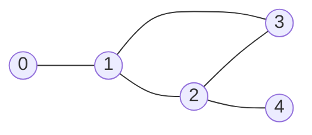

A graph is useful for representing relationships:

| Application | Vertices | Edges |
|---|---|---|
| Social network | People | Friend/follow relationships |
| Road network | Cities | Roads |
| Computer network | Computers/routers | Network connections |
| Web graph | Web pages | Hyperlinks |
| Course prerequisites | Courses | Prerequisite relationships |
| Airline network | Airports | Flight connections |

---

# 2. Basic Graph Notation

| Symbol | Meaning |
|---|---|
| $G$ | A graph |
| $V$ | Set of vertices |
| $E$ | Set of edges |
| $|V|$ | Number of vertices |
| $|E|$ | Number of edges |
| $u,v$ | Common names for vertices |
| $(u,v)$ | Directed edge from $u$ to $v$ |
| ${u,v}$ | Undirected edge between $u$ and $v$ |
| $\deg(v)$ | Degree of vertex $v$ |
| $N(v)$ | Neighbour set of vertex $v$ |
| $w(u,v)$ | Weight of edge between $u$ and $v$ |

**Notation note:** Textbooks may use slightly different conventions, especially for directed edges and paths. Always follow the notation defined in your course.

---

# 3. Fundamental Graph Terminology

## 3.1 Vertex (Node)

A **vertex** is an individual point or entity in a graph.

Example:

```text
        (A) -------- (B)
```

A and B are vertices.

Other names:

- Vertex: singular
- Vertices: plural
- Node: commonly used in programming

## 3.2 Edge

An **edge** represents a connection between two vertices.

```text
(A) -------- (B)
```

The line connecting A and B is an edge.

An edge can be:

- Undirected: no direction.
- Directed: has a direction.

## 3.3 Adjacent Vertices

Two vertices are **adjacent** if an edge directly connects them.

```text
(A) -------- (B) -------- (C)
```

- A and B are adjacent.
- B and C are adjacent.
- A and C are not adjacent.

## 3.4 Neighbour

If two vertices are adjacent, each is called a neighbour of the other in an undirected graph.

For a directed graph, terminology is directional:

- Out‑neighbour of $u$: a vertex $v$ such that $u \to v$.
- In‑neighbour of $v$: a vertex $u$ such that $u \to v$.

## 3.5 Incident Edge

An edge is **incident** on a vertex if the vertex is one of its endpoints.

For edge ${A,B}$:

- The edge is incident on A.
- The edge is incident on B.

## 3.6 Endpoint

The vertices connected by an edge are its **endpoints**.

For edge A—B, A and B are the endpoints.

## 3.7 Self‑loop

A **self‑loop** is an edge that connects a vertex to itself.

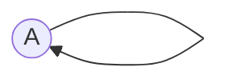

In an undirected graph, a self‑loop contributes $2$ to the degree of its vertex under the standard degree convention.

In a directed graph, it contributes $1$ to both in‑degree and out‑degree.

## 3.8 Parallel Edges

Two or more edges connecting the same pair of vertices are called **parallel edges** (also called multiple edges).

```text
        ========
(A) ---        --- (B)
        ========
```

A graph that permits parallel edges is a **multigraph**.

## 3.9 Isolated Vertex

A vertex with degree zero is called an **isolated vertex**.

```text
(A) -------- (B)       (C)
```

C is isolated.

## 3.10 Pendant Vertex (Leaf Vertex)

A vertex with degree one is called a **pendant vertex** or **leaf vertex**.

```text
(A) -------- (B) -------- (C)
```

If this is the entire graph, A and C are pendant vertices.

In trees, a leaf is a vertex of degree one (for a tree with at least two vertices).

## 3.11 Weighted Edge

An edge with an associated numerical value is called a **weighted edge**.

The value may represent:

- Distance
- Cost
- Time
- Capacity

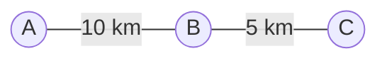

The weight is $10$ on edge A—B and $5$ on edge B—C.

## 3.12 Unweighted Graph

A graph in which edges do not carry explicit weights is called an **unweighted graph**.

---

# 4. Degree of a Vertex

Degree describes how many edge‑ends are incident on a vertex.

## 4.1 Degree in an undirected graph

The **degree** of a vertex $v$, written $\deg(v)$, is the number of incident edge‑ends.

Example:

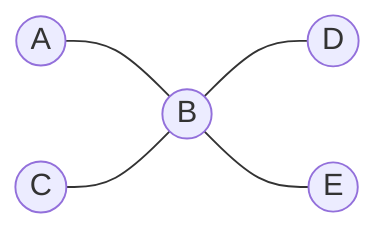

Vertex B has four incident edges.

$$\deg(B)=4$$

The sum of degrees in an undirected graph is:

$$\boxed{\sum_{v\in V}\deg(v)=2|E|}$$

This is called the **handshaking lemma**.

Why $2E$?

Every ordinary undirected edge has two endpoints, so it contributes one to the degree of each endpoint. A self‑loop contributes two to the degree of its single endpoint.

### Example

If a graph has $5$ undirected edges:

$$\sum \deg(v)=2\times5=10$$

The sum of all vertex degrees must be $10$.

## 4.2 In‑degree in a directed graph

The **in‑degree** of a vertex is the number of directed edges entering it.

Notation:

$$\deg^{-}(v)$$

Example:

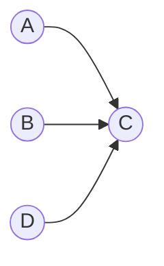

C has three incoming edges:

$$\deg^{-}(C)=3$$

## 4.3 Out‑degree in a directed graph

The **out‑degree** of a vertex is the number of directed edges leaving it.

Notation:

$$\deg^{+}(v)$$

For the same graph:

$$\deg^{+}(A)=1$$

## 4.4 Directed handshaking lemma

For a directed graph:

$$\boxed{\sum_{v\in V}\deg^{-}(v)=|E|}$$

$$\boxed{\sum_{v\in V}\deg^{+}(v)=|E|}$$

Every directed edge has exactly one source and one destination.

Therefore:

$$\sum \deg^{-}(v)=\sum \deg^{+}(v)=|E|$$

## 4.5 Important degree distinctions

| Graph type | Degree concept |
|---|---|
| Undirected graph | Degree |
| Directed graph | In‑degree and out‑degree |
| Directed self‑loop | Adds $1$ to in‑degree and $1$ to out‑degree |
| Undirected self‑loop | Adds $2$ to degree |

---

# 5. Types of Graphs

## 5.1 Undirected Graph

An undirected graph has edges without direction.

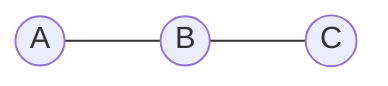

If A is connected to B, B is also connected to A.

In an adjacency list, an ordinary undirected edge ${u,v}$ is normally stored twice:

```cpp
adj[u].push_back(v);
adj[v].push_back(u);
```

## 5.2 Directed Graph (Digraph)

A directed graph has edges with directions.

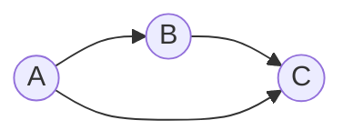

A directed edge from A to B does not automatically imply an edge from B to A.

Adjacency‑list insertion:

```cpp
adj[u].push_back(v);
```

## 5.3 Weighted Graph

Edges have numerical weights.

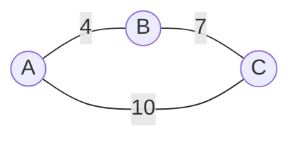

A weighted graph can be directed or undirected.

A common C++ representation is:

```cpp
vector<vector<pair<int,int>>> adj(V);
```

Here, each pair can store:

```
(neighbour, weight)
```

## 5.4 Unweighted Graph

Edges have no explicit numerical weight. In many shortest‑path problems, each edge is treated as having equal cost.

## 5.5 Simple Graph

A **simple graph** is an undirected graph with:

- No self‑loops.
- No parallel edges.

## 5.6 Multigraph

A multigraph permits multiple edges between the same pair of vertices.

## 5.7 Pseudograph

In a common graph‑theory convention, a pseudograph permits self‑loops and may permit parallel edges. Terminology can vary across books.

## 5.8 Complete Graph

A **complete graph** is a simple undirected graph in which every pair of distinct vertices is connected by an edge.

Notation:

$$K_n$$

Number of edges:

$$\boxed{|E|=\frac{n(n-1)}{2}}$$

Examples:

| Complete graph | Vertices | Edges |
|---|---:|---:|
| $K_1$ | 1 | 0 |
| $K_2$ | 2 | 1 |
| $K_3$ | 3 | 3 |
| $K_4$ | 4 | 6 |
| $K_5$ | 5 | 10 |

## 5.9 Null Graph / Empty Graph

A graph with vertices but no edges is often called an **empty graph** or **edgeless graph**.

For example:

$$V=\{0,1,2,3\},\quad E=\varnothing$$

Every vertex is isolated.

Some textbooks use the term null graph differently, so follow your course definition.

## 5.10 Regular Graph

An undirected graph is **$k$‑regular** if every vertex has degree $k$.

Examples:

- $0$‑regular: every vertex has degree zero.
- $2$‑regular: every vertex has degree two.
- $3$‑regular: every vertex has degree three.

For a $k$‑regular graph:

$$\sum \deg(v)=nk=2E$$

Thus:

$$\boxed{E=\frac{nk}{2}}$$

## 5.11 Bipartite Graph

A graph is **bipartite** if its vertices can be divided into two disjoint sets $U$ and $W$, such that every edge connects a vertex in $U$ to a vertex in $W$.

There are no edges between two vertices within the same set.

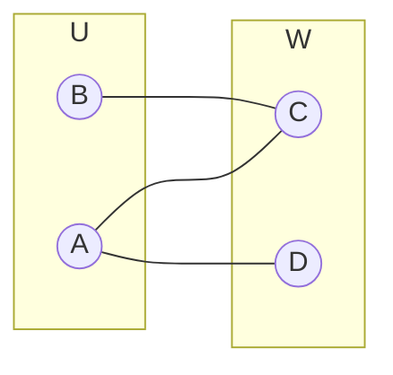

A graph is bipartite if and only if it contains no odd‑length cycle.

## 5.12 Complete Bipartite Graph

A complete bipartite graph connects every vertex in one partition to every vertex in the other partition.

Notation:

$$K_{m,n}$$

Number of edges:

$$\boxed{E=mn}$$

## 5.13 Cyclic Graph

A graph containing at least one cycle is called a cyclic graph.

## 5.14 Acyclic Graph

A graph with no cycles is called an acyclic graph.

A connected, undirected, acyclic graph is a **tree**.

A directed acyclic graph is called a **DAG**.

## 5.15 Directed Acyclic Graph (DAG)

A DAG is a directed graph containing no directed cycle.

DAGs are useful for:

- Task scheduling.
- Course prerequisites.
- Dependency management.
- Build systems.

A DAG has at least one topological ordering.

---

# 6. Paths, Walks, Trails, and Cycles

These terms are related but should not be treated as interchangeable.

## 6.1 Walk

A **walk** is a sequence of vertices in which every consecutive pair is connected by an edge.

Vertices and edges may be repeated.

Example:

```text
A -> B -> C -> B -> D
```

This is a walk if all those edges exist.

## 6.2 Trail

A **trail** is a walk in which no edge is repeated.

Vertices may repeat.

## 6.3 Path

A **simple path** is a walk in which no vertex is repeated.

Example:

```text
A -> B -> C -> D
```

No vertex is repeated.

Some introductory materials use "path" more broadly. The distinction between a walk and a simple path is important in formal graph theory.

## 6.4 Path Length

The length of a path is the number of edges in it.

Example:

```text
A -- B -- C -- D
```

Number of edges = 3.

Therefore, path length = 3.

For weighted graphs, the **total path weight** is the sum of the weights of its edges. Do not confuse path length (edge count) with total weight.

## 6.5 Cycle

A cycle is a closed path: it starts and ends at the same vertex, with no repeated vertices other than the start/end in a simple cycle.

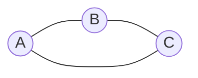

This is a cycle of length 3.

## 6.6 Directed Cycle

A directed cycle follows the direction of every edge and returns to its starting vertex.

## 6.7 Acyclic

A graph is acyclic if it contains no cycles (for directed graphs, specify whether directed cycles are meant).

## 6.8 Reachability

A vertex $v$ is reachable from $u$ if there is a path from $u$ to $v$.

In a directed graph, reachability is directional.

If $u$ can reach $v$, it does not necessarily mean $v$ can reach $u$.

---

# 7. Connectivity

## 7.1 Connected Undirected Graph

An undirected graph is connected if there is a path between every pair of vertices.

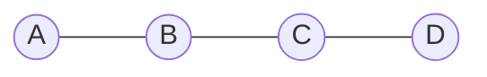

Every vertex is reachable from every other vertex.

## 7.2 Disconnected Graph

An undirected graph is disconnected if at least one pair of vertices has no path connecting them.

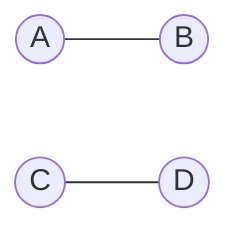

There is no path from A to C.

## 7.3 Connected Component

A **connected component** is a maximal connected subgraph of an undirected graph.

The disconnected graph above has two connected components:

- Component 1: A, B
- Component 2: C, D

An isolated vertex forms a component by itself.

## 7.4 Strongly Connected Directed Graph

A directed graph is strongly connected if every vertex can reach every other vertex following directed edges.

## 7.5 Weakly Connected Directed Graph

A directed graph is weakly connected if replacing every directed edge with an undirected edge produces a connected undirected graph.

## 7.6 Bridge (Cut Edge)

A bridge is an edge whose removal increases the number of connected components in an undirected graph.

Example:

```text
A --- B --- C
```

The edge B—C is a bridge. Removing it disconnects C from A and B.

## 7.7 Articulation Point (Cut Vertex)

An articulation point is a vertex whose removal (along with its incident edges) increases the number of connected components.

Example:

```text
A --- B --- C
```

B is an articulation point.

---

# 8. Special Graphs

## 8.1 Tree

A tree is a connected, undirected, acyclic graph.

For a tree with $V$ vertices:

$$\boxed{E=V-1}$$

A tree with at least two vertices has at least two leaves.

## 8.2 Forest

A forest is an undirected acyclic graph. It may be disconnected.

Each connected component of a forest is a tree.

If a forest has $V$ vertices and $C$ connected components:

$$\boxed{E=V-C}$$

## 8.3 Spanning Tree

A spanning tree of a connected, undirected graph is a subgraph that:

- Contains every vertex.
- Is connected.
- Has no cycles.

A spanning tree on $V$ vertices contains:

$$V-1$$

edges.

## 8.4 Minimum Spanning Tree (MST)

For a connected, weighted, undirected graph, a minimum spanning tree is a spanning tree with minimum possible total edge weight.

Common algorithms:

- Prim's algorithm.
- Kruskal's algorithm.

## 8.5 Directed Tree / Arborescence

A directed tree has a specified root and directed edges arranged so that the root reaches the other vertices (for an out‑arborescence). Definitions should specify edge orientation.

---

# 9. Subgraphs and Graph Operations

## 9.1 Subgraph

A graph $H$ is a subgraph of graph $G$ if its vertices and edges are taken from $G$.

## 9.2 Spanning Subgraph

A spanning subgraph contains all vertices of the original graph, but may contain fewer edges.

A spanning tree is one example.

## 9.3 Induced Subgraph

Given a subset of vertices, the induced subgraph contains those vertices and **all** original edges whose endpoints both belong to the selected subset.

## 9.4 Union of Graphs

The union combines the vertex sets and edge sets of two graphs (with the precise treatment of labels and duplicate edges depending on the graph model).

## 9.5 Complement of a Simple Graph

The complement of a simple graph has the same vertices. Two distinct vertices are adjacent in the complement exactly when they were not adjacent in the original graph.

For a simple graph with $n$ vertices:

$$E(G)+E(\overline{G})=\frac{n(n-1)}{2}$$

---

# 10. Trees as Graphs

Trees are a special category of graphs and are important in DSA.

For a finite undirected graph, the following properties are equivalent to being a tree:

1. It is connected and has no cycles.
2. It is connected and has $V-1$ edges.
3. It is acyclic and has $V-1$ edges.
4. There is exactly one simple path between every pair of vertices.

These statements assume the usual finite, undirected graph setting.

## 10.1 Rooted Tree Terminology

When a tree has a designated root, we use:

| Term | Meaning |
|---|---|
| Root | The designated top/start vertex |
| Parent | The immediate predecessor of a node on the path from the root |
| Child | A vertex directly below a parent |
| Siblings | Vertices sharing the same parent |
| Ancestor | A vertex on the path from the root to a node |
| Descendant | A vertex below a given vertex |
| Leaf | A vertex with no children in a rooted tree |
| Internal node | A vertex with at least one child |
| Depth | Number of edges from the root to the vertex |
| Height of a node | Maximum number of edges from that node down to a leaf |
| Height of a tree | Height of its root |

Tree terminology such as leaf degree can differ slightly between rooted‑tree and general‑graph contexts.

---

# 11. Graph Representation in C++

There are several common ways to represent a graph.

## 11.1 Adjacency Matrix

An adjacency matrix is a $(V \times V)$ matrix.

For an unweighted graph:

$$
A[i][j]=
\begin{cases}
1 & \text{if edge } i\to j \text{ exists}\\
0 & \text{otherwise}
\end{cases}
$$

For an undirected graph, the matrix is symmetric.

Example graph:

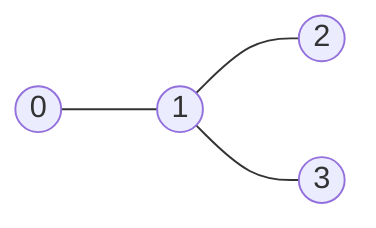

Edges: 0—1, 1—2, 1—3.

Matrix:

|   | 0 | 1 | 2 | 3 |
|---|---:|---:|---:|---:|
| 0 | 0 | 1 | 0 | 0 |
| 1 | 1 | 0 | 1 | 1 |
| 2 | 0 | 1 | 0 | 0 |
| 3 | 0 | 1 | 0 | 0 |

C++:

```cpp
vector<vector<int>> adj(V, vector<int>(V, 0));

// Undirected edge
adj[u][v] = 1;
adj[v][u] = 1;

// Directed edge
adj[u][v] = 1;
```

Complexities:

- Space: $O(V^2)$.
- Edge existence check: $O(1)$.
- Iterate over all neighbours of a vertex: $O(V)$.

## 11.2 Adjacency List

Each vertex stores its neighbours.

C++ using vector:

```cpp
vector<vector<int>> adj(V);

// Undirected edge
adj[u].push_back(v);
adj[v].push_back(u);

// Directed edge
adj[u].push_back(v);
```

C++ using an array of STL lists:

```cpp
list<int>* adj = new list<int>[V];

// Undirected edge
adj[u].push_back(v);
adj[v].push_back(u);

// Directed edge
adj[u].push_back(v);

// Release
delete[] adj;
```

The `std::list<int>` container manages its own internal nodes. `delete[]` destroys the array of list objects; their destructors release their elements.

Complexities:

- Space: $O(V+E)$.
- Iterate over neighbours of vertex $u$: $O(\deg(u))$.
- Check for a particular edge in a standard unsorted list: $O(\deg(u))$.
- Append a neighbour to a `std::list`: $O(1)$.

For an undirected graph, each ordinary edge is stored twice.

## 11.3 Edge List

An edge list stores all edges as pairs (or triples for weighted edges).

Example:

```cpp
vector<pair<int,int>> edges;

edges.push_back({0, 1});
edges.push_back({1, 2});
edges.push_back({1, 3});
```

For a weighted graph:

```cpp
vector<tuple<int,int,int>> edges; // (u, v, weight)
```

Space: $O(E)$ for the edge records, in addition to any vertex metadata.

## 11.4 Comparison

| Representation | Space | Check edge (u,v) | Iterate neighbours of u |
|---|---:|---:|---:|
| Adjacency matrix | $O(V^2)$ | $O(1)$ | $O(V)$ |
| Adjacency list | $O(V+E)$ | $O(\deg(u))$ in an unsorted list | $O(\deg(u))$ |
| Edge list | $O(E)$ | $O(E)$ by linear scan | $O(E)$ by scanning all edges |

These are standard bounds; additional indexing or hashing can change edge lookup complexity.

---

# 12. Graph Traversal

Traversal means visiting vertices of a graph systematically.

Two fundamental traversal algorithms are:

- Breadth‑First Search (BFS).
- Depth‑First Search (DFS).

A `visited` array is commonly used to avoid visiting a vertex repeatedly.

## 12.1 Breadth‑First Search (BFS)

BFS explores a graph level by level.

It uses a **queue** (FIFO: First In, First Out).

Basic process:

1. Mark the starting vertex visited.
2. Insert it into the queue.
3. While the queue is not empty:
   - Remove the front vertex.
   - Visit it.
   - For every unvisited neighbour, mark it visited and insert it into the queue.

BFS is useful for finding shortest paths in an unweighted graph (in terms of number of edges).

## 12.2 Depth‑First Search (DFS)

DFS explores as far as possible along one branch before backtracking.

It uses:

- Recursion (the call stack), or
- An explicit stack.

Basic recursive process:

1. Mark the current vertex visited.
2. Process the current vertex.
3. Visit each unvisited neighbour recursively.

DFS is useful for:

- Connected components.
- Cycle detection.
- Topological sorting (for DAGs).
- Finding bridges and articulation points with suitable algorithms.

## 12.3 BFS and DFS complexity

Using an adjacency list:

$$\boxed{O(V+E)}$$

for a full traversal that visits all vertices and scans all adjacency entries.

For an undirected graph, the adjacency representation contains $2E$ entries, which remains $O(V+E)$.

The visited array uses $O(V)$ extra space. The queue or stack can also use up to $O(V)$ space. Recursive DFS can use $O(V)$ call‑stack space in the worst case.

---

# 13. Important Graph Properties and Formulas

| Concept | Formula / Property |
|---|---|
| Undirected degree sum | $\sum \deg(v)=2E$ |
| Directed in‑degree sum | $\sum \deg^{-}(v)=E$ |
| Directed out‑degree sum | $\sum \deg^{+}(v)=E$ |
| Maximum edges in a simple undirected graph | $V(V-1)/2$ |
| Edges in complete graph $K_n$ | $n(n-1)/2$ |
| Maximum edges in a simple directed graph without loops | $V(V-1)$ |
| Edges in a complete bipartite graph $K_{m,n}$ | $mn$ |
| Edges in a tree | $V-1$ |
| Edges in a forest with $C$ components | $V-C$ |
| Edges in a $k$‑regular graph | $Vk/2$ |
| BFS/DFS with adjacency list | $O(V+E)$ |
| Adjacency matrix space | $O(V^2)$ |
| Adjacency list space | $O(V+E)$ |

For a simple directed graph without self‑loops, there can be at most one edge from each vertex to every other distinct vertex, giving $V(V-1)$ possible directed edges.

For a simple undirected graph, each unordered pair of distinct vertices can have at most one edge, giving $V(V-1)/2$ possible edges.

---

# 14. Time and Space Complexity

Let $V$ be the number of vertices and $E$ the number of edges.

| Operation | Adjacency matrix | Adjacency list |
|---|---:|---:|
| Space | $O(V^2)$ | $O(V+E)$ |
| Add edge | $O(1)$ | $O(1)$ for list/vector append |
| Check edge | $O(1)$ | $O(\deg(u))$ without extra indexing |
| Iterate neighbours | $O(V)$ | $O(\deg(u))$ |
| BFS | $O(V^2)$ | $O(V+E)$ |
| DFS | $O(V^2)$ | $O(V+E)$ |

The adjacency matrix is often useful for dense graphs or frequent edge‑existence checks. The adjacency list is often more space‑efficient for sparse graphs.

**Sparse graph:** A graph with relatively few edges compared with the maximum possible number of edges.

**Dense graph:** A graph with a relatively large number of edges, close to the maximum possible.

---

# 15. Common Exam Traps

1. **Adjacent is not the same as reachable.** Adjacent vertices share a direct edge. Reachable vertices have a path between them.
2. **Undirected edge storage:** An ordinary edge $(u‑v)$ is stored in both adjacency lists.
3. **Directed edge storage:** An edge $(u\to v)$ is stored in the outgoing list of $u$, not automatically in $v$'s list.
4. **Degree and adjacency entries:** In an undirected adjacency list, each ordinary edge contributes two entries.
5. **Self‑loop:** It contributes $2$ to undirected degree under the standard convention.
6. **Isolated vertex:** Degree zero.
7. **Pendant vertex:** Degree one in an undirected graph.
8. **Complete graph:** Every pair of distinct vertices is adjacent.
9. **Tree:** Connected and acyclic; a tree with $V$ vertices has $V-1$ edges.
10. **Forest:** Acyclic but not necessarily connected.
11. **Bipartite graph:** Contains no odd cycle.
12. **DAG:** Directed and has no directed cycle.
13. **BFS:** Uses a queue.
14. **DFS:** Uses recursion or a stack.
15. **BFS shortest path:** BFS finds minimum‑edge‑count paths in an unweighted graph, not necessarily minimum‑weight paths in a weighted graph.
16. **Adjacency matrix:** $O(V^2)$ space.
17. **Adjacency list:** $O(V+E)$ space.
18. **Connected component:** A maximal connected part of an undirected graph.
19. **Bridge:** An edge whose removal increases the number of connected components.
20. **Articulation point:** A vertex whose removal increases the number of connected components.

---

# 16. Quick Revision Sheet

## Core definitions

- Graph: $G=(V,E)$.
- Vertex: point/node.
- Edge: connection.
- Adjacent: directly connected.
- Degree: number of incident edge‑ends in an undirected graph.
- In‑degree: incoming directed edges.
- Out‑degree: outgoing directed edges.
- Path: sequence of connected vertices; a simple path has no repeated vertices.
- Cycle: closed path.
- Connected graph: path exists between every pair of vertices (undirected setting).
- Component: maximal connected subgraph.
- Bridge: cut edge.
- Articulation point: cut vertex.
- Tree: connected, undirected, acyclic graph.
- Forest: undirected acyclic graph, possibly disconnected.
- DAG: directed acyclic graph.
- Bipartite: vertices can be split into two sets, with edges only across the sets.
- Complete graph: every pair of distinct vertices is connected.

## Representation reminders

```cpp
// Adjacency matrix
vector<vector<int>> matrix(V, vector<int>(V, 0));

// Adjacency list
vector<vector<int>> adj(V);

// Array of STL lists
list<int>* arr = new list<int>[V];

// Release the dynamically allocated array
delete[] arr;
```

## Traversal reminders

```
BFS -> Queue
DFS -> Stack / Recursion
```

---

# 17. Practice Questions

Try these before looking at your textbook's solutions.

## Section A: Basic terminology

1. What is a vertex?
2. What is an edge?
3. What is the difference between adjacent and reachable vertices?
4. What is an isolated vertex?
5. What is a pendant vertex?
6. What is a self‑loop?
7. What are parallel edges?
8. What is a weighted graph?
9. What is a connected component?
10. What is the difference between a walk and a simple path?

## Section B: Degree and formulas

11. An undirected graph has 7 edges. What is the sum of all vertex degrees?
12. A vertex has four incident edges. What is its degree?
13. A directed graph has 12 edges. What is the sum of all in‑degrees?
14. What is the maximum number of edges in a simple undirected graph with 6 vertices?
15. How many edges does $K_5$ contain?
16. A 3‑regular graph has 8 vertices. How many edges does it have?
17. A tree has 12 vertices. How many edges does it have?
18. A forest has 12 vertices and 3 components. How many edges does it have?

## Section C: Graph types and properties

19. Is every tree a graph?
20. Is every connected graph a tree?
21. Can a disconnected graph have an isolated vertex?
22. Can a bipartite graph contain a triangle?
23. What is a DAG?
24. What is the difference between a bridge and an articulation point?
25. What is the difference between strong and weak connectivity?

## Section D: Representations and traversal

26. What is the space complexity of an adjacency matrix?
27. What is the space complexity of an adjacency list?
28. Which data structure does BFS use?
29. Which data structure does DFS use?
30. Why is an undirected edge stored twice in an adjacency list?
31. Which representation offers $O(1)$ edge‑existence checks?
32. Why is an adjacency list often preferred for sparse graphs?

---

## Final Learning Advice

Study graph terminology before beginning BFS, DFS, cycle detection, shortest paths, and spanning trees.

For every new graph problem, first identify:

1. How many vertices are present?
2. How many edges are present?
3. Is the graph directed or undirected?
4. Is it weighted or unweighted?
5. Is it connected or disconnected?
6. Does it contain cycles?
7. Which representation is appropriate?

Once you can answer these questions, you will be able to understand the structure of a graph before writing its C++ implementation.
