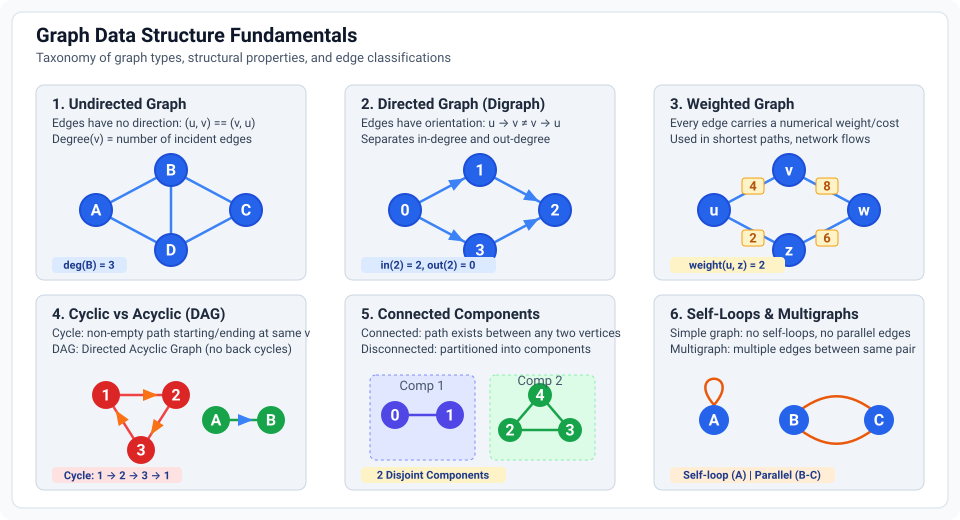
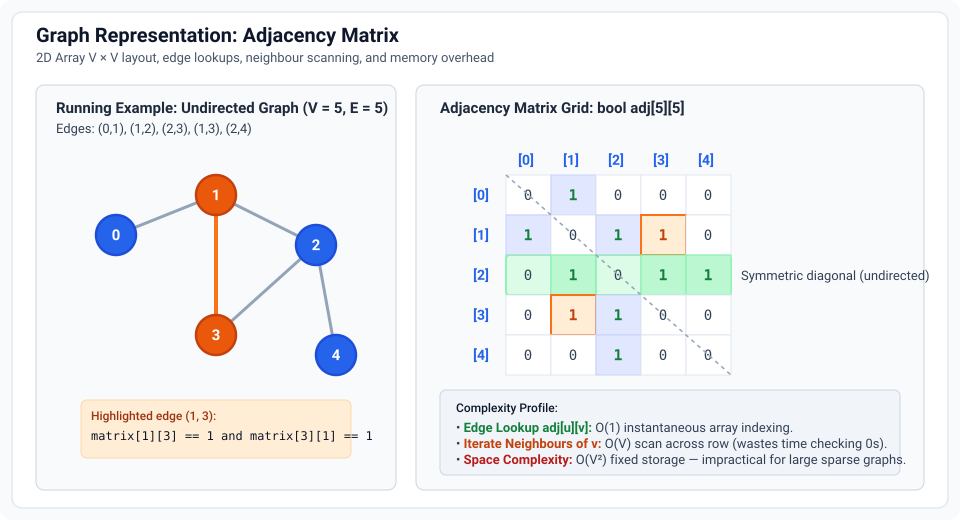
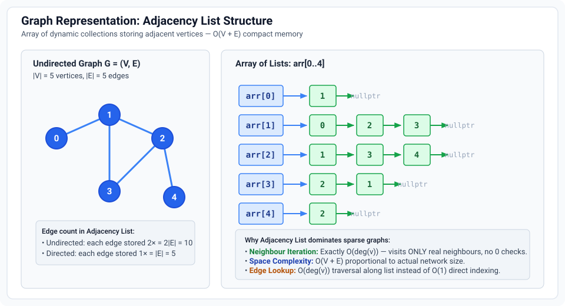
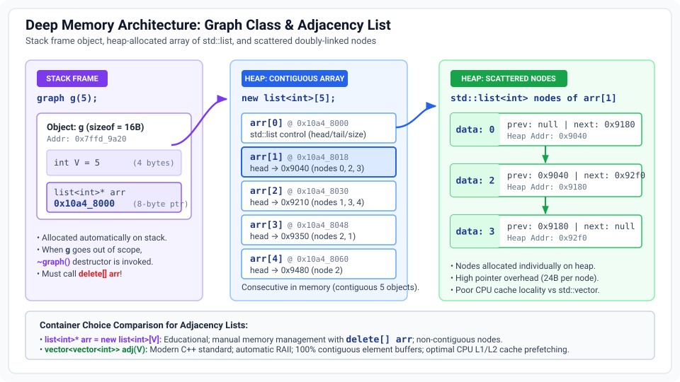
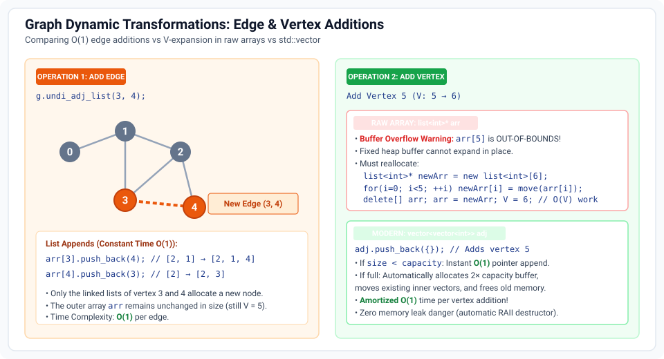
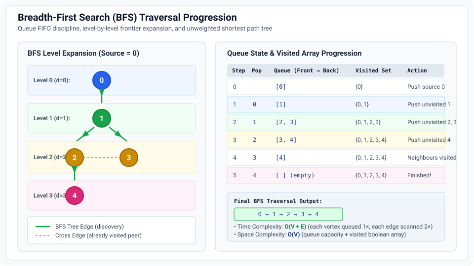
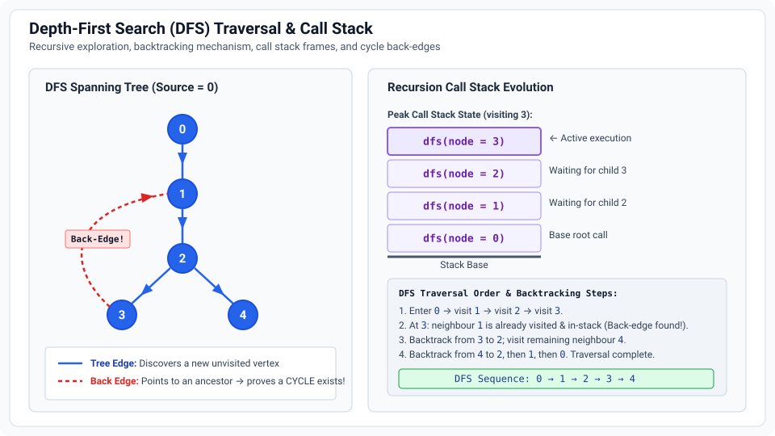

# Graph Data Structures & Algorithms in Modern C++17

A comprehensive, mathematically rigorous, and visual textbook-style guide to graph theory, memory layouts, dynamic allocation, traversal algorithms, and advanced network routines.

---

## Table of Contents

1. [Introduction to Graphs](#1-introduction-to-graphs)
   - [What is a Graph?](#what-is-a-graph)
   - [Why Do We Need Graphs?](#why-do-we-need-graphs)
   - [Real-World Applications](#real-world-applications)
   - [Graph Classifications & Topologies](#graph-classifications--topologies)
2. [Graph Terminology](#2-graph-terminology)
3. [Graph Representations](#3-graph-representations)
   - [A. Adjacency Matrix](#a-adjacency-matrix)
   - [B. Adjacency List (Deep Memory & Container Analysis)](#b-adjacency-list-deep-memory--container-analysis)
   - [Deep Dive: std::vector vs std::list in Memory](#deep-dive-stdvector-vs-stdlist-in-memory)
   - [Deep Dive: Dynamic Resizing & Capacity Doubling](#deep-dive-dynamic-resizing--capacity-doubling)
   - [Deep Dive: Comparison of 4 C++ Adjacency List Types](#deep-dive-comparison-of-4-c-adjacency-list-types)
   - [Deep Dive: Manual Allocation (new/delete[]) vs Modern RAII](#deep-dive-manual-allocation-newdelete-vs-modern-raii)
   - [The 5-Vertex Running Example Transformations](#the-5-vertex-running-example-transformations)
4. [Modern C++17 Implementations](#4-modern-c17-implementations)
   - [Educational Raw Dynamic Adjacency List (Rule of 5)](#educational-raw-dynamic-adjacency-list-rule-of-5)
   - [Modern Production Graph Class](#modern-production-graph-class)
5. [Graph Traversals](#5-graph-traversals)
   - [Breadth-First Search (BFS)](#breadth-first-search-bfs)
   - [Depth-First Search (DFS)](#depth-first-search-dfs)
6. [Advanced Graph Algorithms](#6-advanced-graph-algorithms)
   - [Cycle Detection (Undirected & Directed)](#cycle-detection)
   - [Connected Components](#connected-components)
   - [Topological Sorting (Kahn's & DFS)](#topological-sorting)
   - [Dijkstra's Shortest Path Algorithm](#dijkstras-shortest-path-algorithm)
   - [Bellman-Ford Algorithm](#bellman-ford-algorithm)
   - [Floyd-Warshall All-Pairs Shortest Path](#floyd-warshall-all-pairs-shortest-path)
   - [Disjoint Set Union (DSU / Union-Find)](#disjoint-set-union-dsu--union-find)
   - [Minimum Spanning Trees (Prim's & Kruskal's)](#minimum-spanning-trees-prims--kruskals)
   - [Bipartite Graph Checking](#bipartite-graph-checking)
   - [Bridges & Articulation Points (Tarjan's Algorithm)](#bridges--articulation-points-tarjans-algorithm)
7. [Comprehensive Complexity Matrix](#7-comprehensive-complexity-matrix)
8. [Common Pitfalls & Interview Traps](#8-common-pitfalls--interview-traps)

---

# 1. Introduction to Graphs

### What is a Graph?

A **graph** \( G = (V, E) \) is a non-linear, discrete data structure consisting of two fundamental sets:
1. **A finite set of Vertices (or Nodes) \( V \):** Represents discrete entities, objects, or locations.
2. **A set of Edges \( E \):** Represents connections, relationships, or transitions between pairs of vertices. An edge \( e \in E \) connects two vertices \( u, v \in V \).

Mathematically:
```math
G = (V, E) \quad \text{where} \quad V = \{v_0, v_1, \dots, v_{n-1}\}, \quad E \subseteq V \times V
```

### Why Do We Need Graphs?

Linear data structures (arrays, linked lists, stacks, queues) model strictly sequential data where an element has at most one predecessor and one successor. Hierarchical data structures (trees) model parent-child relationships with a single root and strictly no cycles.

However, real-world systems are rarely purely sequential or strictly hierarchical. Networks feature arbitrary interconnectedness, multiple incoming and outgoing relationships, feedback loops, and alternative paths. Graphs provide the mathematical framework required to model complex interconnected topologies.

### Real-World Applications

- **Social Networks (LinkedIn, Facebook):** Vertices represent people; edges represent friendships (undirected) or follower relationships (directed).
- **Navigation & Maps (Google Maps, OpenStreetMap):** Vertices represent intersections; edges represent road segments weighted by distance, travel time, or toll cost.
- **Web Crawling & Search Engines (Google PageRank):** Vertices represent web pages; directed edges represent hyperlinks between them.
- **Dependency Resolution (Package Managers, Build Systems):** Vertices represent software libraries or build tasks; directed edges represent prerequisites. Topological sort ensures tasks execute in dependency order.
- **Computer Networking & Internet Routing (BGP, OSPF):** Routers are vertices; network cables/channels are edges; shortest path algorithms (Dijkstra, Bellman-Ford) route data packets.
- **Circuit Design & VLSI:** Gates and pins are vertices; printed circuit connections are edges.
- **Computational Biology & Chemistry:** Atoms are vertices; chemical bonds are edges; protein-protein interaction networks predict disease pathways.

### Graph Classifications & Topologies



1. **Undirected Graph:** Edges are bidirectional and unordered pairs: \( (u, v) = (v, u) \). If an edge connects 0 and 1, you can traverse from 0 to 1 and from 1 to 0.
2. **Directed Graph (Digraph):** Edges are ordered pairs with orientation: \( (u, v) \neq (v, u) \). The edge leaves source \( u \) and enters destination \( v \).
3. **Weighted Graph:** Every edge \( (u, v) \) has an associated scalar cost \( w(u, v) \in \mathbb{R} \) representing distance, latency, capacity, or resistance.
4. **Unweighted Graph:** Edges have no weights (or uniformly unit weight 1).
5. **Simple Graph:** A graph having no self-loops (edges connecting a vertex to itself) and no parallel edges (multiple edges between the same pair of vertices).
6. **Multigraph:** A graph that allows parallel edges between vertices (e.g., two flights between the same pair of cities at different times).
7. **Connected Graph (Undirected):** There exists at least one valid path between every pair of vertices.
8. **Disconnected Graph:** The graph is partitioned into two or more independent, disconnected subgraphs called **connected components**.
9. **Strongly Connected (Directed):** Every vertex is reachable from every other vertex following the edge directions.
10. **Cyclic Graph:** Contains at least one cycle (a path of length \( \ge 3 \) in undirected graphs that starts and ends at the same vertex with no repeated edges).
11. **Acyclic Graph:** Contains zero cycles. A directed acyclic graph is universally known as a **DAG**. An undirected acyclic connected graph is a **Tree**.
12. **Vertex Degree:**
    - In an **undirected graph**, \( \text{deg}(v) \) is the total number of edges incident to vertex \( v \).
    - **Handshaking Lemma:** \( \sum_{v \in V} \text{deg}(v) = 2|E| \). The sum of degrees in an undirected graph is always even.
    - In a **directed graph**, the degree is split into **in-degree** \( \text{in-deg}(v) \) (edges entering \( v \)) and **out-degree** \( \text{out-deg}(v) \) (edges leaving \( v \)). Here, \( \sum_{v \in V} \text{in-deg}(v) = \sum_{v \in V} \text{out-deg}(v) = |E| \).

---

# 2. Graph Terminology

| Term | Formal Definition & Practical Meaning |
|---|---|
| **Vertex (Node)** | The atomic data element representing an entity. |
| **Edge (Arc)** | The link connecting two vertices. |
| **Adjacent (Neighbors)** | Two vertices \( u \) and \( v \) are adjacent if an edge directly connects them: \( (u, v) \in E \). |
| **Walk** | An alternating sequence of vertices and edges \( v_0, e_1, v_1, e_2, \dots, e_k, v_k \). Vertices and edges can be repeated. |
| **Trail** | A walk in which **no edge is repeated**. Vertices may still be revisited. |
| **Path** | A walk in which **no vertex is repeated** (which implies no edge is repeated). |
| **Cycle** | A closed path of length \( \ge 3 \) (in simple graphs) where the starting and ending vertices are identical. |
| **Reachability** | Vertex \( v \) is reachable from \( u \) if there exists a valid directed path from \( u \) to \( v \). |
| **Connected Component** | A maximal connected subgraph of an undirected graph. Every node in the component can reach every other node in that component. |
| **Dense Graph** | A graph where the number of edges is close to the theoretical maximum: \( |E| \approx |V|^2 \). |
| **Sparse Graph** | A graph where the number of edges is significantly less than \( |V|^2 \), typically \( |E| = O(|V|) \). Most real-world graphs are sparse! |

---

# 3. Graph Representations

Choosing the correct memory representation for a graph is the most critical design decision in algorithmic graph theory. The two primary representations are **Adjacency Matrix** and **Adjacency List**.

## A. Adjacency Matrix

An **Adjacency Matrix** represents a graph \( G = (V, E) \) using a two-dimensional array \( A \) of size \( |V| \times |V| \), where:
```math
A[i][j] = \begin{cases} 
1 & \text{if } (i, j) \in E \text{ (or weight } w(i, j) \text{ in weighted graphs)} \\
0 & \text{if } (i, j) \notin E \text{ (or } \infty \text{ in weighted graphs)} 
\end{cases}
```



### Construction & Memory Allocation
In C++, an adjacency matrix is allocated either statically as `bool adj[V][V]` or dynamically as a contiguous block `std::vector<std::vector<bool>> adj(V, std::vector<bool>(V, false))`.

For our 5-vertex running example with vertices \( \{0, 1, 2, 3, 4\} \) and edges \( \{(0,1), (1,2), (2,3), (1,3), (2,4)\} \):
```text
      [0]  [1]  [2]  [3]  [4]
 [0]    0    1    0    0    0
 [1]    1    0    1    1    0
 [2]    0    1    0    1    1
 [3]    0    1    1    0    0
 [4]    0    0    1    0    0
```

### Properties & Trade-offs
1. **Symmetry in Undirected Graphs:** The matrix is symmetric about the main diagonal: \( A[i][j] = A[j][i] \).
2. **Instant Edge Lookup:** Testing if edge \( (u, v) \) exists takes strictly \( O(1) \) time by querying `adj[u][v]`.
3. **Slow Neighbor Traversal:** To find all neighbors of vertex \( u \), an algorithm **must** scan all \( V \) columns of row \( u \). Even if vertex \( u \) has only 1 neighbor in a graph of 100,000 vertices, it must iterate 100,000 times! Time: \( O(V) \).
4. **Prohibitive Space Overhead:** Memory consumption is strictly \( \Theta(V^2) \). For a graph with \( V = 100,000 \), a boolean matrix requires \( 100,000 \times 100,000 = 10^{10} \) bytes \( \approx 10 \text{ GB} \) of memory, even if the graph only contains 50,000 edges!

---

## B. Adjacency List (Deep Memory & Container Analysis)

An **Adjacency List** represents a graph as an array (or vector) of dynamic collections (lists or vectors). Each array index represents a vertex, and the collection at index \( u \) contains all vertices \( v \) adjacent to \( u \).



For our 5-vertex example:
```text
arr[0] --> 1
arr[1] --> 0 --> 2 --> 3
arr[2] --> 1 --> 3 --> 4
arr[3] --> 2 --> 1
arr[4] --> 2
```

### Why Adjacency List Dominates Sparse Graphs
In practical applications (social networks, roads, web pages), graphs are almost always **sparse** (\( |E| \ll |V|^2 \)).
- In LinkedIn, a user might have 500 connections out of 900 million users. An adjacency matrix would store 899,999,500 useless zeros for that single user!
- The adjacency list stores **only real edges**. Total space is:
  - Directed Graph: \( O(V + E) \)
  - Undirected Graph: \( O(V + 2E) = O(V + E) \)

---

## Deep Dive: std::vector vs std::list in Memory

Understanding how C++ STL containers manage heap memory is essential for writing high-performance graph algorithms.



### 1. The Doubly Linked List: `std::list<int>`
`std::list` is typically implemented as a doubly linked list.
- **Node Structure:** Each node contains three distinct fields:
  ```cpp
  struct ListNode {
      ListNode* prev; // 8 bytes on 64-bit architecture
      int data;       // 4 bytes (+ 4 bytes structure padding)
      ListNode* next; // 8 bytes on 64-bit architecture
  };                  // Total = 24 bytes per element!
  ```
- **Heap Allocation Overhead:** Each call to `push_back()` invokes the heap memory allocator (`malloc` / `new`) to allocate a separate 24-byte block.
- **Cache Invalidation:** Because nodes are allocated independently over time, they are scattered at arbitrary memory addresses across the heap. When traversing neighbors, the CPU cache cannot prefetch contiguous lines, triggering frequent **L1/L2 cache misses**.

### 2. The Dynamic Array: `std::vector<int>`
`std::vector` is implemented as a contiguous dynamically allocated array with three internal pointers: `begin`, `end`, and `end_of_storage` (24 bytes total on stack/control block).
- **Contiguous Elements:** All integers are stored sequentially in memory: `[0x1000: data][0x1004: data][0x1008: data]`.
- **Zero Pointer Overhead:** Stores purely the raw data (`sizeof(int) = 4` bytes per edge).
- **Hardware Cache Prefetching:** When iterating over `adj[u]`, the CPU loads entire 64-byte cache lines at once, yielding orders-of-magnitude faster traversals than linked lists.

---

## Deep Dive: Dynamic Resizing & Capacity Doubling

When using `std::vector<int>` to store neighbors, how does it grow if the number of edges is not known beforehand?

```text
Capacity: 1 ──> 2 ──> 4 ──> 8 ──> 16 ──> 32 ──> ... ──> 2^k
```

1. **Initial State:** `size = 0, capacity = 0`.
2. **First Element:** Allocates buffer of capacity 1.
3. **Buffer Full:** When `size == capacity` and `push_back()` is called:
   - A new memory block of size \( 2 \times \text{capacity} \) is allocated on the heap.
   - Existing elements are **moved** (or copied) from the old buffer to the new buffer.
   - The old buffer is deallocated.
   - The new element is placed at `data[size++]`.

### Mathematical Proof of Amortized \( O(1) \) Append
Although an individual reallocation takes \( O(n) \) time, reallocations occur exponentially less frequently.
Let us calculate the total cost to insert \( N \) elements:
```math
\text{Total Operations} = N \text{ (insertions)} + \sum_{i=0}^{\lfloor \log_2 N \rfloor} 2^i \text{ (copies during reallocations)}
```
Using the geometric series sum formula \( \sum_{i=0}^{k} 2^i = 2^{k+1} - 1 < 2N \):
```math
\text{Total Operations} < N + 2N = 3N
```
The **amortized cost per insertion** is:
```math
\text{Amortized Cost} = \frac{\text{Total Operations}}{N} < \frac{3N}{N} = O(1)
```

---

## Deep Dive: Comparison of 4 C++ Adjacency List Types

In C++, developers represent adjacency lists using different combinations of arrays, vectors, and lists. The memory and flexibility trade-offs are summarized below:

| Type | Outer Structure | Inner Collection | Can Add Vertices? | Memory Contiguity | Modern C++ Recommendation |
|---|---|---|---|---|---|
| `vector<int> adj[N]` | Fixed compile-time array of size `N` | Dynamic `vector` | **No** (fixed to `N` vertices) | Outer: Stack/BSS; Inner: Contiguous heap | Common in competitive programming with fixed \( N \le 10^5 \) |
| `vector<vector<int>> adj` | Fully dynamic resizable `vector` | Dynamic `vector` | **Yes** (`adj.push_back({})`) | 100% contiguous heap buffers | **Best Practice / Production Standard** |
| `vector<list<int>> adj` | Dynamic `vector` | Doubly linked `std::list` | **Yes** | Outer: Contiguous; Inner: Scattered heap nodes | Educational only; suboptimal cache locality |
| `list<int> adj[N]` | Fixed compile-time array of size `N` | Doubly linked `std::list` | **No** | Outer: Stack/BSS; Inner: Scattered heap nodes | Academic legacy; avoids reallocations but slow |

---

## Deep Dive: Manual Allocation (new/delete[]) vs Modern RAII

When dynamically allocating an array of lists:
```cpp
list<int>* arr = new list<int>[V];
```
### What Happens Internally?
1. The memory manager allocates contiguous storage on the heap sufficient to hold `V` `std::list<int>` objects (`V * sizeof(std::list)`).
2. The default constructor of `std::list` is executed `V` times in ascending index order.
3. The pointer `arr` stores the address of `arr[0]`.

### Why `delete[] arr` is Mandatory
When freeing this memory, using `delete arr;` is **undefined behavior**. You must use `delete[] arr;`:
1. C++ looks up the array size prefix stored by the allocator.
2. It invokes the destructor `~list()` for each of the `V` elements in **reverse order** (`arr[V-1]` down to `arr[0]`).
3. Each list destructor traverses its own doubly linked nodes and deallocates every individual node on the heap.
4. Finally, the raw array buffer itself is freed.

If `delete[] arr;` is omitted, the heap memory remains allocated until process termination, causing a **memory leak**.

### The Rule of Three / Five
If a C++ class manually manages a resource via raw pointers (`new[]` / `delete[]`), it must explicitly define the **Rule of Five**:
1. **Destructor:** To deallocate the array.
2. **Copy Constructor:** To perform a deep copy of all lists, preventing multiple pointers from referencing and double-deleting the same memory.
3. **Copy Assignment Operator:** Using copy-and-swap idiom for exception safety.
4. **Move Constructor:** To transfer ownership without copying.
5. **Move Assignment Operator:** To clean up existing memory and take ownership of the temporary.

In modern C++, we follow the **Rule of Zero**: use `std::vector<std::vector<int>>`, which manages its own memory completely automatically using RAII (Resource Acquisition Is Initialization).

---

## The 5-Vertex Running Example Transformations



### Transformation 1: Adding a New Edge (3, 4)
- **Operation:** `g.undi_adj_list(3, 4);`
- **Execution:**
  1. `arr[3].push_back(4);` appends 4 to list 3: `[2, 1]` becomes `[2, 1, 4]`.
  2. `arr[4].push_back(3);` appends 3 to list 4: `[2]` becomes `[2, 3]`.
- **Time Complexity:** Constant time \( O(1) \).
- **Array Impact:** The outer array `arr` is completely untouched. Only the two involved endpoint lists allocate a new node.

### Transformation 2: Adding a New Vertex 5
- **Using Raw Array `arr = new list<int>[5]`:**
  - Accessing `arr[5]` is an **out-of-bounds heap buffer overflow**!
  - Must allocate `newArr = new list<int>[6]`, copy/move `arr[0..4]` into `newArr`, execute `delete[] arr`, update `arr = newArr`, and set `V = 6`. This takes \( O(V) \) time and manual bookkeeping.
- **Using `vector<vector<int>> adj`:**
  - Simply call `adj.push_back({});`.
  - The vector appends a new empty vector in amortized \( O(1) \) time with automatic buffer reallocation if required.

---

# 4. Modern C++17 Implementations

The repository provides two production-grade, leak-free implementations in [Graph_Adjacency_List.cpp](file:///c:/Users/LENOVO/Documents/Mukunda/DSA_CPP/12-Graphs/Graph_Adjacency_List.cpp):
1. **`DynamicRawGraph`:** Demonstrates dynamic memory allocation with raw pointers, complete with strict RAII, destructor, deep copy constructor, and move semantics (Rule of 5).
2. **`ModernGraph`:** Demonstrates modern C++17 idiomatic graph architecture using `std::vector<std::vector<int>>`, dynamic vertex insertions, and integrated BFS and DFS traversals.

### Complete Modern C++17 Graph Class Snippet

```cpp
#include <iostream>
#include <vector>
#include <queue>
#include <stack>

class ModernGraph {
private:
    int V;
    bool directed;
    std::vector<std::vector<int>> adj;

    void dfsRecursiveHelper(int u, std::vector<bool>& visited, std::vector<int>& order) const {
        visited[u] = true;
        order.push_back(u);

        for (int v : adj[u]) {
            if (!visited[v]) {
                dfsRecursiveHelper(v, visited, order);
            }
        }
    }

public:
    explicit ModernGraph(int vertices, bool isDirected = false)
        : V(vertices), directed(isDirected), adj(vertices) {}

    void addEdge(int u, int v) {
        if (u >= 0 && u < V && v >= 0 && v < V) {
            adj[u].push_back(v);
            if (!directed) {
                adj[v].push_back(u);
            }
        }
    }

    int addVertex() {
        adj.push_back({});
        return V++;
    }

    std::vector<int> bfs(int startVertex) const {
        std::vector<int> order;
        if (startVertex < 0 || startVertex >= V) return order;

        std::vector<bool> visited(V, false);
        std::queue<int> q;

        visited[startVertex] = true;
        q.push(startVertex);

        while (!q.empty()) {
            int u = q.front();
            q.pop();
            order.push_back(u);

            for (int v : adj[u]) {
                if (!visited[v]) {
                    visited[v] = true;
                    q.push(v);
                }
            }
        }
        return order;
    }

    std::vector<int> dfsRecursive(int startVertex) const {
        std::vector<int> order;
        if (startVertex < 0 || startVertex >= V) return order;

        std::vector<bool> visited(V, false);
        dfsRecursiveHelper(startVertex, visited, order);
        return order;
    }
};
```

---

# 5. Graph Traversals

Graph traversal is the systematic process of visiting every vertex and edge in a graph exactly once. Because graphs may contain cycles and disconnected components, traversals require a **`visited` boolean array** to prevent infinite loops.

## Breadth-First Search (BFS)



### Intuition & Mechanism
BFS explores a graph **level by level** (radially outward from a starting source vertex \( s \)). It explores all direct neighbors of distance 1, then all neighbors of distance 2, and so forth.
- **Core Auxiliary Container:** A **FIFO Queue** (`std::queue<int>`).
- **Discovery Property:** In an unweighted graph, the BFS tree rooted at \( s \) yields the **shortest path** (minimum number of edges) from \( s \) to every other reachable vertex!

### Step-by-Step Trace on 5-Vertex Graph (Source = 0)
Adjacency: `0:[1]`, `1:[0, 2, 3]`, `2:[1, 3, 4]`, `3:[2, 1]`, `4:[2]`

1. **Initialization:** Mark `visited[0] = true`, push 0 to queue: `Q = [0]`.
2. **Pop 0:** Neighbors of 0 are `[1]`. `visited[1] = false` → mark `visited[1] = true`, push 1: `Q = [1]`.
3. **Pop 1:** Neighbors of 1 are `[0, 2, 3]`.
   - 0 is visited (skip).
   - 2 is unvisited → mark `visited[2] = true`, push 2.
   - 3 is unvisited → mark `visited[3] = true`, push 3.
   - `Q = [2, 3]`.
4. **Pop 2:** Neighbors of 2 are `[1, 3, 4]`.
   - 1 is visited (skip).
   - 3 is visited (skip).
   - 4 is unvisited → mark `visited[4] = true`, push 4.
   - `Q = [3, 4]`.
5. **Pop 3:** Neighbors of 3 are `[2, 1]`. Both visited. `Q = [4]`.
6. **Pop 4:** Neighbor 2 is visited. `Q = []`.
7. **Queue Empty:** Traversal terminates.

**Traversal Order:** `0 → 1 → 2 → 3 → 4`.

### Mathematical Complexity Derivation
- **Time Complexity:** Every vertex enters and leaves the queue at most once: \( O(V) \). When vertex \( u \) is popped, we iterate over all its outgoing edges \( \text{deg}(u) \). Across the entire traversal, the sum of loop iterations is \( \sum_{u \in V} \text{deg}(u) = 2E \) (for undirected graphs). Total Time:
  ```math
  T(V, E) = O(V) + O(E) = O(V + E)
  ```
- **Space Complexity:** Visited array requires \( O(V) \). The queue holds at most the maximum breadth/frontier of the graph: \( O(V) \). Total Auxiliary Space: \( O(V) \).

---

## Depth-First Search (DFS)



### Intuition & Mechanism
DFS explores as deeply as possible along each branch before **backtracking**. When the search reaches a dead end (a vertex with no unvisited neighbors), it retreats to the most recent vertex with unexplored edges.
- **Core Auxiliary Container:** A **LIFO Stack** (either the system **Call Stack** via recursion, or an explicit `std::stack<int>`).
- **Edge Classification:**
  - **Tree Edge:** Discovers a new unvisited vertex.
  - **Back Edge:** Connects a vertex to an ancestor in the DFS tree. A back edge proves the existence of a **cycle**!
  - **Forward / Cross Edges:** (In directed graphs).

### Step-by-Step Trace on 5-Vertex Graph (Source = 0)
1. Call `dfs(0)`: Mark visited. Explore neighbor 1.
2. Call `dfs(1)`: Mark visited. Explore neighbor 2.
3. Call `dfs(2)`: Mark visited. Explore neighbor 3.
4. Call `dfs(3)`: Mark visited.
   - Neighbor 2 is visited (skip parent).
   - Neighbor 1 is visited and active on the recursion stack! **Back-edge (3, 1) detected! Cycle confirmed!**
   - No more neighbors. Backtrack to `dfs(2)`.
5. Back at `dfs(2)`: Explore remaining neighbor 4.
6. Call `dfs(4)`: Mark visited. Neighbor 2 is visited. Backtrack to `dfs(2)`.
7. Backtrack `dfs(2)` → `dfs(1)` → `dfs(0)`. Complete.

**Traversal Order:** `0 → 1 → 2 → 3 → 4`.

### Mathematical Complexity Derivation
- **Time Complexity:** Each vertex is visited once: \( O(V) \). Each edge is inspected once (directed) or twice (undirected): \( O(E) \). Total Time: \( O(V + E) \).
- **Space Complexity:** Visited array requires \( O(V) \). The recursion stack depth corresponds to the longest simple path in the graph. In a skewed graph (e.g., linked list / path topology), recursion depth is \( V \) frames. Total Auxiliary Space: \( O(V) \).

---

# 6. Advanced Graph Algorithms

## Cycle Detection

### A. In Undirected Graphs
A cycle exists in an undirected graph if during traversal (BFS or DFS), we encounter a visited neighbor that is **not the immediate parent** of the current vertex.
```cpp
bool hasCycleUndirectedDFS(int u, int parent, const std::vector<std::vector<int>>& adj, std::vector<bool>& visited) {
    visited[u] = true;
    for (int v : adj[u]) {
        if (!visited[v]) {
            if (hasCycleUndirectedDFS(v, u, adj, visited)) return true;
        } else if (v != parent) {
            return true; // Visited vertex that is not our parent => CYCLE!
        }
    }
    return false;
}
```

### B. In Directed Graphs (3-Color DFS)
In directed graphs, merely encountering a visited vertex does not indicate a cycle (it could be a cross edge from a previously completed branch). A cycle exists **if and only if** we encounter a vertex currently active in the **current recursion call stack**.
We use three states:
- `0 (White)`: Unvisited.
- `1 (Gray)`: In-Progress / Currently on call stack.
- `2 (Black)`: Completed / Fully explored and popped from stack.
```cpp
bool hasCycleDirectedDFS(int u, const std::vector<std::vector<int>>& adj, std::vector<int>& state) {
    state[u] = 1; // Gray: currently in call stack

    for (int v : adj[u]) {
        if (state[v] == 1) return true; // BACK-EDGE to ancestor on call stack => CYCLE!
        if (state[v] == 0 && hasCycleDirectedDFS(v, adj, state)) return true;
    }

    state[u] = 2; // Black: fully processed
    return false;
}
```

---

## Connected Components

For an undirected graph, connected components represent equivalence classes under the reachability relation.
- **Algorithm:** Initialize `componentCount = 0`. Iterate through all vertices \( i \in \{0, \dots, V-1\} \). If `!visited[i]`, increment `componentCount` and launch `BFS(i)` or `DFS(i)` to mark all vertices in that component.
- **Complexity:** \( O(V + E) \) time, \( O(V) \) space.

---

## Topological Sorting

A **Topological Sort** of a Directed Acyclic Graph (DAG) is a linear ordering of vertices such that for every directed edge \( u \to v \), vertex \( u \) appears before \( v \) in the ordering.
> [!IMPORTANT]
> A topological sort is possible **if and only if** the graph is a Directed Acyclic Graph (DAG). If a cycle exists, no valid linear order exists.

### Kahn's Algorithm (BFS-Based In-Degree Reduction)
1. Compute in-degree for every vertex: \( O(V + E) \).
2. Push all vertices with `in_degree == 0` into a FIFO queue.
3. While the queue is not empty:
   - Pop vertex \( u \), append to topological order list.
   - For each neighbor \( v \) of \( u \): decrement `in_degree[v]`.
   - If `in_degree[v] == 0`, push \( v \) into the queue.
4. **Cycle Detection Check:** If the topological list contains fewer than \( V \) vertices, the graph contains a cycle!
- **Time Complexity:** \( O(V + E) \)
- **Space Complexity:** \( O(V) \)

---

## Dijkstra's Shortest Path Algorithm

Computes the shortest path from a single source vertex to all other vertices in a **non-negatively weighted** graph.

### Intuition & Min-Heap Optimization
Maintains a `dist` array initialized to \( \infty \) (with `dist[source] = 0`). A min-priority queue stores `(distance, vertex)` pairs. At each step, it extracts the unvisited vertex \( u \) with minimum tentative distance and **relaxes** all outgoing edges:
```math
\text{if } \text{dist}[u] + w(u, v) < \text{dist}[v] \implies \text{dist}[v] = \text{dist}[u] + w(u, v)
```

```cpp
#include <vector>
#include <queue>
#include <utility>

const int INF = 1e9;

std::vector<int> dijkstra(int src, int V, const std::vector<std::vector<std::pair<int, int>>>& adj) {
    std::vector<int> dist(V, INF);
    // Min-heap storing pair<distance, vertex>
    std::priority_queue<std::pair<int, int>, 
                        std::vector<std::pair<int, int>>, 
                        std::greater<std::pair<int, int>>> pq;

    dist[src] = 0;
    pq.push({0, src});

    while (!pq.empty()) {
        auto [d, u] = pq.top();
        pq.pop();

        if (d > dist[u]) continue; // Stale heap entry optimization

        for (auto [v, weight] : adj[u]) {
            if (dist[u] + weight < dist[v]) {
                dist[v] = dist[u] + weight;
                pq.push({dist[v], v});
            }
        }
    }
    return dist;
}
```
- **Time Complexity:** \( O((V + E) \log V) \) using binary min-heap.
- **Space Complexity:** \( O(V + E) \) for priority queue and distance table.
- **Constraint:** Does **NOT** work with negative edge weights!

---

## Bellman-Ford Algorithm

Computes single-source shortest paths in graphs with **arbitrary edge weights** (including negative weights) and detects **negative weight cycles**.

### Intuition & Working
In a graph with \( V \) vertices, any simple shortest path contains at most \( V - 1 \) edges.
1. Initialize `dist` array to \( \infty \), `dist[src] = 0`.
2. Relax **all** \( E \) edges \( V - 1 \) times.
3. **Negative Cycle Check (The \( V \)-th Pass):** Relax all edges one additional time. If any distance decreases:
   ```math
   \text{dist}[u] + w(u, v) < \text{dist}[v]
   ```
   then a **negative weight cycle** exists, making shortest paths undefined (path costs can decrease to \( -\infty \)).
- **Time Complexity:** \( O(V \cdot E) \)
- **Space Complexity:** \( O(V) \)

---

## Floyd-Warshall All-Pairs Shortest Path

Computes the shortest path between **every pair of vertices** \( (i, j) \) using dynamic programming.
- **State Definition:** Let \( D^{(k)}[i][j] \) be the length of the shortest path from \( i \) to \( j \) utilizing only intermediate vertices from the set \( \{0, 1, \dots, k\} \).
- **Recurrence:**
  ```math
  D^{(k)}[i][j] = \min\left( D^{(k-1)}[i][j], \; D^{(k-1)}[i][k] + D^{(k-1)}[k][j] \right)
  ```
- **Implementation:** Three nested loops over \( k \), \( i \), and \( j \).
- **Time Complexity:** Strictly \( \Theta(V^3) \).
- **Space Complexity:** \( \Theta(V^2) \) matrix. Best suited for dense graphs or small networks (\( V \le 400 \)).

---

## Disjoint Set Union (DSU / Union-Find)

A data structure that tracks a partition of a set into disjoint subsets, supporting two near-constant-time operations:
1. `find(i)`: Determine which subset element \( i \) belongs to (returns the canonical representative).
2. `unite(i, j)`: Merge the subset containing \( i \) with the subset containing \( j \).

### Two Essential Optimizations
1. **Path Compression:** During `find(i)`, every visited node points directly to the root:
   ```cpp
   int find(int i) {
       if (parent[i] == i) return i;
       return parent[i] = find(parent[i]); // Path compression
   }
   ```
2. **Union by Rank (or Size):** Always attach the shorter tree under the root of the taller tree to prevent tree degradation.
- **Complexity:** Running \( M \) operations on \( N \) elements takes \( O(M \cdot \alpha(N)) \), where \( \alpha \) is the **Inverse Ackermann Function**. For all practical purposes in our universe (\( N < 10^{80} \)), \( \alpha(N) \le 4 \), giving **amortized \( O(1) \)** time!

---

## Minimum Spanning Trees (Prim's & Kruskal's)

A **Minimum Spanning Tree (MST)** of a connected, undirected, weighted graph \( G = (V, E) \) is a subgraph that connects all \( V \) vertices with exactly \( V - 1 \) edges such that the total edge weight is minimized.

### 1. Kruskal's Algorithm (Greedy Edge Sorting + DSU)
1. Sort all \( E \) edges in non-decreasing order of weight: \( O(E \log E) \).
2. Initialize a DSU structure for \( V \) vertices.
3. Iterate through sorted edges. For edge \( (u, v) \):
   - If `find(u) != find(v)`, adding edge \( (u, v) \) does not create a cycle!
   - Add edge to MST and call `unite(u, v)`.
   - If MST edge count reaches \( V - 1 \), terminate early.
- **Time Complexity:** \( O(E \log E) \) (dominated by sorting edges).
- **Best For:** Sparse graphs (\( E \approx V \)).

### 2. Prim's Algorithm (Greedy Vertex Cut + Min-Heap)
1. Maintain a set of visited vertices in the growing MST tree, starting with arbitrary vertex 0.
2. Use a min-priority queue to repeatedly extract the minimum-weight edge connecting a vertex in the MST to a vertex outside the MST.
3. Add the extracted vertex to the MST and push its incident edges into the priority queue.
- **Time Complexity:** \( O((V + E) \log V) \).
- **Best For:** Dense graphs.

---

## Bipartite Graph Checking

A graph is **bipartite** if its vertices can be partitioned into two independent sets \( U \) and \( V \) such that every edge connects a vertex in \( U \) to a vertex in \( V \).
> [!NOTE]
> **Theorem:** A graph is bipartite **if and only if** it contains **no odd-length cycles**.

- **Algorithm (2-Coloring via BFS/DFS):** Assign color 0 to source. For every neighbor \( v \) of \( u \):
  - If \( v \) is uncolored, assign color \( 1 - \text{color}[u] \).
  - If \( v \) has the same color as \( u \), a conflict occurs → the graph is **not bipartite**!
- **Complexity:** \( O(V + E) \) time, \( O(V) \) space.

---

## Bridges & Articulation Points (Tarjan's Algorithm)

- **Bridge (Cut-Edge):** An edge whose removal increases the number of connected components.
- **Articulation Point (Cut-Vertex):** A vertex whose removal increases the number of connected components.
- **Tarjan's DFS Discovery Timer:**
  - `tin[u]`: Discovery time of vertex \( u \).
  - `low[u]`: Lowest discovery time reachable from \( u \) using at most one back edge.
- **Condition for Bridge \( (u, v) \):**
  ```math
  \text{low}[v] > \text{tin}[u]
  ```
  (Vertex \( v \) has no back-edge to reach \( u \) or any ancestor of \( u \)).
- **Condition for Articulation Point \( u \):**
  - If \( u \) is root of DFS tree: has \( \ge 2 \) children.
  - If \( u \) is not root: has at least one child \( v \) with \( \text{low}[v] \ge \text{tin}[u] \).
- **Time Complexity:** \( O(V + E) \) single-pass DFS.

---

# 7. Comprehensive Complexity Matrix

| Operation / Algorithm | Adjacency Matrix | Adjacency List (`std::vector`) | Adjacency List (`std::list`) | Dominant Mathematical Factor |
|---|---|---|---|---|
| **Space Complexity** | \( \Theta(V^2) \) | \( \Theta(V + E) \) | \( \Theta(V + E) \) | Matrix stores all non-edges; list stores only real edges |
| **Add Edge \( (u, v) \)** | \( O(1) \) | \( O(1) \) amortized | \( O(1) \) | Array index vs vector push vs list node allocation |
| **Edge Lookup \( (u, v) \)** | \( O(1) \) | \( O(\text{deg}(u)) \) | \( O(\text{deg}(u)) \) | Matrix has direct indexing; list requires linear search |
| **Iterate All Neighbors of \( u \)** | \( O(V) \) | \( O(\text{deg}(u)) \) | \( O(\text{deg}(u)) \) | Matrix scans entire row of \( V \) elements including 0s |
| **Add Vertex** | \( O(V^2) \) reallocation | \( O(1) \) amortized | \( O(1) \) | Matrix must reallocate 2D grid; vector simply appends empty row |
| **Remove Edge \( (u, v) \)** | \( O(1) \) | \( O(\text{deg}(u)) \) | \( O(\text{deg}(u)) \) | Setting 0 vs erasing from collection |
| **Breadth-First Search (BFS)** | \( O(V^2) \) | \( O(V + E) \) | \( O(V + E) \) | Sum of neighbor scans across all vertices |
| **Depth-First Search (DFS)** | \( O(V^2) \) | \( O(V + E) \) | \( O(V + E) \) | Sum of neighbor scans across all vertices |
| **Dijkstra's (Min-Heap)** | \( O(V^2) \) | \( O((V + E) \log V) \) | \( O((V + E) \log V) \) | Priority queue insertions and edge relaxations |
| **Bellman-Ford** | \( O(V^3) \) | \( O(V \cdot E) \) | \( O(V \cdot E) \) | \( V - 1 \) passes relaxing all \( E \) edges |
| **Floyd-Warshall** | \( \Theta(V^3) \) | \( \Theta(V^3) \) | \( \Theta(V^3) \) | 3 nested loops over \( V \) intermediate vertices |
| **Kruskal's MST** | \( O(E \log E + V^2) \) | \( O(E \log E) \) | \( O(E \log E) \) | Sorting \( E \) edges + DSU union-find operations |
| **Prim's MST (Min-Heap)** | \( O(V^2) \) | \( O((V + E) \log V) \) | \( O((V + E) \log V) \) | Priority queue extraction and edge relaxations |

---

# 8. Common Pitfalls & Interview Traps

1. **Memory Leaks with `new list<int>[V]`:**
   - *Trap:* Writing `delete arr;` instead of `delete[] arr;`.
   - *Result:* Invokes the destructor for `arr[0]` only, leaking the remaining `V - 1` list objects and causing allocator corruption!
2. **Shallow Copy in Graph Classes:**
   - *Trap:* Passing a class holding a raw pointer by value: `void processGraph(DynamicRawGraph g)`.
   - *Result:* Triggers default copy constructor which shallow-copies pointer `arr`. When the function finishes, `g`'s destructor deletes `arr`. The original caller's pointer is now a dangling pointer, leading to a crash on double-free!
3. **Directed vs Undirected Degree Assumptions:**
   - *Trap:* Assuming the sum of degrees is \( E \).
   - *Correction:* In undirected graphs, \( \sum \text{deg}(v) = 2E \). In directed graphs, \( \sum \text{in-deg}(v) = \sum \text{out-deg}(v) = E \).
4. **Negative Edges in Dijkstra:**
   - *Trap:* Believing Dijkstra works with negative edge weights if no negative cycle exists.
   - *Reality:* Dijkstra makes an irrevocable greedy choice assuming that adding subsequent edges can only increase path distance. Negative weights invalidate this greedy choice, leading to incorrect shortest paths. Use **Bellman-Ford**!
5. **Visited Marking Timing in BFS:**
   - *Trap:* Marking a vertex as visited when it is **popped** from the queue.
   - *Result:* Multiple paths can discover the same vertex before it is popped, causing the vertex to be pushed into the queue multiple times and ballooning the queue size to \( O(E) \) or causing Time Limit Exceeded (TLE).
   - *Rule:* **Always mark vertices as visited immediately upon pushing into the queue!**
